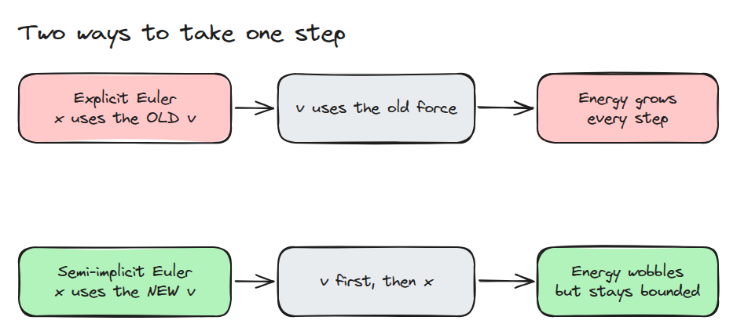
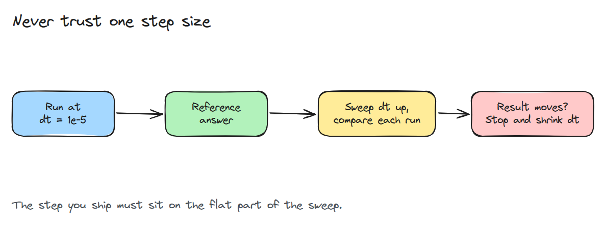
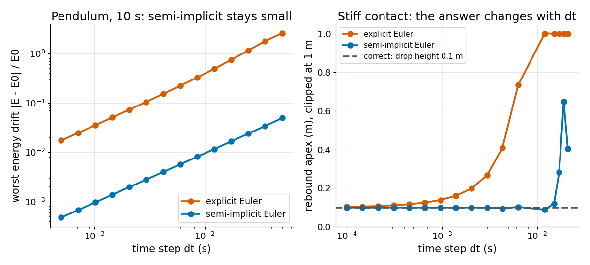

# Time Step과 Solver

> 시뮬레이션 속 공이 떨어진 높이보다 높이 튀는 이유와 한 줄짜리 해결법을 배웁니다.

**유형:** 만들기   **선수 지식:** 12/01 시뮬레이터가 근사하는 것   **시간:** 약 15분

## 쉽게 말하면

상자가 단단한 스프링 패드 위로 떨어져요. 눌린 패드가 상자를 위로 밀어 올리니 상자는 떨어뜨린 높이까지만 올라와야 해요.
컴퓨터는 이 움직임을 정해진 짧은 시간 간격으로 계산해요.
옛 속도로 상자를 옮기면 패드에 에너지가 더 쌓여서 상자가 너무 높이 튀어요. 속도를 먼저 갱신하면 그 에너지가 대부분 사라져요.

## 핵심 용어

- **Time step (`dt`)**: 한 번 갱신할 때 시간을 앞으로 넘기는 일정한 간격입니다.
- **Integrator**: 힘과 속도로 다음 위치를 계산하는 갱신 규칙입니다.
- **Explicit Euler**: 옛 속도로 움직이는 integrator입니다.
- **Semi-implicit Euler**: 속도를 먼저 갱신하고 새 속도로 움직이는 integrator입니다.
- **Energy drift**: 일정해야 할 시뮬레이션 에너지가 조금씩 늘어나는 현상입니다.
- **Stiff contact**: 아주 단단한 접촉면이고 작은 step이 필요합니다.

## 문제

시뮬레이션에서 공을 떨어뜨렸더니 떨어진 높이보다 높이 튑니다. 물리는 그대로이고 계산만 바뀌었습니다.

## 개념

시뮬레이터는 시간을 한 step씩 앞으로 보내므로 step이 잘못되면 로봇 시험이 거짓말을 합니다.



*explicit Euler는 옛 속도로 `x`를 옮깁니다. semi-implicit Euler는 속도를 먼저 갱신합니다.*

스프링에 달린 질량의 위치를 `x`, 속도를 `v`, 주파수를 `w`라 하고 `dt`초마다 갱신합니다. explicit Euler는 매 step 에너지에 `1 + (w*dt)^2`를 곱하므로 에너지가 언제나 늘어납니다.
semi-implicit Euler는 실제와 비슷한 shadow 에너지를 정확히 보존하므로 실제 에너지는 출렁이기만 합니다. `w*dt < 2`인 동안은 안정합니다(발산하지 않습니다).



*아주 작은 step에서 시작해 결과가 움직일 때까지 `dt`를 키웁니다.*



*왼쪽은 `dt` 0.01 s에서 10초 동안 explicit Euler가 39%, semi-implicit이 0.95% drift하는 모습입니다. 오른쪽은 1 kg 질량을 0.1 m 높이에서 10 kN/m 접촉면에 떨어뜨린 결과입니다. 19 ms의 semi-implicit은 그럴듯한 0.65 m를 돌려줍니다. 오차가 닿아 있는 동안에만 커지기 때문입니다.*

올바른 반발은 0.1 m로 돌아옵니다. explicit Euler는 `dt` = 3 ms에서 0.274 m로 돌아와서 2.7배 높고 0.1 ms에서는 0.103 m입니다. 답이 더 움직이지 않을 때까지 `dt`를 줄이세요.


*왼쪽부터 explicit Euler를 3 ms, 1 ms, 0.1 ms로 돌린 상자입니다. 주황색 눈금이 떨어뜨린 높이이고 초록 상자만 거기에 닿습니다.*

## 만들기

step 함수 하나가 두 방법을 모두 맡습니다. 접촉은 바닥 아래에서만 위로 미는 penalty 스프링입니다.

```python
def step(method, x, v, acc, dt):
    if method == "euler":
        return x + dt * v, v + dt * acc(x)
    v = v + dt * acc(x)
    return x + dt * v, v
```

`rebound_height()`는 첫 반발의 꼭대기 높이를 돌려줍니다. 이 값은 떨어뜨린 높이와 같아야 합니다.

```bash
cd robotics-engineering-from-scratch
python3 -m pytest phases/12-simulation-and-sim-to-real/02-timestep-and-solver -q
python3 phases/12-simulation-and-sim-to-real/02-timestep-and-solver/code/main.py
```

## 실제 도구로 보기

MuJoCo는 `option` 요소에서 `timestep`과 `integrator`를 노출합니다. 기본 integrator는 semi-implicit Euler입니다.

출처는 MuJoCo XML reference의 `option/timestep`과 `option/integrator`입니다(https://mujoco.readthedocs.io/en/stable/XMLreference.html, 2026년 11월 9일 확인).

## 결과물

`outputs/skill-timestep-sweep.md`는 시뮬레이션 결과가 `dt`에 의존하지 않음을 확인하는 체크리스트입니다.

## 연습 문제

1. 접촉 stiffness를 절반으로 줄이세요. 안전한 `dt`의 한계가 약 1.4배 커지나요?
2. 진자 drift가 1% 아래인 가장 큰 `dt`를 찾으세요.
3. 19 ms 실행이 깔끔한 발산이 아닌 이유는 무엇인가요?
