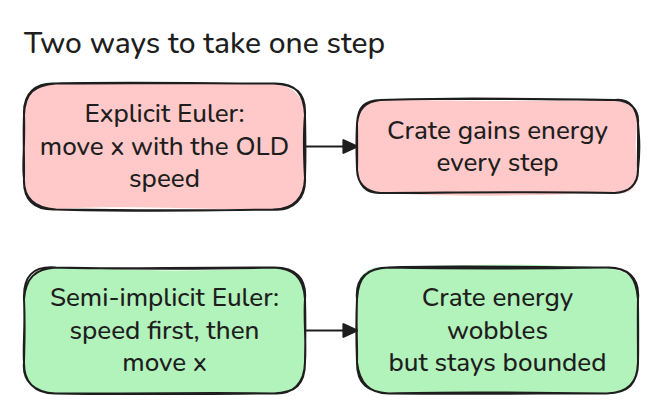
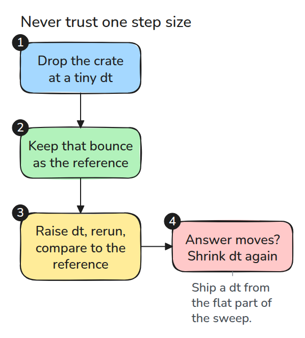
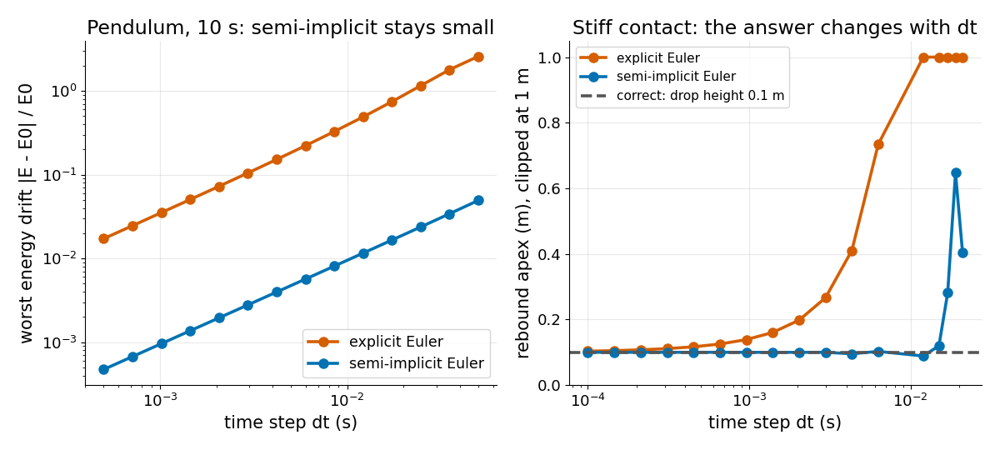

# Time Step과 Solver

> step 크기와 integrator는 모델의 일부이고 이 둘에 따라 바뀌는 결과는 아직 결과가 아닙니다.

**유형:** 만들기   **선수 지식:** 12/01 시뮬레이터가 근사하는 것   **시간:** 약 15분

## 쉽게 말하면

상자가 단단한 스프링 패드 위로 떨어져요.
눌린 패드가 상자를 위로 밀어 올리니 상자는 떨어뜨린 높이까지만 올라와야 해요.
컴퓨터는 이 움직임을 time step, 곧 정해진 짧은 시간 간격마다 계산해요.
한 step에서 패드가 아직 밀지 않은 것처럼 옛 속도로 상자를 옮기면 상자가 패드 안으로 너무 깊이 들어가서 패드에 에너지가 더 쌓여요.

이렇게 갱신하는 규칙을 integrator라고 불러요.
속도를 먼저 갱신하면 그 에너지가 대부분 사라져요.
그래도 step이 너무 크면 속을 수 있어요.

## 문제

로봇 link가 stiff 접촉에서 떨어진 높이보다 높이 튀거나 time step을 키우자 팔이 떨립니다. 물리는 그대로이고 수치 방법만 바뀌었습니다. step을 바꿔 보지 않으면 실제 효과와 계산 방식이 만든 오차를 구분할 수 없습니다.

## 개념



*explicit Euler는 옛 속도로 `x`를 옮깁니다. semi-implicit Euler는 속도를 먼저 갱신하고 새 속도로 `x`를 옮깁니다.*

스프링에 달린 질량(선형 진동자)의 위치를 `x`, 속도를 `v`, 주파수를 `w`라 하고 `dt`초마다 갱신한다고 해 보세요.
explicit Euler는 매 step 에너지에 `1 + (w*dt)^2`를 곱하므로 에너지가 언제나 늘어납니다(drift).
semi-implicit Euler는 오차가 유한하게 머뭅니다. 실제와 조금 다른 shadow 에너지 `v^2/2 + w^2 x^2/2 - dt*w^2*x*v/2`를 정확히 보존하므로 실제 에너지는 출렁이기만 합니다.
`w*dt < 2`인 동안은 안정합니다(발산하지 않습니다).



*아주 작은 step으로 기준을 잡고 결과가 움직일 때까지 `dt`를 키웁니다.*



*왼쪽은 `dt` 0.01 s에서 10초 동안 explicit Euler가 39%, semi-implicit이 0.95% drift하는 모습입니다.
오른쪽은 1 kg 질량을 0.1 m 높이에서 10 kN/m 접촉에 떨어뜨린 결과입니다.
1 ms에서 explicit은 0.14 m로 튀고 semi-implicit은 3 ms까지 5% 안에 머물다가 19 ms에서는 0.65 m가 됩니다.*

진자의 작은 진동에서 `w` = 2 rad/s이므로 `dt` = 0.01 s는 step마다 에너지에 1.0004를 곱해 1000 step이면 1.49배가 됩니다(더 느린 1 rad 진동에서는 39%).
올바른 반발은 0.1 m로 돌아옵니다.
explicit Euler는 `dt` = 3 ms에서 0.274 m로 돌아와서 2.7배 높고 1 ms에서는 0.140 m, 0.1 ms에서는 0.103 m입니다.
답이 더 움직이지 않을 때까지 `dt`를 줄이세요.


*왼쪽부터 explicit Euler를 3 ms, 1 ms, 0.1 ms로 돌린 상자이고 각각 첫 반발의 꼭대기에서 멈춥니다. 주황색 눈금이 떨어뜨린 높이이고 초록 상자만 거기에 닿습니다.*

## 만들기

step 함수 하나가 두 방법을 모두 맡습니다. 접촉은 바닥 아래에서만 위로 미는 penalty 스프링입니다.

```python
def step(method, x, v, acc, dt):
    if method == "euler":
        return x + dt * v, v + dt * acc(x)
    v = v + dt * acc(x)
    return x + dt * v, v
```

`pendulum_drift()`는 감쇠 없는 진자의 10초 동안 최악 에너지 오차를 돌려줍니다. `rebound_height()`는 첫 반발 뒤의 꼭대기 높이를 돌려주며 이 값은 떨어뜨린 높이와 같아야 합니다.

```bash
cd robotics-engineering-from-scratch
python3 -m pytest phases/12-simulation-and-sim-to-real/02-timestep-and-solver -q
python3 phases/12-simulation-and-sim-to-real/02-timestep-and-solver/code/main.py
```

## 실제 도구로 보기

MuJoCo는 `option` 요소에서 `timestep`과 `integrator`를 노출합니다. 기본 integrator는 semi-implicit Euler이고 RK4와 implicit 계열도 있습니다. 접촉 과제를 step 절반으로 다시 돌려 비교해 보세요.

출처는 MuJoCo XML reference의 `option/timestep`과 `option/integrator`입니다(https://mujoco.readthedocs.io/en/stable/XMLreference.html, 2026년 11월 9일 확인).

## 결과물

`outputs/skill-timestep-sweep.md`는 시뮬레이션 결과가 `dt`에 의존하지 않음을 확인하는 체크리스트입니다.

## 연습 문제

1. 접촉 stiffness를 절반으로 줄이고 안전한 semi-implicit `dt`의 한계가 약 1.4배 커지는지 확인하세요.
2. 진자 drift가 1% 아래로 유지되는 가장 큰 `dt`를 찾으세요.
3. 19 ms 실행이 깔끔한 발산이 아닌 이유를 설명하세요.
