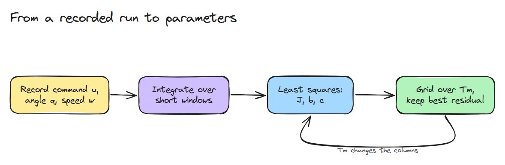
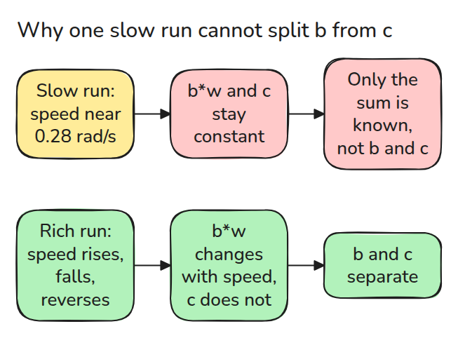
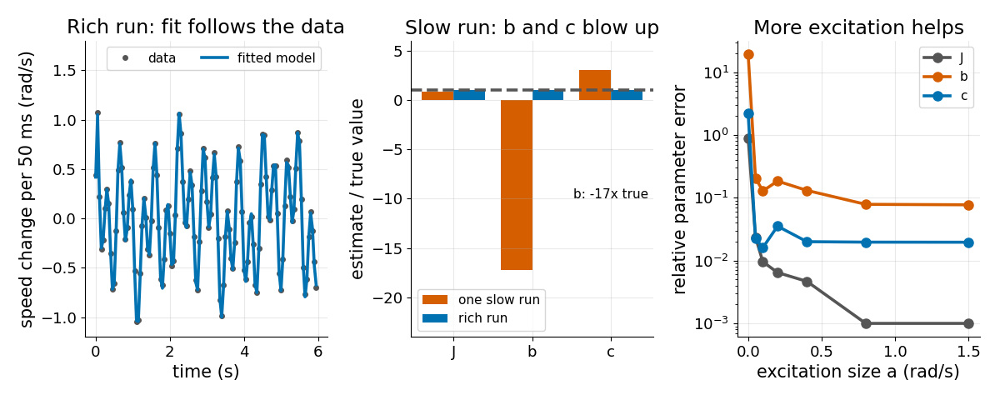

# System Identification

> Fit the plant from a recording, and know that the recording decides which parameters you can learn.

**Type:** Build   **Prerequisites:** 12/01 What a Simulator Approximates   **Time:** ~15 minutes

## In Plain Words

System identification learns a model from recorded motion. Suppose you measure the push needed to keep a bicycle moving. At a single
steady speed, a fixed rubbing resistance and a resistance that grows with speed can add up to the same push.

Change speed and accelerate, and their effects stop looking alike. The joint experiment does this with varied commands, letting the fit
separate inertia, friction and motor lag. Matching one steady-speed recording can hide wrong parameters that fail on another motion.

## The Problem

You copy inertia from CAD, guess a friction value and tune the simulator by eye until one trajectory matches. The next trajectory misses because that single run could not tell friction from damping. The fit looked good and the parameters were wrong.

## The Concept



*Integrating the dynamics over short windows turns noisy speed samples into a linear problem for `J`, `b` and `c`. The motor lag `Tm` changes the columns, so a grid search wraps the solve.*

Over one window the speed change is `dw = (1/J) * int(tm - k sin q) - (b/J) * int(w) - (c/J) * int(tanh(w/eps))`. The unknowns `1/J`, `b/J` and `c/J` appear linearly.



*At constant speed the viscous column and the Coulomb column are both constant, so least squares can only see their sum.*



*Left: the model matches the data of a rich run. Middle: one slow constant-speed run returns `b` at -17 times its true value. Right: error against excitation size with noise fixed. `J` falls below 0.1% and `c` to about 2%, while `b` stays near 8%.*

## Build It

Each candidate `Tm` filters the recorded command, builds the three columns and solves least squares. The lowest residual wins.

```python
for Tm in grid:
    X, y = design(d, Tm)
    th = np.linalg.lstsq(X, y, rcond=None)[0]
    fits.append((float(np.sum((y - X @ th) ** 2)), Tm, th, np.linalg.cond(X / np.linalg.norm(X, axis=0))))
```

Without noise the column-normalised condition number is about 4 for the rich run and about 2400 for the slow one. The test replaces `b = 0.02` by `b = 0` and adds `0.02 * 0.28` to `c`. The slow run barely changes while the rich run separates the two plants. `b` keeps a bias of about 8% from the window integrals.

```bash
cd robotics-engineering-from-scratch
python3 -m pytest phases/12-simulation-and-sim-to-real/03-system-identification -q
python3 phases/12-simulation-and-sim-to-real/03-system-identification/code/main.py
```

## Use It

`scipy.optimize.least_squares(fun, x0, bounds=...)` fits all four parameters at once and accepts bounds. Compare its answer and its covariance with the grid fit.

Sources: signature and docstring checked in the local SciPy 1.11.4 (opened 2026-11-09).

## Ship It

`outputs/skill-excitation-check.md` checks a recording before you fit it.

## Exercises

1. Raise the noise until `J` is off by 20% and note which window length helps.
2. Add the known gravity `k` as a fourth unknown and check its condition number.
3. Design the smallest trajectory that still separates `b` from `c`.
