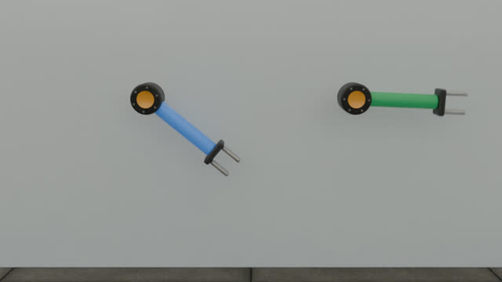

# System Identification

> Learn how to measure a robot joint's hidden numbers from a recording, and why a boring recording fails.

**Type:** Build   **Prerequisites:** 12/01 What a Simulator Approximates   **Time:** ~15 minutes

## In Plain Words

Turn a hanging arm at one steady speed. Part of your push fights a constant rub and part fights a drag that grows with speed. At one steady speed you cannot tell the rub from the drag.

Now vary the speed. Drag follows the speed and the rub does not, so they separate. Fitting a model to such a recording is called system identification.

## Key Terms

- **Inertia (`J`)**: how hard the arm is to speed up.
- **Drag (`b`)**: a push-back that grows with speed.
- **Rub (`c`)**: a constant push-back against the motion.
- **Motor lag (`Tm`)**: how late the motor's push arrives after the command.
- **Least squares**: a way to pick the numbers so the model misses the recording by as little as possible.
- **Excitation**: how varied the motion in a recording is.

## The Problem

You build a simulated arm from design-file numbers and a guess for friction. It matches one motion, but the real arm's next motion misses.

## The Concept

To trust a simulator you need real numbers, and a recording of the real arm can supply them. A computer finds the hidden numbers that make the simulated arm match the recording. But if the arm only moved at one steady speed, rub and drag look the same, so the computer cannot split them. Speeding up and slowing down can.


*A recording goes in and the hidden numbers come out.*


*At a steady speed, rub and drag both stay constant, so only their sum is visible.*


*Left: the model follows a varied recording. Middle: one slow steady run gives a wildly wrong drag. Right: the more excitation (varied motion), the better the match.*

[](../assets/clip-example.mp4)

*Steady speed (blue) gives a wrong drag, varied speed (green) the right one.*

<details><summary>The math (optional)</summary>

Drag `b` is also called viscous damping and rub `c` Coulomb friction. Over a short window, motor torque minus gravity, drag and rub, added up, equals `J` times the speed change, so `1/J`, `b/J` and `c/J` are the only unknowns. A grid search covers the motor lag `Tm`. The slow run holds 0.28 rad/s, where drag `b = 0.02` and rub `c = 0.05` push 0.0556 in all. The fit returned `b = -0.345` and `c = 0.153`, which also total 0.056, so the data cannot choose: `b` comes out at -17 times its true value. In the varied run the speed reaches 3.35 rad/s and the fit returns `b = 0.0206`. More excitation drives `J` below 0.1% error and `c` near 2%, but `b` stays near 8%. The condition number (how blurred the parameters are) is about 4 for the varied run and 361 for the slow one with the noise above (seed 1); without noise, 2400.

</details>

## Build It

Each guess for the motor lag turns the recorded command into what the motor would do, then least squares finds the other numbers. The best match wins.

```python
for Tm in grid:
    X, y = design(d, Tm)
    th = np.linalg.lstsq(X, y, rcond=None)[0]
    fits.append((float(np.sum((y - X @ th) ** 2)), Tm, th, np.linalg.cond(X / np.linalg.norm(X, axis=0))))
```

A varied recording gives a sharp match. A slow steady one gives a blurry match.

```bash
cd robotics-engineering-from-scratch
python3 -m pytest phases/12-simulation-and-sim-to-real/03-system-identification -q
python3 phases/12-simulation-and-sim-to-real/03-system-identification/code/main.py
```

## Use It

SciPy's `scipy.optimize.least_squares` can fit all four numbers at once.

Sources: SciPy 1.11.4 docstring, checked 2026-11-09.

## Ship It

`outputs/skill-excitation-check.md` checks a recording before you fit it.

## Exercises

1. Add more noise. When does the inertia go wrong?
2. Treat gravity as an unknown too and fit one more number.
3. Find the shortest recording where the speed changes enough to separate rub from drag.
