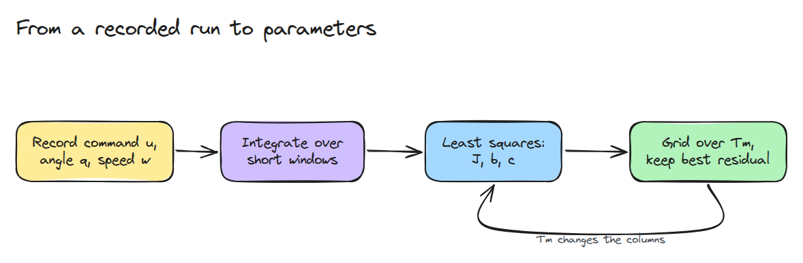
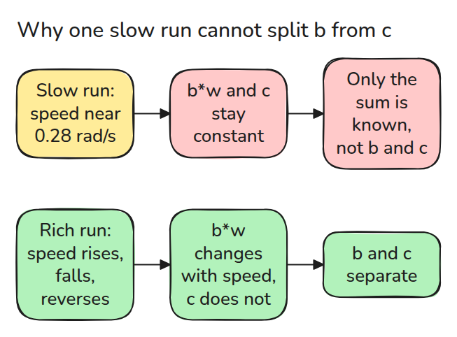
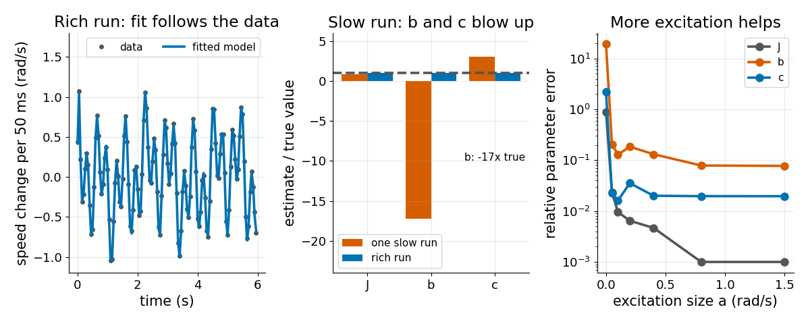

# System Identification

> Learn how to measure a robot joint's hidden numbers from a recording, and why a boring recording fails.

**Type:** Build   **Prerequisites:** 12/01 What a Simulator Approximates   **Time:** ~15 minutes

## In Plain Words

Turn a hanging arm at one steady speed. Part of your push fights a constant rub and part fights a drag that grows with speed. At one speed the two blur together.

Now vary the speed. Drag follows the speed and the rub does not, so they separate. System identification fits a model to such a recording.

## Key Terms

- **System identification**: fitting a model's unknown numbers to a recording of the real system.
- **Inertia (`J`)**: how hard the arm is to speed up.
- **Viscous damping (`b`)**: a drag that grows with speed.
- **Coulomb friction (`c`)**: a constant rub against the motion.
- **Least squares**: the fit that makes the sum of squared mismatches smallest.
- **Excitation**: how varied the motion in a recording is.

## The Problem

You build a simulated arm from design-file numbers and a guess for friction. It matches one motion, but the real arm's next motion misses.

## The Concept

To trust a simulator you need real numbers, and a recording of the real arm can supply them.



*Short windows turn noisy speed samples into a linear problem for `J`, `b` and `c`. A grid search covers `Tm`.*

In one short window, motor torque minus gravity, drag and rub, summed over the window, equals `J` times the speed change. Only `1/J`, `b/J` and `c/J` are unknown, so least squares finds them.



*At constant speed drag and rub are both constant, so least squares sees only their sum.*



*Left: the model matches a rich run. Middle: one slow run returns `b` at -17 times its true value. Right: more excitation drives `J` below 0.1% error and `c` near 2%, but `b` stays near 8%.*

The slow run holds 0.28 rad/s (radians per second). Drag `b = 0.02` and rub `c = 0.05` push 0.0556 in all. The fit returned `b = -0.345` and `c = 0.153`, which also total 0.056, so the data cannot choose. In the rich run the speed reaches 3.35 rad/s and the fit returns `b = 0.0206`.


*Steady speed (blue, fit `b = -0.345`) against varied speed (green).*

## Build It

Each candidate `Tm` filters the recorded command, builds the three sums and solves least squares. The lowest residual wins.

```python
for Tm in grid:
    X, y = design(d, Tm)
    th = np.linalg.lstsq(X, y, rcond=None)[0]
    fits.append((float(np.sum((y - X @ th) ** 2)), Tm, th, np.linalg.cond(X / np.linalg.norm(X, axis=0))))
```

Without noise the condition number (how blurred the parameters are) is about 4 for the rich run and about 2400 for the slow one.

```bash
cd robotics-engineering-from-scratch
python3 -m pytest phases/12-simulation-and-sim-to-real/03-system-identification -q
python3 phases/12-simulation-and-sim-to-real/03-system-identification/code/main.py
```

## Use It

`scipy.optimize.least_squares(fun, x0, bounds=...)` fits all four parameters at once (SciPy 1.11.4, checked 2026-11-09).

## Ship It

`outputs/skill-excitation-check.md` checks a recording before you fit it.

## Exercises

1. Raise the noise until `J` is off by 20%.
2. Add gravity `k` as a fourth unknown.
3. Design the smallest trajectory that still separates `b` from `c`.
