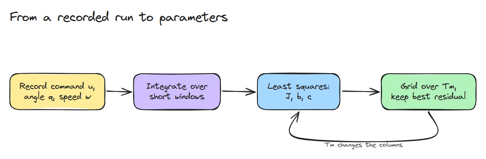
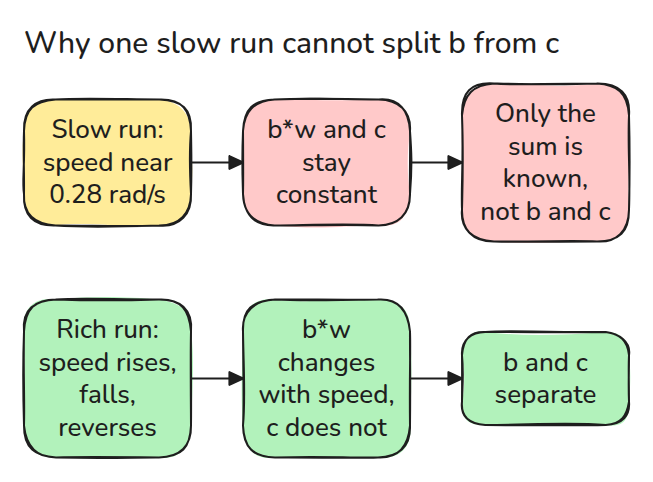
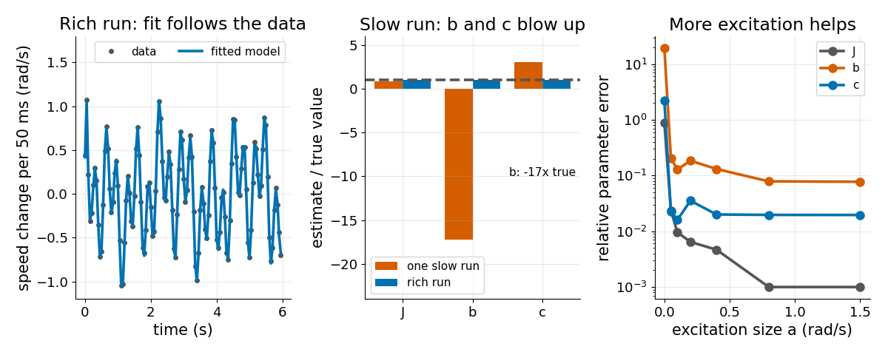

# System Identification

> 녹화에서 로봇 관절의 숨은 수치를 재는 법과 단조로운 녹화가 실패하는 이유를 배웁니다.

**유형:** 만들기   **선수 지식:** 12/01 시뮬레이터가 근사하는 것   **시간:** 약 15분

## 쉽게 말하면

매달린 팔을 일정한 속도로 돌려 보세요. 미는 힘의 일부는 일정한 마찰을 이기고 나머지는 속도가 클수록 커지는 저항을 이겨요. 속도가 하나뿐이면 두 부분이 합쳐서 숫자 하나가 되니 여러 가지로 나눠도 똑같이 느껴져요.

이제 속도를 바꿔 보세요. 저항은 속도를 따라 변하고 마찰은 그렇지 않아서 둘이 갈라져요. system identification은 이런 기록에 모델을 맞추는 방법이에요.

## 핵심 용어

- **System identification**: 실제 시스템의 기록에 모델의 미지수를 맞추는 일입니다.
- **Inertia (`J`)**: 팔의 속도를 올리기 어려운 정도입니다.
- **Viscous damping (`b`)**: 속도가 클수록 커지는 저항입니다.
- **Coulomb friction (`c`)**: 움직임의 반대 방향으로 일정하게 작용하는 마찰입니다.
- **Least squares**: 어긋남의 제곱합을 가장 작게 만드는 맞춤법입니다.
- **Excitation**: 기록 속 움직임이 얼마나 다양한지입니다.

## 문제

설계 파일의 숫자와 마찰의 짐작으로 시뮬레이션 팔을 만들었더니 움직임 하나는 맞는데 실제 팔의 다음 움직임은 빗나갑니다. 그 움직임 하나로는 마찰과 저항을 구분할 수 없었습니다.

## 개념

시뮬레이터를 믿으려면 실제 숫자가 필요하고 실제 팔의 짧은 녹화가 그 숫자를 줄 수 있습니다.



*짧은 구간들이 잡음 섞인 속도 샘플을 `J`, `b`, `c`를 구하는 선형 문제로 바꿉니다. `Tm`을 격자로 훑으면서 이를 되풀이합니다.*

짧은 구간 하나에서 모터 토크에서 중력과 저항과 마찰을 뺀 값을 구간 동안 더하면 `J`에 속도 변화를 곱한 값과 같습니다. 미지수는 `1/J`, `b/J`, `c/J`뿐이므로 least squares가 이를 찾습니다.



*속도가 일정하면 저항과 마찰이 둘 다 상수이므로 least squares는 둘의 합만 볼 수 있습니다.*



*왼쪽은 다양한 실행의 데이터를 모델이 따라가는 모습입니다. 가운데는 느린 실행 하나가 `b`를 참값의 -17배로 돌려주는 모습입니다. 오른쪽은 excitation을 키운 결과입니다. `J`는 0.1% 아래, `c`는 약 2%까지 내려가고 `b`는 8% 근처에 남습니다.*

느린 실행에서는 속도가 0.28 rad/s(초당 라디안)에 머뭅니다. 저항 `b = 0.02`와 마찰 `c = 0.05`가 미는 힘은 합쳐서 0.0556입니다.
fit은 `b = -0.345`와 `c = 0.153`을 돌려주는데 이것도 합이 0.056이라서 데이터로는 고를 수 없습니다. 다양한 실행에서는 속도가 3.35 rad/s까지 올라가고 fit이 `b = 0.0206`을 돌려줍니다.


*속도가 일정한 기록(파랑, fit은 `b = -0.345`)과 속도가 달라지는 기록(초록)입니다.*

## 만들기

`Tm` 후보마다 기록된 명령을 filter하고 세 열을 만든 다음 least squares를 풉니다. 잔차가 가장 낮은 후보가 이깁니다.

```python
for Tm in grid:
    X, y = design(d, Tm)
    th = np.linalg.lstsq(X, y, rcond=None)[0]
    fits.append((float(np.sum((y - X @ th) ** 2)), Tm, th, np.linalg.cond(X / np.linalg.norm(X, axis=0))))
```

잡음이 없을 때 condition number(파라미터가 얼마나 뭉개지는지 나타내는 값)는 다양한 실행에서 약 4, 느린 실행에서 약 2400입니다.

```bash
cd robotics-engineering-from-scratch
python3 -m pytest phases/12-simulation-and-sim-to-real/03-system-identification -q
python3 phases/12-simulation-and-sim-to-real/03-system-identification/code/main.py
```

## 실제 도구로 보기

`scipy.optimize.least_squares(fun, x0, bounds=...)`는 네 파라미터를 한꺼번에 맞춥니다.

출처는 로컬 SciPy 1.11.4의 시그니처와 docstring입니다(2026년 11월 9일 확인).

## 결과물

`outputs/skill-excitation-check.md`는 fit하기 전에 기록이 충분한지 점검합니다.

## 연습 문제

1. `J`가 20% 틀어질 때까지 잡음을 키우세요.
2. 중력 `k`를 네 번째 미지수로 넣으세요.
3. `b`와 `c`를 가르는 가장 짧은 궤적을 설계하세요.
