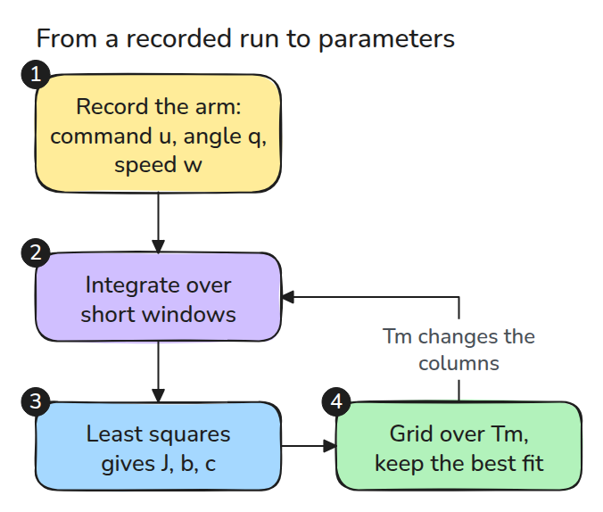
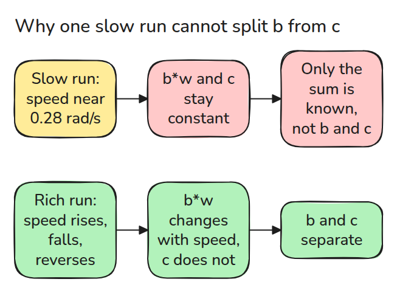
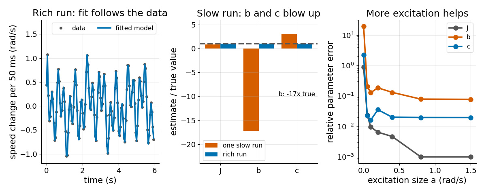

# System Identification

> 기록에서 plant를 맞추되 어떤 파라미터를 배울 수 있는지는 기록이 정한다는 것을 알아야 합니다.

**유형:** 만들기   **선수 지식:** 12/01 시뮬레이터가 근사하는 것   **시간:** 약 15분

## 쉽게 말하면

매달린 팔을 느리고 일정한 속도로 돌리면서 얼마나 세게 밀어야 하는지 느껴 보세요.
미는 힘의 일부는 속도와 상관없이 일정한 마찰을 이기고 나머지는 속도가 클수록 커지는 저항을 이겨요.
속도가 하나뿐이면 두 부분이 합쳐서 숫자 하나가 되니 여러 가지로 나눠도 똑같이 느껴져요.

이제 팔을 빠르게도 돌리고 느리게도 돌리고 방향도 바꿔 보세요.
저항은 속도를 따라 변하고 마찰은 그렇지 않아서 둘을 구분할 수 있어요.
system identification은 이런 기록에 모델을 맞추는 방법이에요.

## 문제

CAD에서 관성 `J`(속도를 올리기 어려운 정도)를 가져오고 마찰과 저항은 짐작해서 넣은 뒤 궤적 하나가 맞을 때까지 눈으로 튜닝합니다. 다음 궤적은 빗나갑니다. 그 궤적 하나로는 마찰과 저항을 구분할 수 없었기 때문입니다. 맞춘 결과는 좋아 보였지만 파라미터는 틀렸습니다.

## 개념



*짧은 구간들이 잡음 섞인 속도 샘플을 `J`, `b`, `c`를 구하는 선형 문제로 바꿉니다. 모터 지연 `Tm`은 그 문제를 바꾸므로 `Tm`을 격자로 훑으면서 매번 풀이를 합니다.*

짧은 구간 하나에서 모터 토크에서 중력과 저항(`b`에 속도를 곱한 값)과 마찰(`c`, 항상 움직임의 반대 방향)을 뺀 값을 구간 동안 더하면 `J`에 속도 변화를 곱한 값과 같습니다.
각 합은 기록에서 계산되므로 미지수는 `1/J`, `b/J`, `c/J`뿐이고 최소제곱(어긋남의 제곱합이 가장 작은 해)이 이를 찾습니다.



*속도가 일정하면 저항 항과 마찰 항이 둘 다 상수이므로 최소제곱은 둘의 합만 볼 수 있습니다.*



*왼쪽은 다양한 실행(속도가 크게 달라지는 실행)의 데이터를 모델이 따라가는 모습입니다. 가운데는 느린 등속 실행 하나가 `b`를 참값의 -17배로 돌려주는 모습입니다.
오른쪽은 잡음을 고정하고 가진(excitation, 움직임을 얼마나 다양하게 주는지) 크기를 키운 결과입니다. `J`는 0.1% 아래, `c`는 약 2%까지 내려가고 `b`는 8% 근처에 남습니다.*

느린 실행에서는 속도가 0.28 rad/s 근처에 머뭅니다.
그때 저항(`b = 0.02`)은 `0.02 * 0.28 = 0.0056`으로 밀고 마찰(`c = 0.05`)은 0.05로 밀어서 합이 0.0556입니다.
fit은 `b = -0.345`와 `c = 0.153`을 돌려주는데 이것도 `-0.345 * 0.28 + 0.153 = 0.056`으로 합이 같아서 데이터로는 두 나눔 중 하나를 고를 수 없습니다.
다양한 실행에서는 속도가 3.35 rad/s까지 올라가고 그때 `b = 0.02`는 0.067로 밀지만 `b = 0`은 아무것도 밀지 않으므로 fit이 `b = 0.0206`을 돌려줍니다.


*두 팔을 보세요. 같은 관절을 두 번 기록한 모습이고 파란 팔은 속도가 일정하며 초록 팔은 속도가 달라집니다.*

## 만들기

`Tm` 후보마다 기록된 명령을 filter하고 세 열을 만든 다음 최소제곱을 풉니다. 잔차가 가장 낮은 후보가 이깁니다.

```python
for Tm in grid:
    X, y = design(d, Tm)
    th = np.linalg.lstsq(X, y, rcond=None)[0]
    fits.append((float(np.sum((y - X @ th) ** 2)), Tm, th, np.linalg.cond(X / np.linalg.norm(X, axis=0))))
```

잡음이 없을 때 열을 정규화한 condition number(데이터에서 파라미터가 얼마나 뭉개지는지 나타내는 값)는 다양한 실행에서 약 4, 느린 실행에서 약 2400입니다.
`b`에는 구간 적분 때문에 약 8%의 bias가 남습니다.

```bash
cd robotics-engineering-from-scratch
python3 -m pytest phases/12-simulation-and-sim-to-real/03-system-identification -q
python3 phases/12-simulation-and-sim-to-real/03-system-identification/code/main.py
```

## 실제 도구로 보기

`scipy.optimize.least_squares(fun, x0, bounds=...)`는 네 파라미터를 한꺼번에 맞추고 bound도 받습니다. 그 답과 공분산을 격자 fit과 비교해 보세요.

출처는 로컬 SciPy 1.11.4의 시그니처와 docstring입니다(2026년 11월 9일 확인).

## 결과물

`outputs/skill-excitation-check.md`는 fit하기 전에 기록이 충분한지 점검합니다.

## 연습 문제

1. J가 20% 틀어질 때까지 잡음을 키우고 어떤 구간 길이가 도움이 되는지 적으세요.
2. 알려진 중력 `k`를 네 번째 미지수로 넣고 condition number를 확인하세요.
3. `b`와 `c`를 가르는 가장 짧은 궤적을 설계하세요.
