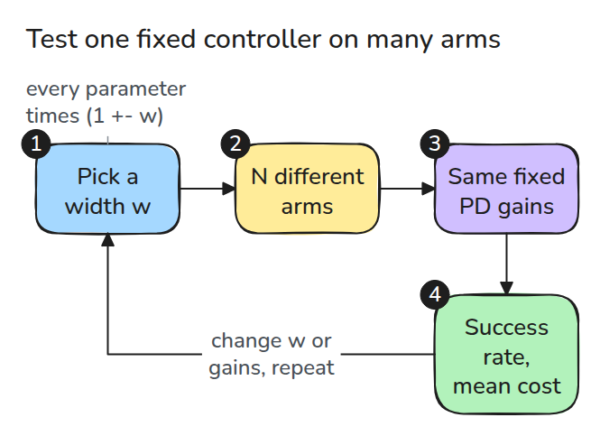
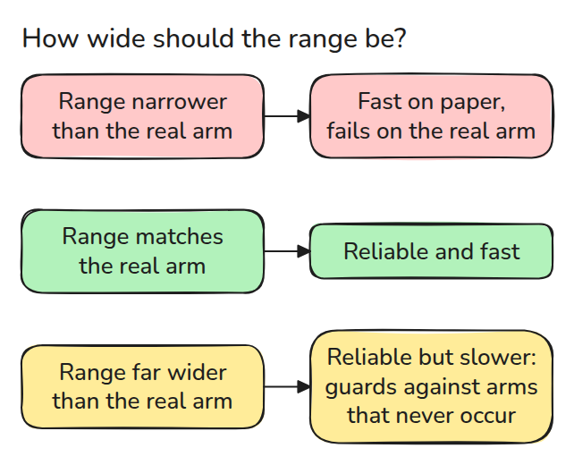
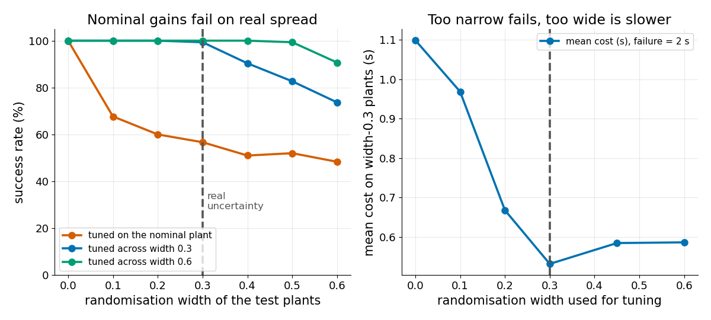

# Domain Randomisation

> Tune a fixed controller across a spread of plants that matches the real uncertainty, no wider and no narrower.

**Type:** Build   **Prerequisites:** 12/03 System Identification   **Time:** ~15 minutes

## In Plain Words

Twelve arms leave the same assembly line, yet no two are alike. One has a heavier link, another a stickier hinge, another a slower motor. Controller gains (how hard it pushes) tuned on the average arm leave no margin for these differences, so some copies swing past the target.

Domain randomisation tunes the gains across many different simulated arms. A narrow range misses real differences. A range that is too wide gives slow, cautious gains for arms that never occur. No learning is involved.

## The Problem

Gains tuned on the nominal simulator work there and fail on the real joint, whose mass, friction, lag and delay are slightly off. Randomising the simulator should fix that. The open question is how wide to randomise, because every plant you guard against has a price.

## The Concept



*Scale every parameter by `1 +- w`, run the same controller on each plant and count successes.*

Each plant is one simulated arm, and the nominal plant is the unscaled one. A PD controller (push `kp` per unit of error, brake `kd` per unit of speed) with a torque limit and sensor delay steps a joint by 1 rad. A run succeeds if it settles (stays within 0.05 rad) by 0.8 s and peaks below 1.05 rad. A failure costs 2 s. `tune()` tries every `kp`, `kd` pair on arms drawn at one width and keeps the lowest mean cost.



*A narrow range gives brittle gains, a matched range gives reliable fast ones, and a much wider range buys safety against plants that never occur.*



*Left: gains tuned on the nominal plant drop to 57% success at width 0.3, while gains tuned across width 0.3 reach 99%. Right: tuned across 0.6, the mean cost on width-0.3 plants is 0.586 s against 0.532 s, about 10% slower for 1 point more success.*

Width 0.3 turns inertia 0.05 into anything from 0.035 to 0.065, and sensor delay 0.02 s into 0.014 to 0.026 s. Over 12 such arms, gains tuned on the nominal arm (`kp` 4.5, `kd` 0.70) leave 6 failing. Gains tuned across 0.3 (`kp` 7.7, `kd` 1.35) settle all 12 in 0.52 s on average. Gains tuned across 0.6 (`kp` 4.5, `kd` 0.88) settle all 12, but need 0.59 s.


*The same 12 arms. Watch which group settles first: green (tuned across 0.3) or blue (tuned across 0.6).*

## Build It

`simulate()` integrates M plants at once with RK4. Delay is a per-plant lookup into the stored history. `tune()` simulates every gain pair on the same random plants and keeps the lowest mean cost.

```python
def sample(width, n, rng):
    return {k: v * (1 + width * rng.uniform(-1, 1, n)) for k, v in NOM.items()}
```

Width 0 returns the nominal plant exactly. The tests check that a plant simulated alone matches the same plant inside a batch.

```bash
cd robotics-engineering-from-scratch
python3 -m pytest phases/12-simulation-and-sim-to-real/04-domain-randomisation -q
python3 phases/12-simulation-and-sim-to-real/04-domain-randomisation/code/main.py
```

## Use It

In MuJoCo 3.11.0 the model arrays `dof_damping`, `dof_frictionloss` and `body_mass` can be scaled in place before each episode, as in `model.body_mass[1] *= 0.8`. Reuse `sample()` to draw the scale factors.

Sources: MuJoCo 3.11.0 Python bindings, arrays read and written locally (2026-11-09).

## Ship It

`outputs/skill-randomisation-range.md` picks and checks a randomisation range.

## Exercises

1. Randomise only the delay and see which parameter matters most.
2. Lower the real width to 0.15 and find the best tuning width.
3. Replace the mean cost by the worst plant and compare the gains.
