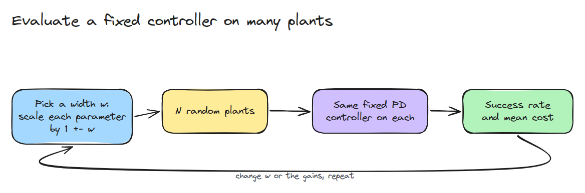
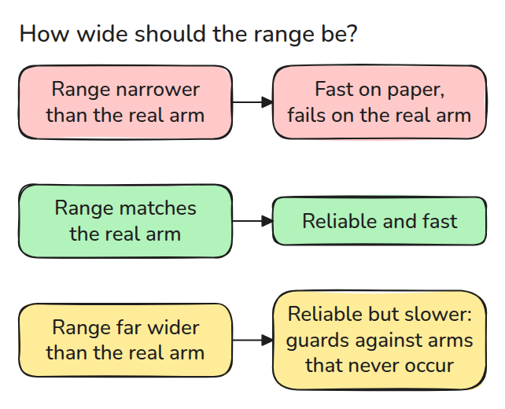
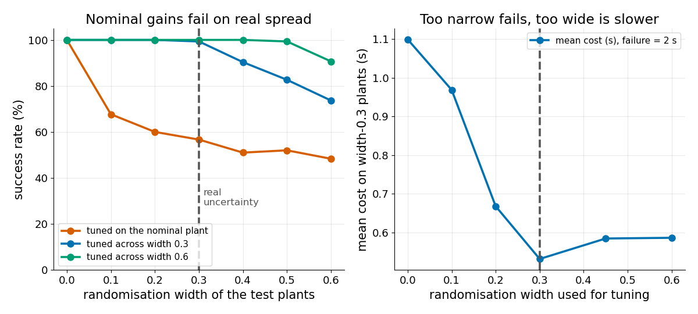

# Domain Randomisation

> Learn how to tune a robot's controller so it works on many slightly different robots, not just one.

**Type:** Build   **Prerequisites:** 12/03 System Identification   **Time:** ~15 minutes

## In Plain Words

Arms leave the same assembly line, yet no two are alike. Gains tuned on the average arm leave no margin, so some copies overshoot.

Domain randomisation tunes the gains across many different simulated arms. A narrow range misses real differences. A wide range gives slow, cautious gains.

## Key Terms

- **Domain randomisation**: tuning a controller across many simulated plants with randomly scaled parameters.
- **Nominal plant**: the simulated arm with unscaled, average parameters.
- **PD controller**: pushes by `kp` per unit of error and brakes by `kd` per unit of speed.
- **Gains**: the numbers `kp` and `kd` that set how hard the controller pushes and brakes.
- **Width (`w`)**: how far each parameter may be scaled, as a fraction.
- **Settling**: staying within a small band around the target.

## The Problem

Your controller works on the simulated arm and fails on the real one, which is a bit heavier, stickier and slower. Randomising the simulator can cover that, but how wide?

## The Concept

No two real robots are identical, so tuning on one perfect copy is a gamble.



*Scale every parameter by `1 +- w`, run the same controller on each plant and count successes.*

A PD controller with a torque limit and sensor delay steps a joint by 1 rad. It succeeds if it settles within 0.05 rad by 0.8 s and peaks below 1.05 rad. A failure costs 2 s. `tune()` keeps the `kp`, `kd` pair with the lowest mean cost.



*Narrow gives brittle gains, matched gives reliable fast ones, much wider is slow and over-cautious.*



*Left: nominal-tuned gains drop to 57% success at width 0.3, gains tuned across 0.3 reach 99%. Right: tuning across 0.6 costs 0.586 s against 0.532 s, about 10% slower.*

Width 0.3 turns inertia 0.05 into anything from 0.035 to 0.065. Over 12 such arms, nominal-tuned gains leave 6 failing. Gains tuned across 0.3 settle all 12 in 0.52 s on average. Gains tuned across 0.6 settle all 12 but need 0.59 s.


*Lamps light as arms settle. At 0.5 s, 6 green arms are lit, no blue.*

## Build It

`simulate()` integrates many plants at once with RK4. `tune()` simulates every gain pair on the same random plants and keeps the lowest mean cost.

```python
def sample(width, n, rng):
    return {k: v * (1 + width * rng.uniform(-1, 1, n)) for k, v in NOM.items()}
```

Width 0 returns the nominal plant. Tests check that a plant simulated alone matches the same plant in a batch.

```bash
cd robotics-engineering-from-scratch
python3 -m pytest phases/12-simulation-and-sim-to-real/04-domain-randomisation -q
python3 phases/12-simulation-and-sim-to-real/04-domain-randomisation/code/main.py
```

## Use It

In MuJoCo 3.11.0, `dof_damping`, `dof_frictionloss` and `body_mass` can be scaled before each episode, e.g. `model.body_mass[1] *= 0.8`.

Sources: MuJoCo 3.11.0 Python bindings (2026-11-09).

## Ship It

`outputs/skill-randomisation-range.md` picks and checks a randomisation range.

## Exercises

1. Randomise only the delay. Which parameter matters most?
2. Lower the real width to 0.15. What tuning width is best?
3. Score the worst plant instead of the mean.
