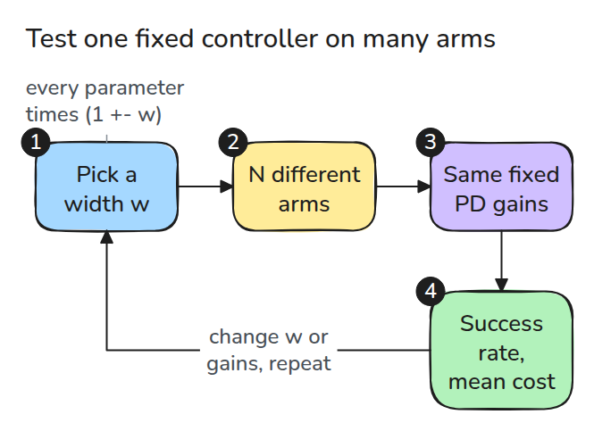
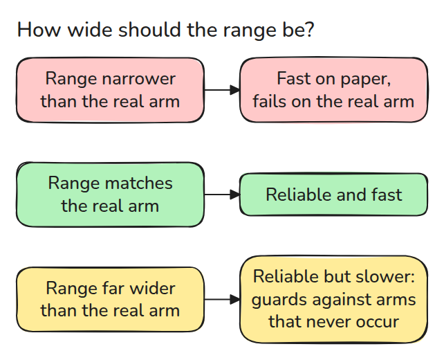
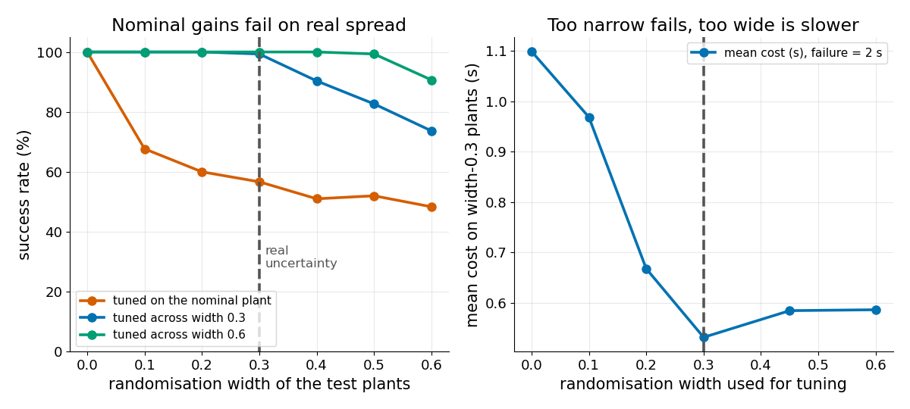

# Domain Randomisation

> 고정 controller는 실제 불확실성과 같은 폭의 plant 분포에서 튜닝합니다. 더 좁아도 더 넓어도 손해입니다.

**유형:** 만들기   **선수 지식:** 12/03 System Identification   **시간:** 약 15분

## 쉽게 말하면

같은 조립 라인에서 팔 열두 개가 나왔지만 똑같은 팔은 하나도 없어요.
어떤 팔은 링크가 더 무겁고 어떤 팔은 경첩이 더 뻑뻑하고 어떤 팔은 모터가 더 느려요.
평균 팔에서 맞춘 controller gain(얼마나 세게 밀지 정하는 값)은 이런 차이를 받아 줄 여유가 없어서 일부 팔은 목표를 지나쳐 버려요.

domain randomisation은 조금씩 다른 시뮬레이션 팔 여러 개에 걸쳐 gain을 맞춰요.
범위가 좁으면 실제 차이를 놓쳐요.
너무 넓으면 일어나지 않을 팔까지 대비하느라 느리고 조심스러운 gain이 나와요.
여기서는 학습 없이 controller만 튜닝해요.

## 문제

nominal(기준값) 시뮬레이터에서 튜닝한 gain은 거기서는 잘 돌고 질량과 마찰과 지연이 조금씩 다른 실제 관절에서는 실패합니다. 시뮬레이터를 무작위로 흔들면 해결될 것 같습니다. 문제는 얼마나 넓게 흔드느냐입니다. 막아 주는 plant가 하나 늘 때마다 대가가 따르기 때문입니다.

## 개념



*모든 파라미터에 `1 +- w`를 곱하고 같은 controller를 각 plant에 돌려서 성공을 셉니다.*

각 plant는 시뮬레이션 팔 하나이고 nominal plant는 배율을 곱하지 않은 팔입니다.
PD controller(오차에 `kp`를 곱해 밀고 속도에 `kd`를 곱해 브레이크를 거는 controller)가 토크 제한과 센서 지연을 가지고 관절을 1 rad 움직입니다.
0.8초까지 안정되어(0.05 rad 안에 머물러) 최고점이 1.05 rad 아래이면 성공입니다. 실패는 2초의 비용으로 칩니다.
`tune()`은 한 폭에서 뽑은 팔들에 모든 `kp`, `kd` 쌍을 돌려 보고 평균 비용이 가장 낮은 쌍을 고릅니다.



*범위가 좁으면 gain이 plant가 조금만 달라져도 깨집니다. 범위가 맞으면 gain이 믿을 만하고 빠릅니다. 훨씬 넓으면 일어나지 않을 plant까지 막느라 안전을 삽니다.*



*왼쪽은 nominal에서 튜닝한 gain이 폭 0.3에서 57%로 떨어지고 폭 0.3에 걸쳐 튜닝한 gain은 99%인 모습입니다.
오른쪽은 폭 0.6으로 튜닝하면 폭 0.3 plant의 비용이 0.532초에서 0.586초로 약 10% 느려지고 성공은 1%p 늘어나는 모습입니다.*

폭 0.3은 관성 0.05를 0.035에서 0.065 사이의 값으로, 센서 지연 0.02초를 0.014초에서 0.026초 사이의 값으로 바꿉니다.
이런 팔 12개에서 nominal 팔에 맞춘 gain(`kp` 4.5, `kd` 0.70)은 6개를 실패시킵니다.
폭 0.3에 걸쳐 맞춘 gain(`kp` 7.7, `kd` 1.35)은 12개를 모두 평균 0.52초에 안정시킵니다.
폭 0.6에 걸쳐 맞춘 gain(`kp` 4.5, `kd` 0.88)도 12개를 모두 안정시키지만 평균 0.59초가 걸립니다.


*같은 팔 12개입니다. 어느 쪽이 먼저 안정되는지 보세요. 초록은 폭 0.3에 걸쳐 맞췄고 파랑은 폭 0.6에 걸쳐 맞췄습니다.*

## 만들기

`simulate()`는 M개의 plant를 RK4로 한꺼번에 적분합니다. 지연은 plant마다 저장된 기록에서 찾아 읽습니다. `tune()`은 모든 gain 쌍을 같은 무작위 plant들에서 돌려 평균 비용이 가장 낮은 쌍을 고릅니다.

```python
def sample(width, n, rng):
    return {k: v * (1 + width * rng.uniform(-1, 1, n)) for k, v in NOM.items()}
```

폭 0은 nominal plant를 그대로 돌려줍니다. 테스트는 plant 하나를 따로 돌린 결과가 batch 안의 같은 plant와 일치하는지 확인합니다.

```bash
cd robotics-engineering-from-scratch
python3 -m pytest phases/12-simulation-and-sim-to-real/04-domain-randomisation -q
python3 phases/12-simulation-and-sim-to-real/04-domain-randomisation/code/main.py
```

## 실제 도구로 보기

MuJoCo 3.11.0에서는 모델 배열 `dof_damping`, `dof_frictionloss`, `body_mass`를 episode마다 제자리에서 곱할 수 있습니다. `model.body_mass[1] *= 0.8`이 그 예입니다. 배율은 `sample()`로 뽑아 쓰세요.

출처는 MuJoCo 3.11.0 Python binding이며 로컬에서 배열을 읽고 써서 확인했습니다(2026년 11월 9일).

## 결과물

`outputs/skill-randomisation-range.md`는 randomisation 범위를 고르고 검증합니다.

## 연습 문제

1. 지연만 무작위로 바꾸고 어떤 파라미터가 가장 중요한지 보세요.
2. 실제 폭을 0.15로 낮추고 가장 좋은 튜닝 폭을 찾으세요.
3. 평균 비용을 최악의 plant로 바꾸고 gain을 비교하세요.
