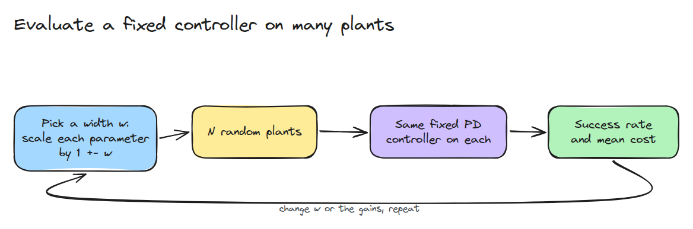
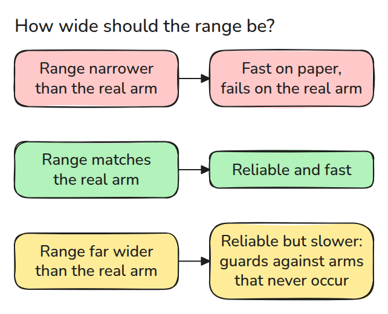
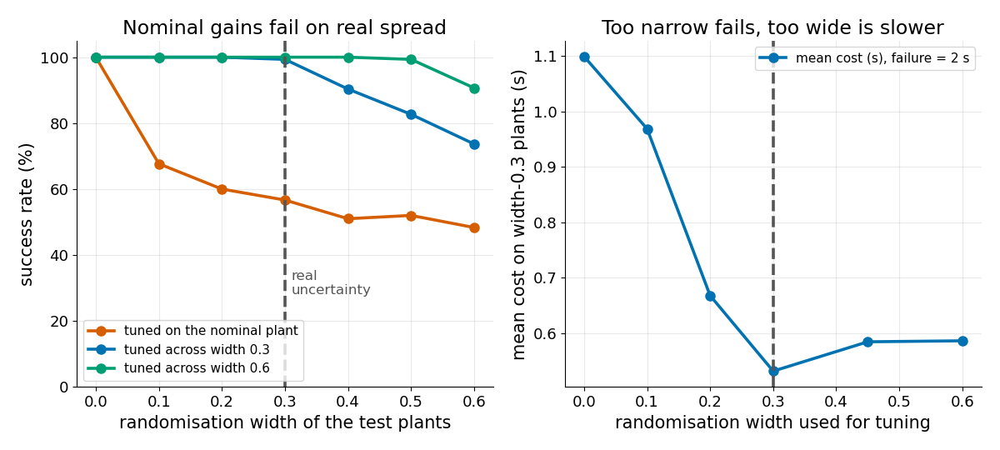

# Domain Randomisation

> 조금씩 다른 여러 로봇에서 잘 돌도록 로봇의 controller를 튜닝하는 법을 배웁니다.

**유형:** 만들기   **선수 지식:** 12/03 System Identification   **시간:** 약 15분

## 쉽게 말하면

같은 조립 라인에서 팔이 나오지만 똑같은 팔은 하나도 없어요. 어떤 팔은 링크가 더 무겁고 어떤 팔은 경첩이 더 뻑뻑해요. 평균 팔에서 맞춘 gain은 여유가 없어서 일부 팔은 목표를 지나쳐 버려요.

domain randomisation은 조금씩 다른 시뮬레이션 팔 여러 개에 걸쳐 gain을 맞춰요. 범위가 좁으면 실제 차이를 놓쳐요. 넓으면 느리고 조심스러운 gain이 나와요.

## 핵심 용어

- **Domain randomisation**: 파라미터를 무작위로 곱한 여러 시뮬레이션 plant에 걸쳐 controller를 튜닝하는 방법입니다.
- **Nominal plant**: 배율을 곱하지 않은 평균 파라미터의 시뮬레이션 팔입니다.
- **PD controller**: 오차 한 단위당 `kp`만큼 밀고 속도 한 단위당 `kd`만큼 브레이크를 거는 controller입니다.
- **Gains**: controller가 얼마나 세게 밀고 브레이크를 걸지 정하는 수 `kp`와 `kd`입니다.
- **Width (`w`)**: 각 파라미터를 얼마나 크게 바꿀 수 있는지를 비율로 나타낸 값입니다.
- **Settling**: 목표 주변의 좁은 범위 안에 머무는 것입니다.

## 문제

controller가 시뮬레이션 팔에서는 잘 돌고 실제 팔에서는 실패합니다. 실제 팔이 조금 더 무겁고 뻑뻑하고 느리기 때문입니다. 시뮬레이터를 무작위로 흔들어 대비할 수 있지만 얼마나 넓게 흔들지가 문제이고 대비할 때마다 대가가 따릅니다.

## 개념

똑같은 로봇은 없으므로 완벽한 복사본 하나에 맞춘 controller는 도박입니다.



*모든 파라미터에 `1 +- w`를 곱하고 같은 controller를 각 plant에 돌려서 성공을 셉니다.*

PD controller가 토크 제한과 센서 지연을 가지고 관절을 1 rad 움직입니다. 0.8초까지 0.05 rad 안에 안정되고 최고점이 1.05 rad 아래이면 성공이며 실패는 2초의 비용으로 칩니다. `tune()`은 평균 비용이 가장 낮은 `kp`, `kd` 쌍을 고릅니다.



*좁으면 gain이 깨지기 쉽고 맞으면 믿을 만하고 빠릅니다. 훨씬 넓으면 일어나지 않을 plant까지 막느라 안전을 삽니다.*



*왼쪽은 nominal 튜닝 gain의 성공률이 폭 0.3에서 57%로 떨어지고 폭 0.3으로 튜닝한 gain은 99%인 모습입니다. 오른쪽은 폭 0.6으로 튜닝하면 비용이 0.532초에서 0.586초로 약 10% 느려지는 모습입니다.*

폭 0.3은 관성 0.05를 0.035에서 0.065 사이의 값으로 바꿉니다. 이런 팔 12개에서 nominal 팔에 맞춘 gain은 6개를 실패시킵니다. 폭 0.3에 걸쳐 맞춘 gain은 12개를 모두 평균 0.52초에 안정시킵니다.
폭 0.6에 걸쳐 맞춘 gain도 12개를 모두 안정시키지만 평균 0.59초가 걸립니다.


*팔이 안정되면 램프가 켜집니다. 0.5초에 초록 팔(폭 0.3에 걸쳐 맞춤) 6개가 켜졌고 파란 팔은 없습니다.*

## 만들기

`simulate()`는 여러 plant를 RK4로 한꺼번에 적분합니다. `tune()`은 모든 gain 쌍을 같은 무작위 plant들에서 돌려 평균 비용이 가장 낮은 쌍을 고릅니다.

```python
def sample(width, n, rng):
    return {k: v * (1 + width * rng.uniform(-1, 1, n)) for k, v in NOM.items()}
```

폭 0은 nominal plant를 그대로 돌려줍니다. 테스트는 plant 하나를 따로 돌린 결과가 batch 안의 같은 plant와 일치하는지 확인합니다.

```bash
cd robotics-engineering-from-scratch
python3 -m pytest phases/12-simulation-and-sim-to-real/04-domain-randomisation -q
python3 phases/12-simulation-and-sim-to-real/04-domain-randomisation/code/main.py
```

## 실제 도구로 보기

MuJoCo 3.11.0에서는 `dof_damping`, `dof_frictionloss`, `body_mass`를 episode마다 제자리에서 곱할 수 있습니다. 예를 들면 `model.body_mass[1] *= 0.8`입니다.

출처는 MuJoCo 3.11.0 Python binding이며 로컬에서 배열을 읽고 써서 확인했습니다(2026년 11월 9일).

## 결과물

`outputs/skill-randomisation-range.md`는 randomisation 범위를 고르고 검증합니다.

## 연습 문제

1. 지연만 무작위로 바꾸세요. 어떤 파라미터가 가장 중요한가요?
2. 실제 폭을 0.15로 낮추세요. 가장 좋은 튜닝 폭은 얼마인가요?
3. 평균 대신 최악의 plant를 채점하세요.
