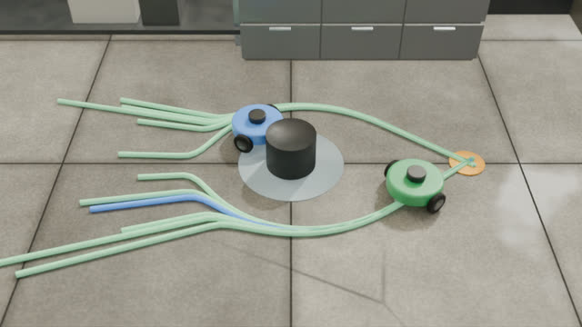

# Imitation from Demonstrations

> Learn how to teach a robot by showing it examples instead of writing rules.

**Type:** Build   **Prerequisites:** none   **Time:** ~15 minutes

## In Plain Words

A small rover must drive around a pillar to a goal, and nobody has written its rules. You drive it a few times and record, at each spot, which way you steered.

The rover then looks up the nearest recorded spots and steers as you did.

## Key Terms

- **Imitation learning**: teaching a robot by showing it examples of an expert doing the task.
- **Observation**: what the robot senses. Here it is its spot on the floor.
- **Action**: what the robot does next. Here it is a driving direction.
- **Policy**: the rule that turns an observation into an action.
- **Least squares**: a way to pick the numbers so the model misses the examples by as little as possible. Here it gives one straight rule.
- **Nearest neighbours**: a method that copies, or averages, the actions of the closest examples.

## The Problem

You want a toy rover to drive around a pillar from any starting spot. Writing rules, or a reward (a score for how well it did), takes days. Driving it by hand a few times is easy and cheap.

## The Concept

Robots meet situations no one wrote rules for, and a person can often just show the right move. We save each spot the expert drove through with the move they made, then find a rule that matches those pairs. One straight rule averages "go left" and "go right" into "go straight" and hits the pillar. Copying the closest examples works much better.


*An expert drives, we save what they did, and training turns the saved pairs into a policy.*


*One straight rule goes straight at the pillar. Copying the closest examples goes around it.*


*Left: how often the drive succeeds, by number of demonstrations. The closest-examples rule matches the expert after about a dozen, the straight rule gets worse. Right: one test drive.*

[](../assets/clip-example.mp4)

*Blue learned from one demonstration and hits the pillar. Green learned from ten and goes around.*

<details><summary>The math (optional)</summary>

A policy maps the rover's position `x` to a velocity. Least squares fits one straight rule. 3-nearest-neighbours averages the 3 closest recorded actions. Real robots replace both rules with a neural network (a large trained model). Over 60 random starts it succeeds from 13% of starts with one demonstration, 92% with three and 100% with ten. A drive counts as a success only if it never enters the obstacle and ends within 0.1 m of the goal.

</details>

## Build It

The code's pretend expert steers sideways near the pillar. The code stores the examples and builds both policies.

```python
X, A = collect(rng, n_demos)        # stacked (position, velocity) pairs
policy = fit_knn(X, A, k=3)         # mean action of the 3 closest demo states
linear_policy = fit_linear(X, A)   # alternative: one straight rule
```

`success()` checks that a drive never touches the pillar and ends near the goal.

```bash
cd robotics-engineering-from-scratch
python3 -m pytest phases/13-learning-for-robots/01-imitation-from-demonstrations -q
python3 phases/13-learning-for-robots/01-imitation-from-demonstrations/code/figure.py
```

## Use It

A test checks our neighbour search against SciPy's `cKDTree`, a ready-made nearest-neighbour finder.

Sources: Ross, Gordon and Bagnell, arXiv:1011.0686 (opened 2026-11-09).

## Ship It

`outputs/skill-imitation-data-check.md` judges a demonstration set before training.

## Exercises

1. Add a second pillar. How many demonstrations do you need now?
2. Change how many neighbours are averaged. What happens?
3. Give the observation a speed too. Does the straight rule still fail?
