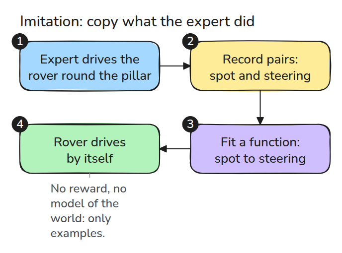
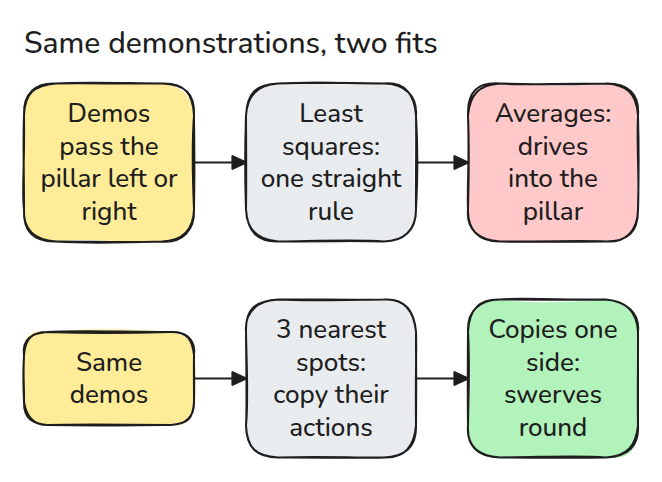
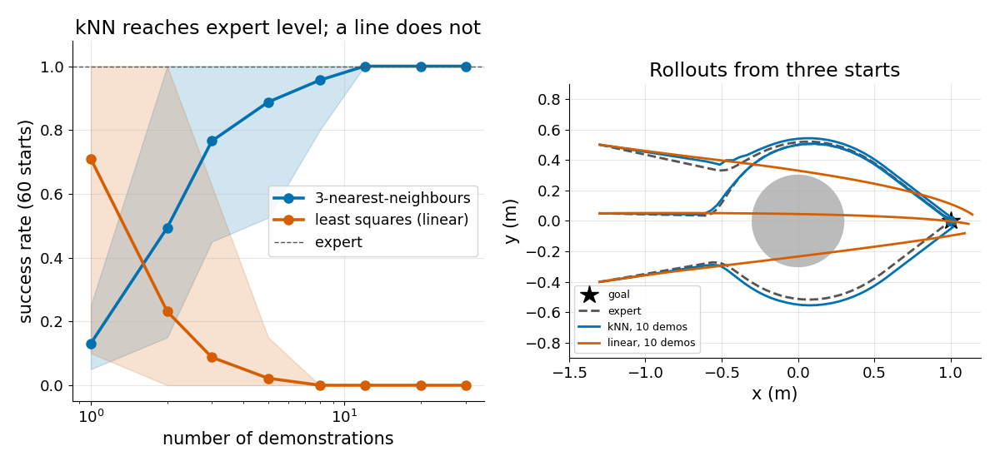

# Imitation from Demonstrations

> If you cannot write the reward, show the robot what to do and fit a function to the examples.

**Type:** Build   **Prerequisites:** 03/02 Gravity Compensation   **Time:** ~15 minutes

## In Plain Words

A small rover must drive around a pillar to a goal, and nobody has written its rules. Instead you drive it yourself a few times and record, at each spot, which way you steered.

The rover then looks up the nearest recorded spots and steers the way you did there. That works even if some of your runs passed the pillar on the left and some on the right. A single straight-line rule would average left and right into straight ahead, and the rover would hit the pillar.

## The Problem

You can drive a robot around an obstacle by hand, but writing a controller that does it from every start position takes days. Writing a reward (a score for how well it did) is no easier. Recording a few good runs and training on them is cheap. That leaves two questions: how many runs you need, and what kind of function to fit.

## The Concept



*Follow the numbers. An expert drives, you store each observation with the action taken, and a regression (a curve fit) turns those pairs into a policy.*

This is supervised learning: every example comes with its right answer, here the expert's action. An observation is the rover's position `x` in the plane, an action is the velocity it chose, and a policy is the function from one to the other. The expert heads for the goal and swerves round the pillar's keep-out disc.



*Compare the two rows. Least squares fits one straight rule, so it averages "go left" and "go right" into "go straight". Nearest neighbours look up the closest recorded spots and copy their actions.*



*Left: nearest neighbours reach expert success after about a dozen demonstrations, while least squares gets worse. Right: a rollout is one test drive, and the linear policy's goes straight through the disc.*

More data, one draw of `python3 code/main.py` (60 random starts each): 3-nearest-neighbours (average the 3 closest recorded actions) succeeds from 13% of starts with one demonstration, 92% with three and 100% with ten.


*Watch the pillar. The blue rover learned from the one blue line, has nothing to copy beside the pillar and drives into it. The green rover learned from ten green lines and goes around.*

## Build It

The expert adds a swirl term near the obstacle, a push sideways around it. The code then collects pairs and fits two policies.

```python
X, A = collect(rng, n_demos)        # stacked (position, velocity) pairs
policy = fit_knn(X, A, k=3)         # mean action of the 3 closest demo states
W = np.linalg.lstsq(feats, A)[0]    # or one linear rule, fit_linear
```

`success()` counts a rollout only if it never enters the obstacle and ends within 0.1 m of the goal. Run it with:

```bash
cd robotics-engineering-from-scratch
python3 -m pytest phases/13-learning-for-robots/01-imitation-from-demonstrations -q
python3 phases/13-learning-for-robots/01-imitation-from-demonstrations/code/figure.py
```

## Use It

The test file cross-checks the neighbour search against `scipy.spatial.cKDTree` and skips if SciPy is missing. Production code replaces both fits with a neural network.

Sources: Ross, Gordon and Bagnell, "A Reduction of Imitation Learning and Structured Prediction to No-Regret Online Learning", arXiv:1011.0686 (opened 2026-11-09; its abstract says sequential prediction violates the i.i.d. assumption of statistical learning).

## Ship It

`outputs/skill-imitation-data-check.md` is a checklist for judging a demonstration set before training.

## Exercises

1. Add a second obstacle and find how many demonstrations 3-NN needs to reach 95% success.
2. Replace `k=3` by `k=1` and `k=15` and explain the change in success.
3. Give the observation a velocity term and check that least squares still fails.
