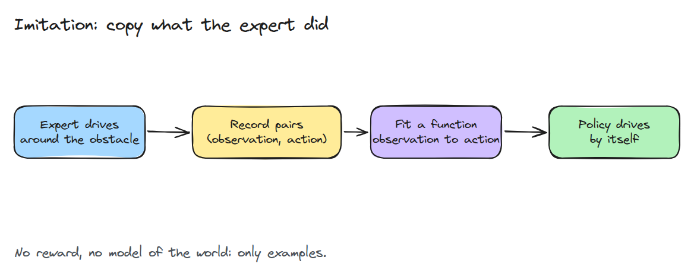
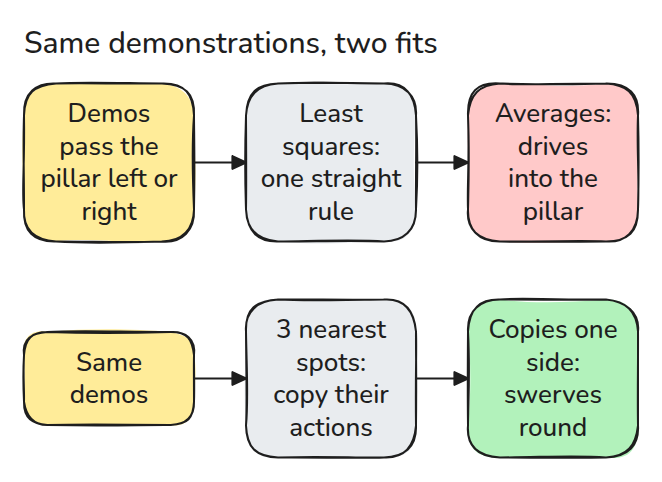
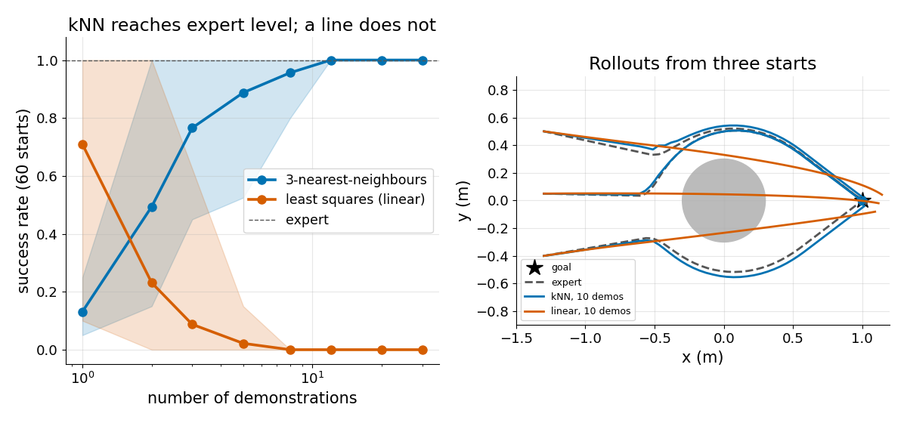

# Imitation from Demonstrations

> Learn how to teach a robot by showing it examples instead of writing rules.

**Type:** Build   **Prerequisites:** 03/02 Gravity Compensation   **Time:** ~15 minutes

## In Plain Words

A small rover must drive around a pillar to a goal, and nobody has written its rules. You drive it a few times and record, at each spot, which way you steered.

The rover then looks up the nearest recorded spots and steers as you did. One straight-line rule would average left and right into straight ahead, and the rover would hit the pillar.

## Key Terms

- **Imitation learning**: teaching a robot by fitting a function to examples of an expert's behaviour.
- **Observation**: what the robot senses. Here it is its position `x` on a plane.
- **Action**: what the robot does at that moment. Here it is a velocity.
- **Policy**: the function that maps an observation to an action.
- **Least squares**: a curve fit that makes squared errors smallest. Here it gives one straight rule.
- **Nearest neighbours**: a fit that copies the actions of the closest recorded examples.

## The Problem

You want a toy rover to drive around a pillar from any starting spot. Writing rules, or a reward (a score for how well it did), takes days. Driving it by hand a few times is easy and cheap.

## The Concept

Robots meet situations no one wrote rules for, and a person can often just show the right move.



*An expert drives, you store each observation with its action, and a regression (a curve fit) turns the pairs into a policy.*

This is supervised learning: every example comes with its right answer, the expert's action. The expert heads for the goal and swerves round the pillar's keep-out disc.



*Least squares averages "go left" and "go right" into "go straight". Nearest neighbours copy the closest recorded actions.*



*Left: nearest neighbours reach expert success after about a dozen demonstrations, while least squares gets worse. Right: a rollout is one test drive.*

Over 60 random starts, 3-nearest-neighbours (average the 3 closest recorded actions) succeeds from 13% of starts with one demonstration, 92% with three and 100% with ten.


*The blue rover learned from one line, has nothing to copy beside the pillar and hits it. The green rover learned from ten lines and goes around.*

## Build It

The expert adds a swirl term near the obstacle, a sideways push around it.

```python
X, A = collect(rng, n_demos)        # stacked (position, velocity) pairs
policy = fit_knn(X, A, k=3)         # mean action of the 3 closest demo states
W = np.linalg.lstsq(feats, A)[0]    # or one linear rule, fit_linear
```

`success()` counts a rollout only if it never enters the obstacle and ends within 0.1 m of the goal.

```bash
cd robotics-engineering-from-scratch
python3 -m pytest phases/13-learning-for-robots/01-imitation-from-demonstrations -q
python3 phases/13-learning-for-robots/01-imitation-from-demonstrations/code/figure.py
```

## Use It

The test cross-checks the neighbour search against `scipy.spatial.cKDTree`. Production code replaces both fits with a neural network.

Sources: Ross, Gordon and Bagnell, arXiv:1011.0686 (opened 2026-11-09).

## Ship It

`outputs/skill-imitation-data-check.md` judges a demonstration set before training.

## Exercises

1. Add a second obstacle. How many demonstrations does 3-NN need for 95% success?
2. Replace `k=3` by `k=1` and `k=15` and explain the change.
3. Give the observation a velocity term. Does least squares still fail?
