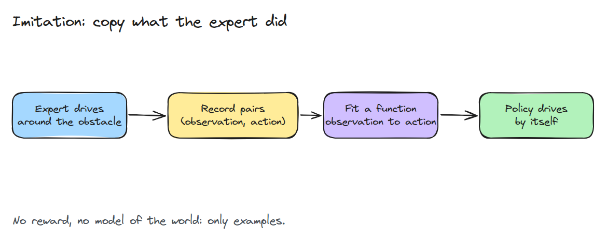
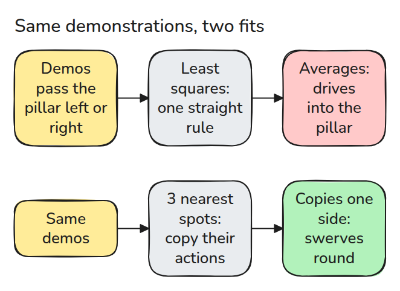
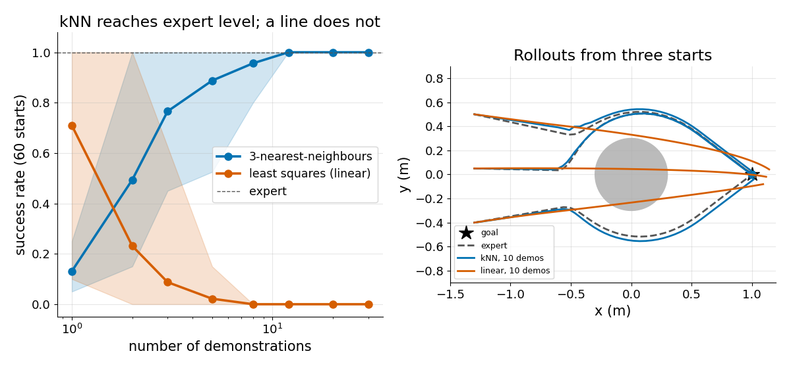

# 시연으로부터의 모방 (Imitation from Demonstrations)

> 규칙을 쓰는 대신 예시를 보여 주면서 로봇을 가르치는 법을 배웁니다.

**유형:** 만들기   **선수 지식:** 03/02 중력 보상   **시간:** 약 15분

## 쉽게 말하면

작은 로버가 기둥을 돌아 목표까지 가야 하는데 규칙은 아무도 써 두지 않았어요. 사람이 로버를 몇 번 직접 몰면서 위치마다 어느 방향으로 움직였는지 기록해요.

그러면 로버는 가장 가까운 기록들을 찾아 사람이 했던 대로 움직여요. 직선 규칙 하나로 맞추면 왼쪽과 오른쪽을 평균해서 정면이 되고 로버는 기둥에 부딪혀요.

## 핵심 용어

- **Imitation learning**: 전문가 행동의 예시에 함수를 맞춰서 로봇을 가르치는 방법입니다.
- **Observation**: 로봇이 감지하는 것입니다. 여기서는 평면 위 위치 `x`입니다.
- **Action**: 그 순간 로봇이 하는 일입니다. 여기서는 속도입니다.
- **Policy**: 관측을 행동으로 바꾸는 함수입니다.
- **Least squares**: 오차의 제곱을 가장 작게 만드는 곡선 맞춤입니다. 여기서는 직선 규칙 하나가 나옵니다.
- **Nearest neighbours**: 가장 가까운 기록 예시의 행동을 그대로 따라 하는 맞춤법입니다.

## 문제

작은 로버를 어느 시작 위치에서든 기둥을 돌아가게 하고 싶습니다. 규칙이나 reward(얼마나 잘했는지 알려 주는 점수)를 쓰는 데는 며칠이 걸리지만 손으로 몇 번 몰아 보는 것은 쉽고 쌉니다.

## 개념

로봇은 아무도 규칙을 쓰지 않은 상황을 만나는데 사람은 올바른 동작을 그냥 보여 줄 수 있는 경우가 많습니다.



*전문가가 움직이면 관측과 행동을 짝지어 저장하고 regression(곡선 맞추기)이 그 짝을 policy로 바꿉니다.*

이것은 예시마다 정답이 붙어 있는 supervised learning이고 여기서 정답은 전문가의 행동입니다. 전문가는 목표 쪽으로 가면서 기둥 주위의 금지 원판을 돌아갑니다.



*least squares는 "왼쪽으로"와 "오른쪽으로"를 평균해서 "직진"으로 만듭니다. nearest neighbours는 가장 가까운 기록 행동을 따라 합니다.*



*왼쪽은 nearest neighbours가 시연 열두 번쯤에서 전문가 수준에 닿는 반면 least squares는 오히려 나빠지는 모습입니다. 오른쪽에서 rollout은 시험 주행 한 번입니다.*

시작 위치 60개를 무작위로 뽑아 돌리면 3-nearest-neighbours(가장 가까운 기록 행동 3개의 평균)의 성공률은 시연 1개에서 13%, 3개에서 92%, 10개에서 100%입니다.


*파랑 로버는 선 하나만 보고 배워서 기둥 옆에서 따라 할 기록이 없고 기둥에 부딪힙니다. 초록 로버는 선 열 개를 보고 배워서 기둥을 돌아갑니다.*

## 만들기

전문가는 장애물 근처에서 swirl 항(장애물을 돌아가도록 옆으로 미는 항)을 더합니다.

```python
X, A = collect(rng, n_demos)        # stacked (position, velocity) pairs
policy = fit_knn(X, A, k=3)         # mean action of the 3 closest demo states
W = np.linalg.lstsq(feats, A)[0]    # or one linear rule, fit_linear
```

`success()`는 장애물에 한 번도 들어가지 않고 목표 0.1 m 안에서 끝난 rollout만 성공으로 셉니다.

```bash
cd robotics-engineering-from-scratch
python3 -m pytest phases/13-learning-for-robots/01-imitation-from-demonstrations -q
python3 phases/13-learning-for-robots/01-imitation-from-demonstrations/code/figure.py
```

## 실제 도구로 보기

테스트는 이웃 탐색을 `scipy.spatial.cKDTree`와 대조합니다. 실제 시스템은 두 fit을 신경망으로 바꿉니다.

출처: Ross, Gordon and Bagnell, arXiv:1011.0686. 2026년 11월 9일에 열어 확인했습니다.

## 결과물

`outputs/skill-imitation-data-check.md`는 학습 전에 시연 데이터를 점검하는 체크리스트입니다.

## 연습 문제

1. 장애물을 하나 더 넣으세요. 3-NN이 성공률 95%에 닿는 데 시연이 몇 개 필요한가요?
2. `k=1`과 `k=15`로 바꾸고 변화를 설명하세요.
3. 관측에 속도 항을 넣으세요. least squares가 여전히 실패하나요?
