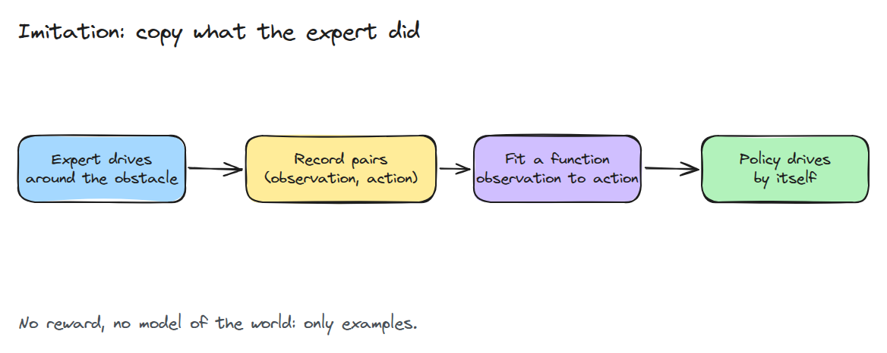
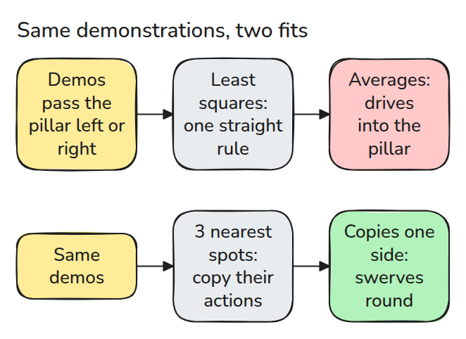
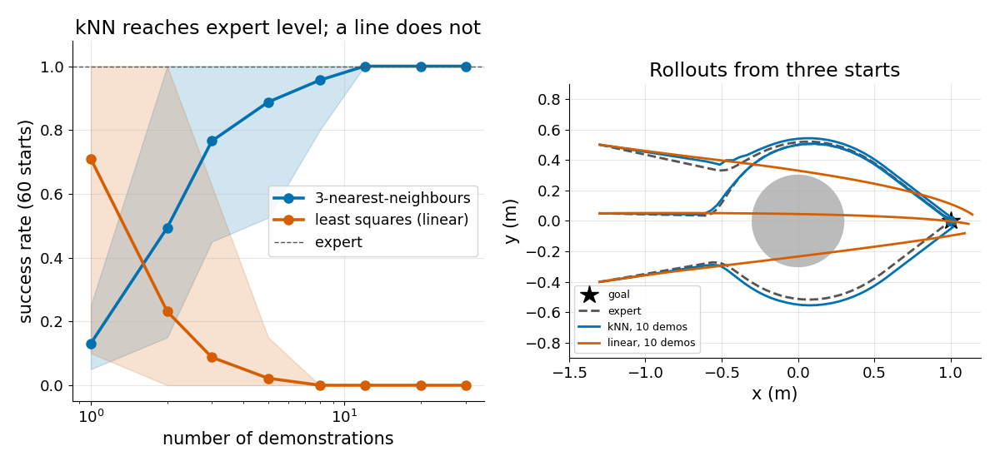

# 시연으로부터의 모방 (Imitation from Demonstrations)

> reward를 쓸 수 없으면 로봇에게 하는 법을 보여 주고 그 예시에 함수를 맞춥니다.

**유형:** 만들기   **선수 지식:** 03/02 중력 보상   **시간:** 약 15분

## 쉽게 말하면

친구가 운동장의 콘 사이를 지나갈 때 서 있는 위치와 다음에 움직인 방향을 짝지어 기록해요. 그 예시로 지금 위치에서 어디로 움직일지 고르는 규칙을 배울 수 있어요.

imitation learning은 행동마다 reward를 정하지 않고 그 규칙을 맞춰요. 가까운 예시를 따르면 근처의 우회 동작을 살릴 수 있어요. 하지만 linear 규칙 하나로 맞추면 서로 다른 우회를 평균해서 콘을 통과할 수 있어요.
시연을 늘려도 배울 규칙이 그 움직임을 표현할 수 있어야 해요.

## 문제

로봇을 손으로 몰아 장애물을 돌아가게 하기는 쉽습니다. 하지만 모든 시작 위치에서 그렇게 움직이는 제어기를 짜려면 며칠이 걸립니다. 학습 알고리즘에 줄 reward를 쓰는 일도 쉽지 않습니다.
좋은 주행을 몇 번 녹화해서 학습시키면 비용이 적게 듭니다. 남는 질문은 시연이 몇 번 필요한지와 어떤 함수를 맞출지입니다.

## 개념



*전문가가 움직이면 관측과 행동을 짝지어 저장합니다. 회귀가 그 짝을 정책으로 바꿉니다.*

이것은 라벨이 전문가의 행동인 supervised learning입니다. 상태는 평면 위의 점 `x`이고 행동은 속도입니다. 전문가는 목표 쪽으로 당기면서 원판을 돌아갑니다.



*직선은 "왼쪽으로"와 "오른쪽으로"를 평균해서 "직진"으로 만듭니다. 최근접 이웃은 한쪽을 그대로 따라 합니다.*



*왼쪽은 최근접 이웃이 시연 열두 번쯤에서 전문가 수준에 닿는 반면 최소제곱은 오히려 나빠지는 모습입니다. 오른쪽은 선형 정책이 원판을 곧장 통과하는 모습입니다.*

## 만들기

전문가는 장애물 근처에서 swirl 항을 더합니다. 코드는 짝을 모은 뒤 두 정책을 맞춥니다.

```python
X, A = collect(rng, n_demos)        # stacked (position, velocity) pairs
policy = fit_knn(X, A, k=3)         # mean action of the 3 closest demo states
W = np.linalg.lstsq(feats, A)[0]    # or one linear rule, fit_linear
```

`success()`는 장애물에 한 번도 들어가지 않고 목표 0.1 m 안에서 끝난 롤아웃만 성공으로 셉니다. 아래 명령으로 실행합니다.

```bash
cd robotics-engineering-from-scratch
python3 -m pytest phases/13-learning-for-robots/01-imitation-from-demonstrations -q
python3 phases/13-learning-for-robots/01-imitation-from-demonstrations/code/figure.py
```

## 실제 도구로 보기

테스트 파일은 이웃 탐색을 `scipy.spatial.cKDTree`와 대조하고 SciPy가 없으면 건너뜁니다. 실제 시스템은 두 fit을 신경망으로 바꾸지만 데이터 파이프라인은 같습니다. 가장 먼저 바꿔 볼 값도 여전히 시연 수입니다.

출처: Ross, Gordon and Bagnell, "A Reduction of Imitation Learning and Structured Prediction to No-Regret Online Learning", arXiv:1011.0686.
초록을 2026년 11월 9일에 열어 확인했고 순차 예측이 통계 학습의 i.i.d. 가정을 깨뜨린다고 적혀 있습니다.

## 결과물

`outputs/skill-imitation-data-check.md`는 학습 전에 시연 데이터를 점검하는 체크리스트입니다.

## 연습 문제

1. 장애물을 하나 더 넣고 3-NN이 성공률 95%에 닿는 데 필요한 시연 수를 찾으세요.
2. `k=1`과 `k=15`로 바꾸고 성공률 변화를 설명하세요.
3. 관측에 속도 항을 넣어도 최소제곱이 여전히 실패하는지 확인하세요.
