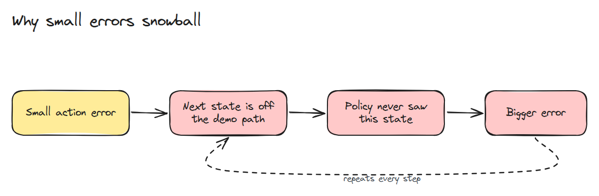
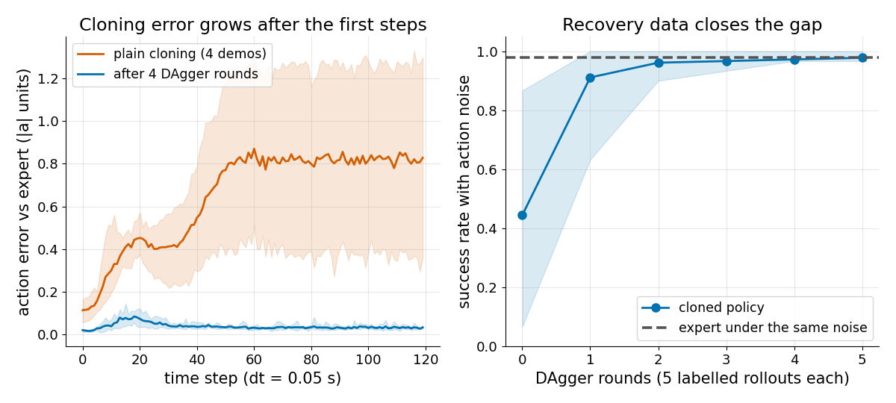
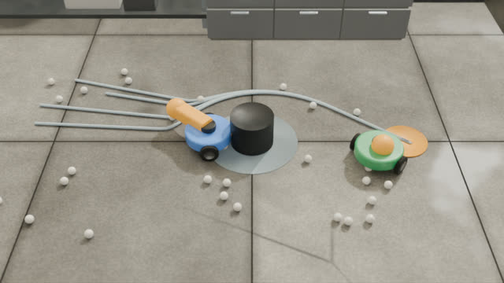

# Behaviour Cloning Pitfalls

> Learn why a robot that copies an expert works at first and then drifts off, and how to fix it.

**Type:** Build   **Prerequisites:** 13/01 Imitation from Demonstrations   **Time:** ~15 minutes

## In Plain Words

A rover learns to drive round a pillar from clean runs with no bumps. One bump pushes it to a spot none of those runs visited, where its steering is a poor guess.

DAgger lets the rover drive first. The expert then marks, for each spot the rover reached, the move it should have made, and the rover learns again from them.

## Key Terms

- **Behaviour cloning**: training a policy to copy an expert's actions at recorded spots.
- **Compounding error**: a small slip leads to an unfamiliar spot, which causes a bigger slip.
- **Rollout**: one test drive of a policy from a start spot.
- **Learner**: the policy being trained.
- **DAgger**: the learner drives, the expert marks the right move at the spots it reached, and the marks join the training data.

## The Problem

A rover that copied your driving scores well on saved demonstrations, yet on the floor it drifts off the path. Training only checked spots you drove through.

## The Concept

A real robot always slips a little, so it must handle places its teacher never showed. One small slip puts the rover where no demonstration went. There its guess is worse, so the next slip is bigger and the error snowballs. DAgger fixes this by training on the spots the rover really reaches.



*A slip puts the rover outside the demonstrations, where its steering is worse.*


*One DAgger round: the learner drives, the expert marks the right move where it went, the learner trains again.*



*Left: plain copying drifts further and further, DAgger stays close to the expert's path. Right: DAgger reaches expert level in about two rounds.*

[](../assets/clip-example.mp4)

*The line is each rover's distance from anything it was taught. Blue's grows until the pillar, green's stays short.*

<details><summary>The math (optional)</summary>

Noise added to the commanded velocity mimics wheel slip. With four clean demonstrations, plain cloning error rises about sevenfold over 60 steps, and after four DAgger rounds it stays near zero. Plain cloning ends 0.31 m from the nearest recorded spot when it hits the pillar. After four DAgger rounds it never exceeds 0.09 m. Goal success is 52.5% for plain cloning, 90% after two rounds and 93% after four. If the learner's error rate on the expert's own states is a small `e`, the extra cost of a drive can grow as `T*T*e`, because early mistakes carry the rover to places it never saw (Ross, Gordon and Bagnell).

</details>

## Build It

`dagger()` with `rounds=0` is plain cloning. Each round adds spots where the expert marked the right move.

```python
for _ in range(rounds):
    V = np.vstack([rollout(pol, x0, rng)[:-1] for x0 in starts(rng, 5)])
    X, A = np.vstack([X, V]), np.vstack([A, [expert(x) for x in V]])
    pol = fit_knn(X, A)
```

The marks always come from `expert(x)`, never from the learner.

```bash
cd robotics-engineering-from-scratch
python3 -m pytest phases/13-learning-for-robots/02-behaviour-cloning-pitfalls -q
python3 phases/13-learning-for-robots/02-behaviour-cloning-pitfalls/code/figure.py
```

## Use It

Often the expert is not around while the robot drives, so a person marks the spots later.

Sources: Ross, Gordon and Bagnell, arXiv:1011.0686, opened 2026-11-09.

## Ship It

`outputs/skill-cloning-drift-audit.md` is a procedure for finding compounding error.

## Exercises

1. Plot the learner's distance to the nearest demonstration spot and see when it grows.
2. Halve the noise. How many rounds do you still need?
3. Lower `per_round`, the new drives added each round.
