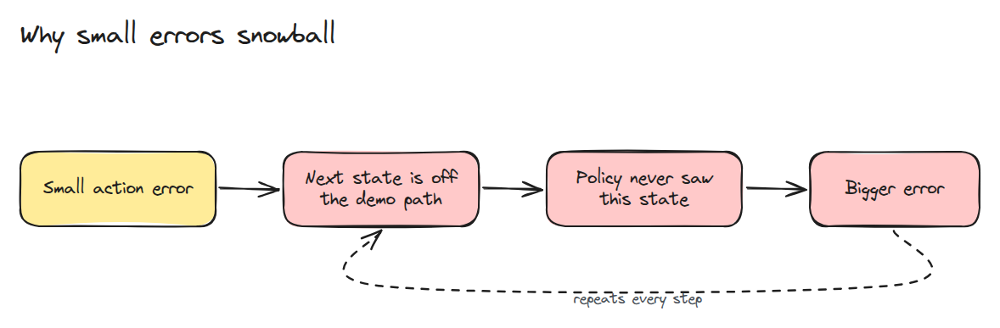
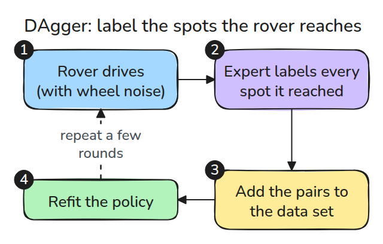
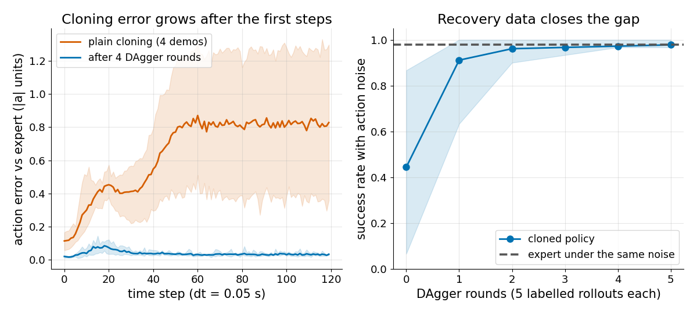

# Behaviour Cloning Pitfalls

> A cloned policy is accurate where the expert drove and wrong one step later, because its own mistakes put it somewhere the expert never was.

**Type:** Build   **Prerequisites:** 13/01 Imitation from Demonstrations   **Time:** ~15 minutes

## In Plain Words

You learn cycling from examples that always begin in the middle of a lane. A wobble puts you near the edge, where none of those
examples says how to recover. A guessed correction can put you farther out again.

In behaviour cloning, actions change the states the learner sees next. DAgger lets the learner try, asks the expert for the right
action at the positions the learner actually reached, and adds those recovery examples before fitting again.

## The Problem

Your cloned policy scores well on held-out demonstration data, yet on the robot it drifts off the path and fails. The training loss never measured the states the policy creates by itself. Every small error moves it a little further from the data.

## The Concept



*One wrong action puts the next observation outside the demonstrations, where the policy is worse, so the next error is larger.*

Noise added to the commanded velocity stands in for slip and delay. With only four clean demonstrations the learner leaves the demonstrated states within a few steps. Its action error then climbs and stays high.



*The learner drives, the expert labels the states it actually visited, and those pairs join the data.*



*Left: plain cloning error rises about sevenfold over the first 60 steps, and the cloned policy trained after four DAgger rounds stays near zero. Right: success under noise climbs to the expert's level in about two rounds.*

## Build It

`dagger()` is plain cloning when `rounds=0`. Each round adds labelled recovery states.

```python
for _ in range(rounds):
    V = np.vstack([rollout(pol, x0, rng)[:-1] for x0 in starts(rng, 5)])
    X, A = np.vstack([X, V]), np.vstack([A, [expert(x) for x in V]])
    pol = fit_knn(X, A)
```

The labels come from `expert(x)`, never from the learner. `drift_curves()` returns action error and distance to the nearest data state at every step.

```bash
cd robotics-engineering-from-scratch
python3 -m pytest phases/13-learning-for-robots/02-behaviour-cloning-pitfalls -q
python3 phases/13-learning-for-robots/02-behaviour-cloning-pitfalls/code/figure.py
```

## Use It

The expert is often not available while the robot drives, so DAgger needs a person or a planner to label states after the fact. A cheaper option is to record recovery moves on purpose. Whichever you use, measure error on rollouts of the learner, not on held-out demonstrations.

Sources: Ross, Gordon and Bagnell, arXiv:1011.0686, opened 2026-11-09. Its text says a supervised learner can make as many as T² mistakes over T steps under its own state distribution, and defines DAgger as aggregating datasets over iterations.

## Ship It

`outputs/skill-cloning-drift-audit.md` is a procedure for finding compounding error in a cloned policy.

## Exercises

1. Plot `dist` from `drift_curves` for plain cloning and say when the learner leaves the data.
2. Halve `NOISE` and find the smallest number of rounds that matches the expert.
3. Roll out a mix of expert and learner whose expert share decays each round, like the paper's `beta`, and compare.
