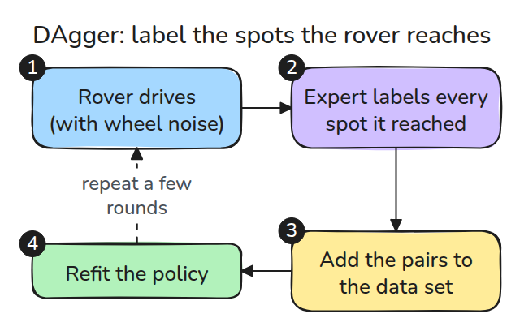

# Behaviour Cloning Pitfalls

> Learn why a robot that copies an expert works at first and then drifts off, and how to fix it.

**Type:** Build   **Prerequisites:** 13/01 Imitation from Demonstrations   **Time:** ~15 minutes

## In Plain Words

A rover learns to drive round a pillar from clean runs with no bumps. One bump pushes it to a spot none of those runs visited, where its steering is a poor guess. The next guess is worse, so the error grows.

DAgger lets the rover drive first. The expert then labels the spots the rover actually reached, and the rover learns again from them.

## Key Terms

- **Behaviour cloning**: training a policy by copying an expert's actions at recorded states.
- **Compounding error**: a small mistake leads to an unfamiliar state, which causes a bigger mistake.
- **Rollout**: one test drive of a policy from a start state.
- **DAgger**: dataset aggregation. The learner drives, the expert labels the visited states, and the labels join the data.
- **Held-out data**: examples kept aside from training to test a model.
- **Learner**: the policy being trained.

## The Problem

A rover that copied your driving scores well on saved demonstrations, yet on the floor it drifts off the path. Training only checked spots you drove through, never the odd spots a small slip leaves it in.

## The Concept

A real robot always slips a little, so it must handle places its teacher never showed.


*One wrong action puts the next observation outside the demonstrations, where the policy is worse.*

Noise in the commanded velocity mimics wheel slip. With four clean demonstrations the learner leaves the demonstrated states within a few steps.



*One DAgger round: the learner drives, the expert labels the visited states, the learner refits.*


*Left: plain cloning error rises about sevenfold over 60 steps; after four DAgger rounds it stays near zero. Right: success reaches the expert's level in about two rounds.*

Both rovers learned from four demonstrations. Plain cloning (blue) ends 0.31 m from the nearest recorded state when it hits the pillar. After four DAgger rounds (green) it never exceeds 0.09 m. Goal success is 52.5% for plain cloning, 90% after two rounds and 93% after four.


*The amber line joins each rover to its nearest recorded state. Blue's grows until the pillar; green's stays short.*

## Build It

`dagger()` is plain cloning when `rounds=0`. Each round adds labelled recovery states.

```python
for _ in range(rounds):
    V = np.vstack([rollout(pol, x0, rng)[:-1] for x0 in starts(rng, 5)])
    X, A = np.vstack([X, V]), np.vstack([A, [expert(x) for x in V]])
    pol = fit_knn(X, A)
```

Labels come from `expert(x)`, never from the learner.

```bash
cd robotics-engineering-from-scratch
python3 -m pytest phases/13-learning-for-robots/02-behaviour-cloning-pitfalls -q
python3 phases/13-learning-for-robots/02-behaviour-cloning-pitfalls/code/figure.py
```

## Use It

The expert is often unavailable while the robot drives, so a person or planner labels states afterwards. Always measure error on the learner's rollouts.

Sources: Ross, Gordon and Bagnell, arXiv:1011.0686, opened 2026-11-09. A learner can make up to T² mistakes over T steps.

## Ship It

`outputs/skill-cloning-drift-audit.md` is a procedure for finding compounding error.

## Exercises

1. Plot `dist` from `drift_curves` for plain cloning. When does the learner leave the data?
2. Halve `NOISE`. How few rounds suffice?
3. Decay the expert share each round, like the paper's `beta`.
