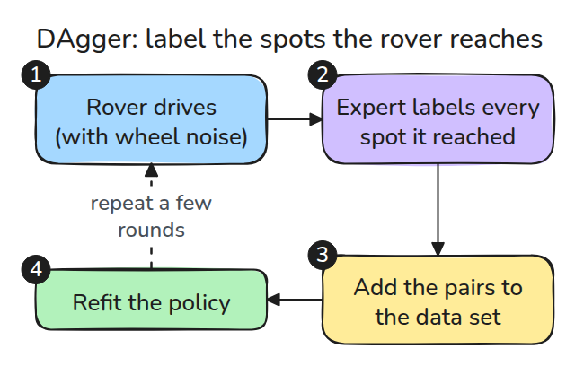
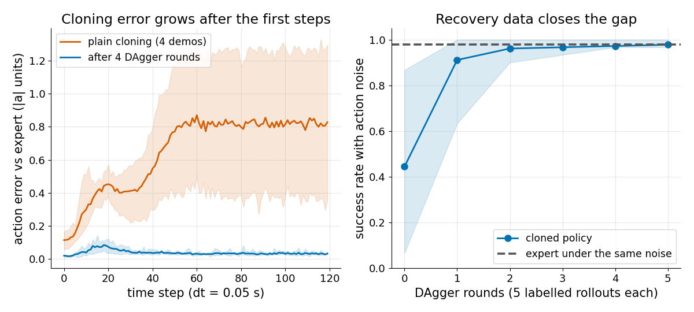

# 행동 복제의 함정 (Behaviour Cloning Pitfalls)

> 전문가를 따라 하는 로봇이 처음엔 잘하다가 점점 벗어나는 이유와 고치는 법을 배웁니다.

**유형:** 만들기   **선수 지식:** 13/01 시연으로부터의 모방   **시간:** 약 15분

## 쉽게 말하면

로버가 흔들림 없는 깨끗한 주행만 보고 기둥을 돌아가는 법을 배워요. 바퀴가 한 번 튀어서 그 주행들이 가 본 적 없는 곳으로 밀려나면 거기서는 어디로 갈지 짐작으로 정할 수밖에 없어요. 다음 짐작은 더 틀리기 쉬워서 오차가 점점 커져요.

DAgger는 로버가 먼저 달려 보게 해요. 그러면 전문가가 로버가 실제로 간 위치에 라벨을 붙이고 로버는 그 예시로 다시 배워요.

## 핵심 용어

- **Behaviour cloning**: 기록된 상태에서 전문가의 행동을 따라 해서 policy를 학습시키는 방법입니다.
- **Compounding error**: 작은 실수가 낯선 상태로 이어지고 그 상태에서 더 큰 실수가 나는 현상입니다.
- **Rollout**: 시작 상태에서 policy를 한 번 시험 주행해 보는 것입니다.
- **DAgger**: dataset aggregation입니다. learner가 달리면 전문가가 지나간 상태에 라벨을 붙이고 그 라벨을 데이터에 합칩니다.
- **Held-out data**: 학습에 쓰지 않고 모델을 시험하려고 따로 남겨 둔 예시입니다.
- **Learner**: 학습 중인 policy입니다.

## 문제

내 운전을 따라 배운 로버가 저장된 시연에서는 점수가 좋은데 바닥에서는 경로를 벗어납니다. 학습은 내가 지나간 위치만 점검했고 작게 미끄러진 뒤에 놓이는 낯선 위치는 점검한 적이 없습니다.

## 개념

실제 로봇은 늘 조금씩 미끄러지므로 선생이 보여 준 적 없는 위치도 다룰 수 있어야 합니다.


*행동 하나가 틀리면 다음 관측이 시연 밖으로 밀려납니다. 거기서는 policy가 더 나쁩니다.*

명령 속도의 noise가 바퀴 미끄러짐을 흉내 냅니다. 깨끗한 시연이 네 번뿐이면 learner는 몇 step 안에 시연된 상태를 벗어납니다.



*DAgger 한 라운드는 이렇습니다. learner가 달리면 전문가가 지나간 상태에 라벨을 붙이고 learner가 다시 맞춥니다.*



*왼쪽은 plain cloning의 오차가 60 step 동안 약 7배로 오르고 DAgger를 네 라운드 거치면 0 근처에 머무는 모습입니다. 오른쪽은 noise 아래의 성공률이 두 라운드쯤에 전문가 수준까지 오르는 모습입니다.*

두 로버는 시연 네 개로 배웠습니다. 단순 복제한 파랑 로버는 기둥에 부딪힐 때 가장 가까운 기록 상태에서 0.31 m 떨어져 있습니다. DAgger를 네 라운드 거친 초록 로버는 0.09 m를 넘은 적이 없습니다.
목표 도달 성공률은 단순 복제 52.5%, 두 라운드 후 90%, 네 라운드 후 93%입니다.


*주황색 선은 각 로버와 가장 가까운 기록 상태를 잇습니다. 파랑 로버의 선은 기둥에 닿을 때까지 길어지고 초록 로버의 선은 짧게 유지됩니다.*

## 만들기

`rounds=0`이면 `dagger()`는 단순 복제입니다. 라운드마다 라벨 붙은 복구 상태가 추가됩니다.

```python
for _ in range(rounds):
    V = np.vstack([rollout(pol, x0, rng)[:-1] for x0 in starts(rng, 5)])
    X, A = np.vstack([X, V]), np.vstack([A, [expert(x) for x in V]])
    pol = fit_knn(X, A)
```

라벨은 항상 `expert(x)`에서 오고 learner에게서 오지 않습니다.

```bash
cd robotics-engineering-from-scratch
python3 -m pytest phases/13-learning-for-robots/02-behaviour-cloning-pitfalls -q
python3 phases/13-learning-for-robots/02-behaviour-cloning-pitfalls/code/figure.py
```

## 실제 도구로 보기

로봇이 달리는 동안 전문가를 쓸 수 없는 경우가 많아서 사람이나 planner가 나중에 상태에 라벨을 붙입니다. 오차는 언제나 learner의 rollout에서 잽니다.

출처: Ross, Gordon and Bagnell, arXiv:1011.0686. 2026년 11월 9일에 열어 확인했고 learner는 T 스텝 동안 최대 T²번 틀릴 수 있다고 적혀 있습니다.

## 결과물

`outputs/skill-cloning-drift-audit.md`는 누적되는 오차를 찾는 절차입니다.

## 연습 문제

1. 단순 복제의 `drift_curves`에서 `dist`를 그리세요. learner는 언제 데이터를 벗어나나요?
2. `NOISE`를 절반으로 줄이세요. 몇 라운드면 여전히 전문가와 맞먹나요?
3. 논문의 `beta`처럼 전문가 비중을 라운드마다 줄이세요.
