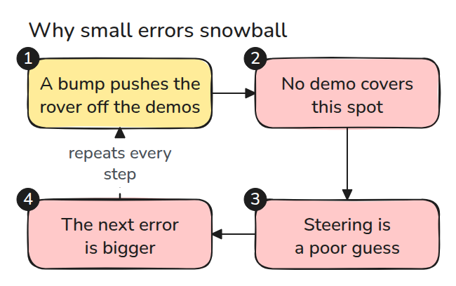
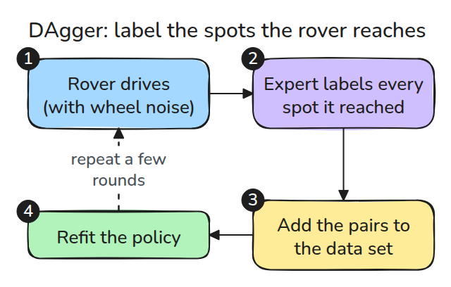
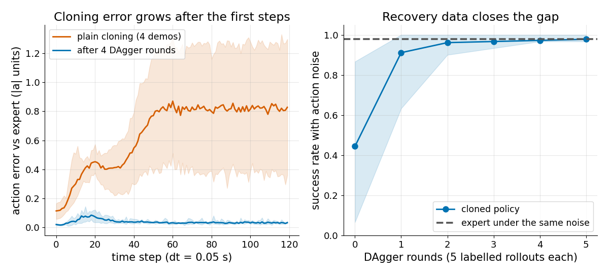

# 행동 복제의 함정 (Behaviour Cloning Pitfalls)

> 복제한 policy는 전문가가 달린 곳에서는 정확하지만 한 걸음 뒤에는 틀립니다. 자기가 낸 실수 때문에 전문가가 가 본 적 없는 곳에 서게 되기 때문입니다.

**유형:** 만들기   **선수 지식:** 13/01 시연으로부터의 모방   **시간:** 약 15분

## 쉽게 말하면

로버가 흔들림 없는 깨끗한 주행만 보고 기둥을 돌아가는 법을 배워요. 바퀴가 한 번 튀어서 그 주행들이 가 본 적 없는 곳으로 밀려나면 거기서는 어디로 갈지 짐작으로 정할 수밖에 없어요. 다음 짐작은 더 틀리기 쉬워서 오차가 점점 커져요.

DAgger(dataset aggregation, 데이터를 모아 합치기)는 로버가 먼저 달려 보게 해요. 그러면 전문가가 로버가 실제로 간 위치마다 어떻게 움직여야 하는지 알려 주고 이 복구 예시를 데이터에 더한 뒤 로버가 다시 배워요.

## 문제

복제한 policy가 따로 떼어 둔 시연 데이터(테스트용으로 남겨 둔 시연)에서는 점수가 좋은데 로봇에서는 경로를 벗어나 실패합니다.
학습 loss는 policy의 행동이 전문가의 행동과 얼마나 다른지를 시연 위치에서만 잴 뿐 policy가 스스로 만드는 상태에서는 한 번도 재지 않았습니다.

## 개념



*행동 하나가 틀리면 다음 관측이 시연 밖으로 밀려납니다. 거기서는 policy가 더 나쁘고 다음 오차는 더 커집니다.*

명령 속도에 noise를 더해서 바퀴 미끄러짐과 지연을 흉내 냅니다. 깨끗한 시연이 네 번뿐이면 복제한 policy, 즉 learner는 몇 step 안에 시연된 상태를 벗어납니다.
그러면 행동 오차, 즉 그 자리에서 learner의 행동이 전문가의 행동과 얼마나 다른지가 올라가 높은 채로 머뭅니다.



*번호를 따라가 보세요. DAgger 한 라운드는 이렇습니다. learner가 달리면 전문가가 learner가 실제로 지나간 상태에 라벨을 붙이고 그 짝이 데이터에 합쳐지면 learner가 다시 맞춥니다.*



*왼쪽은 plain cloning의 오차가 처음 60 step 동안 약 7배로 오르는 반면 DAgger를 네 라운드 거친 policy는 0 근처에 머무는 모습입니다. 오른쪽은 noise 아래의 성공률이 두 라운드쯤에 전문가 수준까지 오르는 모습입니다.*

아래 두 로버는 시연 네 개로 배웠습니다. 단순 복제한 파랑 로버는 가장 가까운 기록 상태에서 0.09 m 떨어져 출발하고 기둥에 부딪힐 때는 0.31 m 떨어져 있습니다.
DAgger를 네 라운드 거친 초록 로버는 0.09 m를 넘은 적이 없습니다.
시작 위치를 많이 바꿔 보면 `python3 code/main.py`가 내는 목표 도달 성공률은 단순 복제 52.5%, DAgger 두 라운드 후 90%, 네 라운드 후 93%입니다.


*각 로버에서 가장 가까운 기록 상태까지 이어진 주황색 선을 보세요. 파랑 로버의 선은 기둥에 닿을 때까지 계속 길어집니다. 초록 점은 learner가 지나가고 전문가가 라벨을 붙인 상태라서 초록 로버의 선은 짧게 유지됩니다.*

## 만들기

`rounds=0`이면 `dagger()`는 단순 복제입니다. 라운드마다 라벨 붙은 복구 상태가 추가됩니다.

```python
for _ in range(rounds):
    V = np.vstack([rollout(pol, x0, rng)[:-1] for x0 in starts(rng, 5)])
    X, A = np.vstack([X, V]), np.vstack([A, [expert(x) for x in V]])
    pol = fit_knn(X, A)
```

라벨은 항상 `expert(x)`에서 오고 learner에게서 오지 않습니다. `drift_curves()`는 매 스텝의 행동 오차와 가장 가까운 데이터 상태까지의 거리를 돌려줍니다.

```bash
cd robotics-engineering-from-scratch
python3 -m pytest phases/13-learning-for-robots/02-behaviour-cloning-pitfalls -q
python3 phases/13-learning-for-robots/02-behaviour-cloning-pitfalls/code/figure.py
```

## 실제 도구로 보기

로봇이 달리는 동안 전문가를 쓸 수 없는 경우가 많아서 사람이나 planner가 나중에 상태에 라벨을 붙여 줘야 합니다. 더 싼 방법은 복구 동작을 일부러 녹화하는 것입니다. 어느 쪽이든 오차는 따로 둔 시연이 아니라 learner의 rollout에서 잽니다.

출처: Ross, Gordon and Bagnell, arXiv:1011.0686. 2026년 11월 9일에 열어 확인했습니다.
본문에 따르면 supervised learner는 자기가 만든 상태 분포에서 T 스텝 동안 최대 T²번 틀릴 수 있고 DAgger는 반복마다 데이터셋을 합쳐 갑니다.

## 결과물

`outputs/skill-cloning-drift-audit.md`는 복제한 policy에서 누적되는 오차를 찾는 절차입니다.

## 연습 문제

1. 단순 복제의 `drift_curves`에서 `dist`를 그리고 learner가 데이터를 벗어나는 시점을 말하세요.
2. `NOISE`를 절반으로 줄이고 전문가와 맞먹는 최소 라운드 수를 찾으세요.
3. 논문의 `beta`처럼 전문가 비중이 라운드마다 줄어드는 혼합 policy로 rollout하고 비교하세요.
