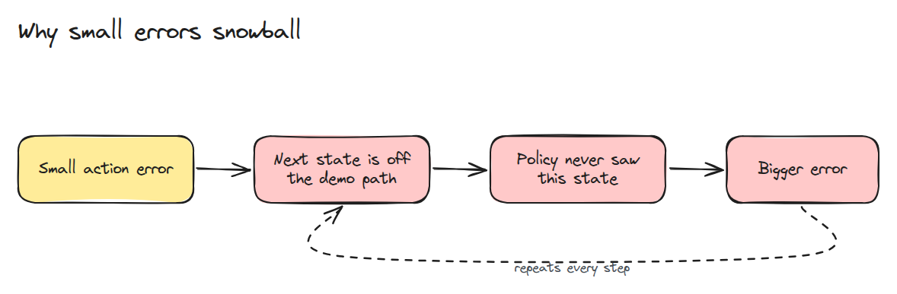

# 행동 복제의 함정 (Behaviour Cloning Pitfalls)

> 전문가를 따라 하는 로봇이 처음엔 잘하다가 점점 벗어나는 이유와 고치는 법을 배웁니다.

**유형:** 만들기   **선수 지식:** 13/01 시연으로부터의 모방   **시간:** 약 15분

## 쉽게 말하면

로버가 흔들림 없는 깨끗한 주행만 보고 기둥을 돌아가는 법을 배워요. 바퀴가 한 번 튀어서 그 주행들이 가 본 적 없는 곳으로 밀려나면 거기서는 어디로 갈지 짐작으로 정할 수밖에 없어요.

DAgger는 로버가 먼저 달려 보게 해요. 그러면 전문가가 로버가 실제로 간 위치마다 했어야 할 움직임을 표시하고 로버는 그 예시로 다시 배워요.

## 핵심 용어

- **Behaviour cloning**: 기록된 위치에서 전문가의 행동을 따라 해서 policy를 학습시키는 방법입니다.
- **Compounding error**: 작은 실수가 낯선 위치로 이어지고 거기서 더 큰 실수가 나는 현상입니다.
- **Rollout**: 시작 위치에서 policy를 한 번 시험 주행해 보는 것입니다.
- **Learner**: 학습 중인 policy입니다.
- **DAgger**: learner가 달리면 전문가가 지나간 위치마다 맞는 움직임을 표시하고 그 표시를 학습 데이터에 합칩니다.

## 문제

내 운전을 따라 배운 로버가 저장된 시연에서는 점수가 좋은데 바닥에서는 경로를 벗어납니다. 학습은 내가 지나간 위치만 점검했습니다.

## 개념

실제 로봇은 늘 조금씩 미끄러지므로 선생이 보여 준 적 없는 위치도 다룰 수 있어야 합니다. 작게 미끄러지면 로버는 어떤 시연도 가지 않은 곳에 서고 거기서는 짐작이 더 나빠서 다음 미끄러짐이 더 크고 오차가 눈덩이처럼 커집니다.
DAgger는 로버가 실제로 가는 위치에서 학습해서 이것을 고칩니다.



*미끄러지면 로버가 시연 밖으로 밀려나고 거기서는 조향이 더 나쁩니다.*


*DAgger 한 라운드는 이렇습니다. learner가 달리면 전문가가 간 곳마다 맞는 움직임을 표시하고 learner가 다시 학습합니다.*


*왼쪽은 단순 복제가 점점 멀리 벗어나고 DAgger는 전문가의 경로 가까이 머무는 모습입니다. 오른쪽은 DAgger가 두 라운드쯤에 전문가 수준에 닿는 모습입니다.*


*선은 각 로버가 배운 어떤 것에서도 얼마나 멀리 있는지 보여 줍니다. 파랑 로버의 선은 기둥에 닿을 때까지 길어지고 초록 로버의 선은 짧게 유지됩니다.*

<details><summary>The math (optional)</summary>

명령 속도의 noise가 바퀴 미끄러짐을 흉내 냅니다. 깨끗한 시연이 네 번뿐일 때 단순 복제의 오차는 60 step 동안 약 7배로 오르고 DAgger를 네 라운드 거치면 0 근처에 머뭅니다.
단순 복제는 기둥에 부딪힐 때 가장 가까운 기록 위치에서 0.31 m 떨어져 있고 DAgger를 네 라운드 거치면 0.09 m를 넘은 적이 없습니다. 목표 도달 성공률은 단순 복제 52.5%, 두 라운드 후 90%, 네 라운드 후 93%입니다.
learner는 T 스텝 동안 최대 T²번 틀릴 수 있습니다(Ross, Gordon and Bagnell).

</details>

## 만들기

`rounds=0`이면 `dagger()`는 단순 복제입니다. 라운드마다 전문가가 맞는 움직임을 표시한 위치가 추가됩니다.

```python
for _ in range(rounds):
    V = np.vstack([rollout(pol, x0, rng)[:-1] for x0 in starts(rng, 5)])
    X, A = np.vstack([X, V]), np.vstack([A, [expert(x) for x in V]])
    pol = fit_knn(X, A)
```

표시는 항상 `expert(x)`에서 오고 learner에게서 오지 않습니다.

```bash
cd robotics-engineering-from-scratch
python3 -m pytest phases/13-learning-for-robots/02-behaviour-cloning-pitfalls -q
python3 phases/13-learning-for-robots/02-behaviour-cloning-pitfalls/code/figure.py
```

## 실제 도구로 보기

로봇이 달리는 동안 전문가를 쓸 수 없는 경우가 많아서 사람이 나중에 위치에 맞는 움직임을 표시합니다.

출처: Ross, Gordon and Bagnell, arXiv:1011.0686, 2026년 11월 9일에 열어 확인했습니다.

## 결과물

`outputs/skill-cloning-drift-audit.md`는 누적되는 오차를 찾는 절차입니다.

## 연습 문제

1. learner에서 가장 가까운 시연 위치까지의 거리를 그려서 언제 커지는지 보세요.
2. 잡음을 절반으로 줄이세요. 라운드가 몇 번 더 필요한가요?
3. 라운드마다 더하는 새 주행의 수 `per_round`를 낮춰 보세요.
