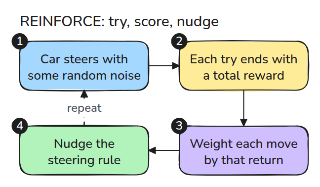
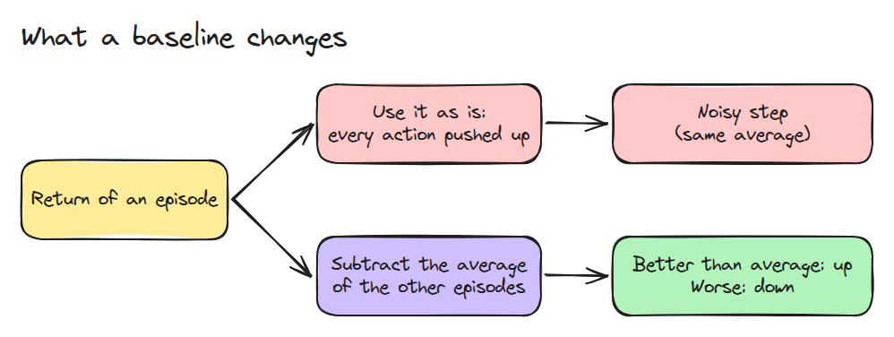
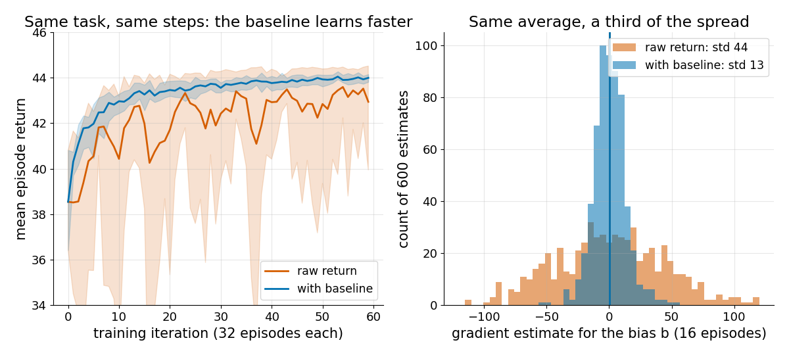

# Policy Gradients

> Nudge the policy toward actions that scored above average, and the only price is noise, which a baseline cuts.

**Type:** Build   **Prerequisites:** 13/01 Imitation from Demonstrations   **Time:** ~15 minutes

## In Plain Words

In a target game, you try slightly different joystick moves and score each round. Policy gradients change the rule so moves followed by
better returns become more likely.

Suppose every round also earns a large participation bonus. Weighting updates by the full score adds noise that hides small performance
differences. A baseline from other rounds subtracts that common level, so the update responds to doing better or worse than expected.
Subtracting this baseline reduces variation without changing the average learning direction.

## The Problem

Sometimes there is no expert, only a reward, and the policy has to find its own way. You try random actions, keep score, and move toward what worked. The score of one episode is a noisy number, so two training runs with the same settings can look very different.

## The Concept



*Sample actions and add up the rewards. Weight each action's score by its return, then step the parameters.*

The policy is a Gaussian whose mean is `w*x + b`. The "score" of an action is the gradient of its log probability. Multiply it by the return and average over episodes, and you get an estimate of the gradient of expected return.



*When every return is large and positive, every sampled action gets pushed up, and the useful signal hides in the differences.*



*Left: ten seeds each. The baseline run climbs steadily, the raw run wobbles. Right: at the start the two estimators have the same mean, and the baseline cuts the spread to about a third.*

## Build It

The task is a 1-D reach: `x' = x + 0.2*a`, reward `3 - x'^2 - 0.01*a^2` per step. The baseline for episode `i` at time `t` is the mean reward-to-go of the other episodes, so it never sees its own action.

```python
G = np.array([reward_to_go(r) for _, _, r in eps])
b = (G.sum(0) - G) / (batch - 1) if baseline else np.zeros_like(G)
g += sum(score(theta, x, a) * (G[i, t] - b[i, t]) for t, (x, a) in enumerate(zip(xs, acts)))
```

`score()` is checked against a finite difference in the tests.

```bash
cd robotics-engineering-from-scratch
python3 -m pytest phases/13-learning-for-robots/03-policy-gradients -q
python3 phases/13-learning-for-robots/03-policy-gradients/code/figure.py
```

## Use It

Libraries differ in what they put in place of `b`, usually a learned value function, but the update has the same form. Always compare gradient variance across seeds before comparing final returns.

Sources: OpenAI Spinning Up, "Intro to Policy Optimization", opened 2026-11-09. It states that a baseline that depends only on the state leaves the expected gradient unchanged and reduces its variance, and that reward-to-go removes zero-mean noise terms.

## Ship It

`outputs/skill-policy-gradient-debug.md` lists what to measure when a policy-gradient run is unstable.

## Exercises

1. Set `BONUS` to 0 and 10, and plot how the gap between raw and baseline changes.
2. Make `SIGMA` a learned parameter and derive its score term.
3. Replace the leave-one-out mean by the mean over all episodes and test for bias at `batch=2`.
