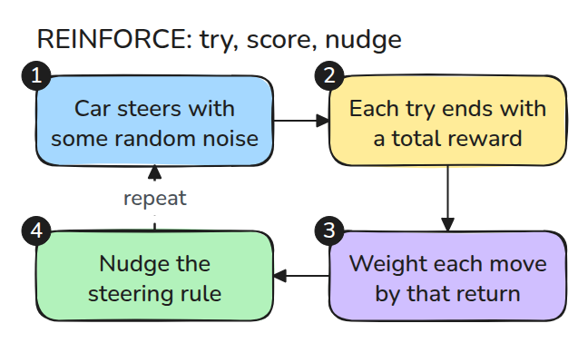
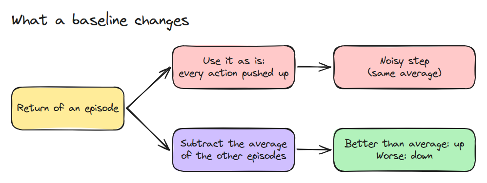
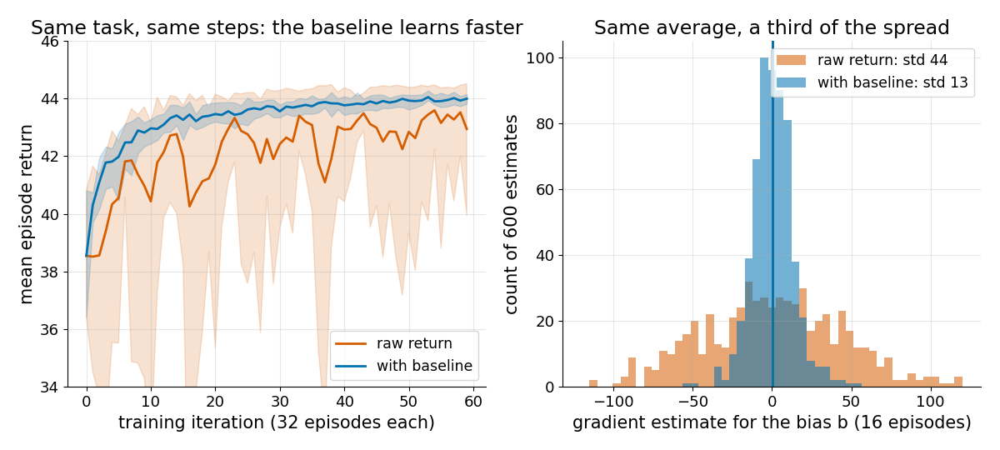

# Policy Gradients

> Learn how a robot can improve from points alone, with no teacher, and why the learning wobbles.

**Type:** Build   **Prerequisites:** 13/01 Imitation from Demonstrations   **Time:** ~15 minutes

## In Plain Words

A toy car must stop on a line, and nobody tells it how. Each try earns points, more when it ends nearer the line. You change its steering rule so moves from high-scoring tries become more likely.

## Key Terms

- **Reward-to-go**: the points collected from now until the end of the try.
- **Return**: the total points of one try.
- **Episode**: one try from start to finish.
- **Policy gradient**: nudging the policy toward moves that scored above average.
- **Baseline**: an average subtracted from the score so good moves stand out.
- **Variance**: how much an estimate jumps around between runs.

## The Problem

A toy car must stop on a line and nobody can show it how. You can only score each try. Random tries score wildly, so two training runs with the same settings can look very different.

## The Concept

When no expert exists, trial and error with a score is the only teacher a robot has. The car tries random moves and nudges its steering toward the ones that scored well. If every try scores big, every move is pushed up and the real differences hide. Subtracting the other tries' average fixes that.



*Try random moves, add up the points, and nudge the steering toward what scored well.*



*When every score is big, every move is pushed up. A baseline keeps only the differences.*



*Left: learning with a baseline climbs steadily, without it wobbles. Right: the baseline makes the nudges much steadier.*


*Blue arrows are all about equal. After subtracting the average, green arrows push up and red arrows push down.*

<details><summary>The math (optional)</summary>

The policy is a Gaussian (a bell-shaped random choice): the car steers near `w*x + b` plus exploration noise. Multiplying each action's nudge direction (`score()`) by the return and averaging estimates the gradient of expected return. Four tries from one start return 35.93, 34.91, 27.63 and 27.26, so all four are pushed up, the best only 32% harder than the worst. With the baseline (the average of the other three) the pushes become +6.0, +4.6, -5.1 and -5.6. Over ten seeds the baseline cuts the spread to about a third. The task is a 1-D reach: `x' = x + 0.2*a`, with reward `3 - x'^2 - 0.01*a^2` per step. The arrows in the clip are drawn 4 times longer.

</details>

## Build It

The car steers along a line toward a goal. The baseline for each try is the average reward-to-go of the other tries, so it never sees its own move.

```python
G = np.array([reward_to_go(r) for _, _, r in eps])
b = (G.sum(0) - G) / (batch - 1) if baseline else np.zeros_like(G)
g += sum(score(theta, x, a) * (G[i, t] - b[i, t]) for t, (x, a) in enumerate(zip(xs, acts)))
```

Tests check the nudge direction against a slow, simple calculation.

```bash
cd robotics-engineering-from-scratch
python3 -m pytest phases/13-learning-for-robots/03-policy-gradients -q
python3 phases/13-learning-for-robots/03-policy-gradients/code/figure.py
```

## Use It

Compare how much the nudges jump around across runs before comparing final scores.

Sources: OpenAI Spinning Up, "Intro to Policy Optimization", opened 2026-11-09.

## Ship It

`outputs/skill-policy-gradient-debug.md` lists what to measure when a run is unstable.

## Exercises

1. Try a much bigger flat bonus. How does the gap between the two methods change?
2. Make the amount of randomness learnable too.
3. Use the average of all tries as the baseline. Is it biased with only two tries?
