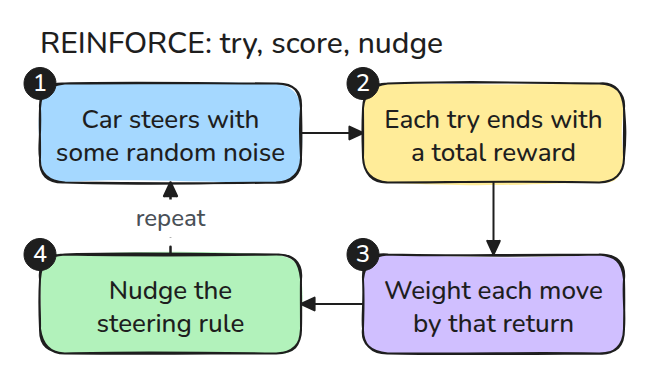
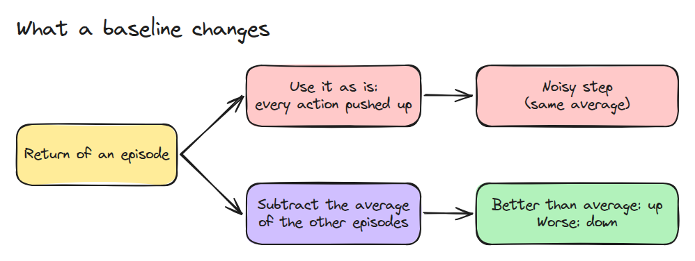
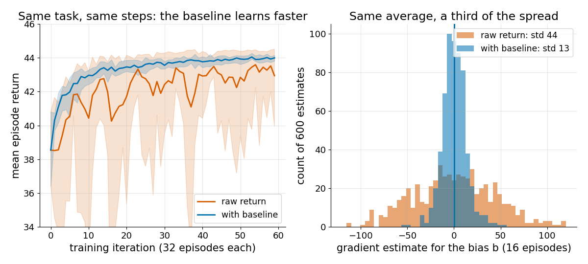

# 정책 경사 (Policy Gradients)

> 선생 없이 점수만으로 로봇이 나아지는 방법과 학습이 흔들리는 이유를 배웁니다.

**유형:** 만들기   **선수 지식:** 13/01 시연으로부터의 모방   **시간:** 약 15분

## 쉽게 말하면

장난감 자동차가 선 위에 멈춰야 하는데 방법은 아무도 알려 주지 않아요. 시도마다 선에 가까이 멈출수록 높은 점수를 줘요. 점수가 높았던 시도의 움직임이 더 자주 나오도록 조향 규칙을 바꿔요.

시도마다 똑같은 기본 점수를 받으면 모든 움직임이 올라가고 작은 차이는 묻혀요. 다른 시도들의 평균 점수를 빼면 평균보다 나은 움직임은 올라가고 못한 움직임은 내려가요.

## 핵심 용어

- **Reward-to-go**: 현재 step부터 에피소드 끝까지 받는 reward의 합입니다.
- **Return**: 에피소드 하나에서 받은 reward의 합입니다.
- **Episode**: 처음부터 끝까지 한 번 해 보는 시도입니다.
- **Policy gradient**: 평균보다 높은 return을 받은 행동 쪽으로 policy의 숫자를 미는 방법입니다.
- **Baseline**: 추정을 안정시키려고 return에서 빼는 평균입니다.
- **Variance**: 추정값이 실행마다 튀는 정도입니다.

## 문제

장난감 자동차가 선 위에 멈춰야 하는데 아무도 방법을 보여 줄 수 없고 시도마다 점수만 줄 수 있습니다. 무작위 시도는 점수가 들쭉날쭉해서 같은 설정으로 학습해도 두 실행이 전혀 다르게 보일 수 있습니다.

## 개념

전문가가 없을 때 로봇의 선생은 점수를 받는 시행착오뿐입니다.



*행동을 뽑아 reward를 더하고 각 행동의 미는 방향에 return을 곱한 뒤 `w`와 `b`를 바꿉니다.*

policy는 Gaussian(종 모양으로 무작위하게 고르는 분포)이고 자동차는 `w*x + b` 근처로 조향하면서 탐험 noise를 더합니다. 행동마다 미는 방향(`score()`)에 return을 곱해 평균하면 기대 return의 gradient를 추정할 수 있습니다.



*모든 return이 크면 행동이 전부 위로 밀리고 신호가 묻힙니다. baseline은 이 퍼짐을 줄입니다.*



*왼쪽은 baseline을 쓴 실행은 꾸준히 오르고 raw 실행은 흔들리는 모습입니다(seed 열 개, 각각 무작위 값이 다른 반복). 오른쪽은 baseline이 퍼짐을 약 3분의 1로 줄이는 모습입니다.*

같은 출발점에서 한 시도 네 번의 return은 35.93, 34.91, 27.63, 27.26입니다. 그대로 쓰면 네 시도가 모두 위로 밀리고 가장 좋은 시도도 가장 나쁜 시도보다 32%만 더 세게 밀립니다.
baseline을 빼면 밀리는 힘은 +6.0, +4.6, -5.1, -5.6이 됩니다.


*처음에는 파란 화살표가 거의 같은 길이입니다. 그다음 화살표는 각 시도가 다른 시도들의 평균과 얼마나 다른지를 4배 길게 그린 것입니다. 초록은 위로 빨강은 아래로 갑니다.*

## 만들기

과제는 1차원 도달입니다. 조향 `a`가 자동차를 `x`에서 `x' = x + 0.2*a`로 옮기고 step마다 `3 - x'^2 - 0.01*a^2`의 reward를 줍니다.
에피소드 `i`의 baseline은 다른 에피소드들의 reward-to-go 평균이라서 자기 행동을 보지 않습니다.

```python
G = np.array([reward_to_go(r) for _, _, r in eps])
b = (G.sum(0) - G) / (batch - 1) if baseline else np.zeros_like(G)
g += sum(score(theta, x, a) * (G[i, t] - b[i, t]) for t, (x, a) in enumerate(zip(xs, acts)))
```

`score()`는 테스트에서 유한 차분과 대조합니다.

```bash
cd robotics-engineering-from-scratch
python3 -m pytest phases/13-learning-for-robots/03-policy-gradients -q
python3 phases/13-learning-for-robots/03-policy-gradients/code/figure.py
```

## 실제 도구로 보기

최종 return을 비교하기 전에 seed 사이의 gradient 분산부터 비교하세요.

출처: OpenAI Spinning Up, "Intro to Policy Optimization". 2026년 11월 9일에 열어 확인했습니다.

## 결과물

`outputs/skill-policy-gradient-debug.md`는 실행이 불안정할 때 무엇을 잴지 정리한 목록입니다.

## 연습 문제

1. `BONUS`를 0과 10으로 두고 raw와 baseline의 차이를 그리세요.
2. `SIGMA`를 학습 파라미터로 바꾸고 그 `score()` 항을 유도하세요.
3. 전체 에피소드 평균을 baseline으로 쓰고 `batch=2`에서 편향을 검증하세요.
