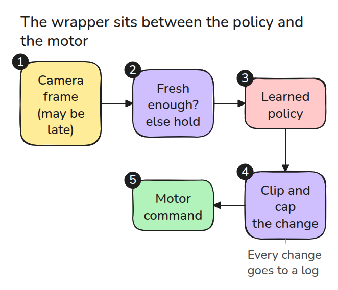
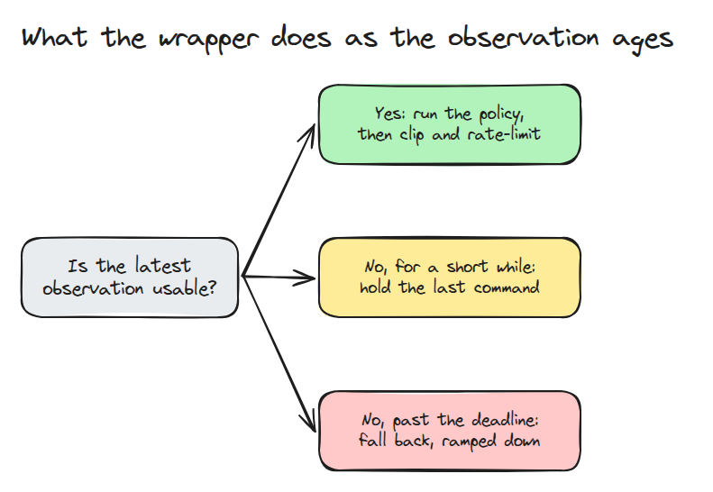
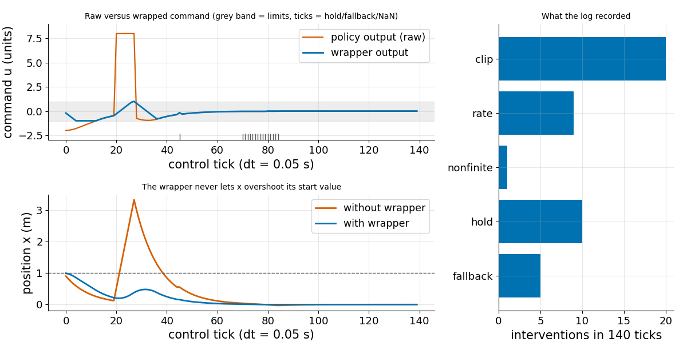

# A Safety Wrapper for Learned Policies

> Learn how to put a simple, checkable guard between a learned model and a motor.

**Type:** Build   **Prerequisites:** 13/02 Behaviour Cloning Pitfalls   **Time:** ~15 minutes

## In Plain Words

A toy car takes speed commands from a learned policy that sometimes shouts nonsense. A safety wrapper before the motor keeps the command small and slow to change.

If the camera frame is old, the wrapper repeats the last command, then eases the car to a stop.

## Key Terms

- **Safety wrapper**: a fixed layer between a policy and the motor that limits every command.
- **Tick**: one control step, one round of look, decide, command.
- **Clip**: cut a value so it stays inside a range.
- **Rate limit**: a cap on how much a command may change in one tick.
- **Fallback**: the safe command used when the picture is too old. Here it is a stop.
- **Fuzzing**: throwing many random inputs at code to see if it breaks.

## The Problem

A learned model drives a toy car. Now and then it outputs nonsense such as NaN (not a number) or a huge speed, or the camera freezes and it acts on an old picture. That command reaches the motor at full speed.

## The Concept

A learned model can surprise you, so a robot that can hurt someone needs a guard that never surprises. The wrapper is a few plain lines of code. It checks how old the picture is, clips the command to a safe range and limits how fast the command may change. Because it is plain, you can test it hard.



*Check the picture's age, run the policy only on a fresh picture, then clip and slow down the command.*



*A short gap: repeat the last command. A long gap: slide down to a stop.*



*Without the wrapper a flipped-sign burst throws the car far past its target. With it the car barely moves.*


*The amber arrow is the command the motor gets. Blue gets the raw nonsense and is thrown backward. Green's stays small.*

<details><summary>The math (optional)</summary>

A tick lasts 0.05 s. A gap past the 10-tick deadline ramps down to the fallback. A point should go from x = 1 to 0, but a sign-flipped burst throws it to about 3.3. With the wrapper x never exceeds 1, and 45 interventions are logged. At tick 20 the policy, until then steering home at -0.48, shouts 8.0 for 8 ticks with flipped sign. The wrapper clips it to 1.0 and lets the command rise only 0.2 per tick: -0.28, -0.08, 0.12. The wrapped car moves from x = 0.22 to 0.38. Without it the car goes from 0.12 to 3.32.

</details>

## Build It

`act()` rejects a stale picture, calls the policy, replaces NaN or infinity, clips and limits the change.

```python
raw = policy(obs)
target = fallback if not np.isfinite(raw) else float(np.clip(raw, lo, hi))
out = float(np.clip(target, last_out - max_step, last_out + max_step))
```

The fuzz test sends 2000 random commands, NaN included, and checks every output obeys both limits.

```bash
cd robotics-engineering-from-scratch
python3 -m pytest phases/13-learning-for-robots/04-learned-policy-safety-wrapper -q
python3 phases/13-learning-for-robots/04-learned-policy-safety-wrapper/code/figure.py
```

## Use It

Real controllers ship limiters, such as the ROS 2 `joint_limits` package. Put the age check in front of it.

Sources: ROS Index, `joint_limits` (index.ros.org/p/joint_limits), opened 2026-11-09.

## Ship It

`outputs/skill-policy-safety-wrapper.md` reviews a policy-to-motor layer.

## Exercises

1. Add a speed-dependent limit and fuzz it.
2. Slide the fallback to zero over a different number of ticks.
3. Replay a recorded policy log through `Wrapper.act`.
