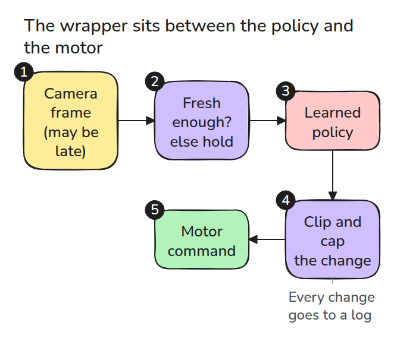
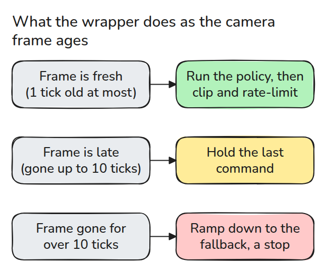
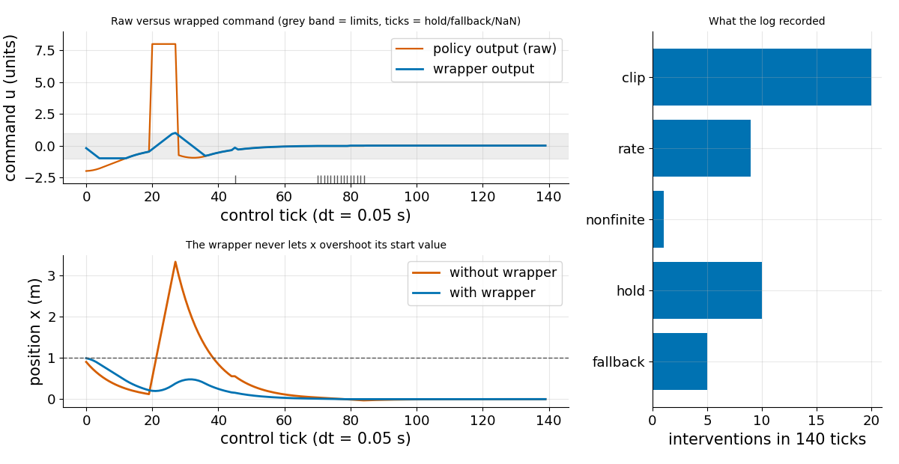

# A Safety Wrapper for Learned Policies

> A learned policy can output anything. The layer after it must be deterministic and must not care what it outputs.

**Type:** Build   **Prerequisites:** 13/02 Behaviour Cloning Pitfalls   **Time:** ~15 minutes

## In Plain Words

A toy car takes its speed commands from a learned policy that sometimes shouts nonsense, such as a flipped sign or NaN (not a number). A safety wrapper sits between the policy and the motor. Whatever the policy says, it keeps the command small and slow to change.

If the camera frame is old, the wrapper repeats the last command briefly, then eases the car to a stop. The commands become predictable, but no motion is proved safe.

## The Problem

A policy trained on demonstrations outputs a command every tick (one control step), with no promise that it is finite, small, smooth or based on a recent observation. One spike, one NaN or one frozen camera frame reaches the motor at full speed. A neural network cannot be tested into safety, but a short deterministic layer can.

## The Concept



*Follow the numbers. The wrapper checks the frame's age, runs the policy only on a fresh frame, then clips (cuts to a range) and rate-limits (caps the change per tick) the output.*

The policy may differ from run to run. The wrapper never does: the same inputs always give the same output and log, so asserts (rule checks) and fuzzing (random inputs thrown at it) can test it.



*A short gap holds the last command. A gap past the 10-tick deadline ramps down to the fallback, here a stop.*



*A point should go from x = 1 to 0. Without the wrapper a sign-flipped burst throws it to x of about 3.3. With it, x never exceeds 1, and the log counts 45 interventions.*

A tick lasts 0.05 s; the car's position `x` (distance from the stop mark) changes by command times 0.05: a negative command drives toward the mark, a positive one away. At tick 20 the policy, until then steering home at -0.48, shouts 8.0, an 8-tick burst with flipped sign. The wrapper clips it to 1.0 and lets the command rise only 0.2 per tick: -0.28, -0.08, 0.12. The wrapped car (slowed earlier by limits) moves from x = 0.22 to 0.38. Without it the car gets 8.0 every tick and goes from 0.12 to 3.32.


*Watch the amber arrow on each car, the command the motor receives. Blue gets the raw 8.0 and is thrown backward. Green's arrow stays short: the wrapper caps it at 1.0 and 0.2 per tick.*

## Build It

`act()` runs these steps in order: reject a stale or missing observation, call the policy, replace a non-finite value (NaN or infinity), clip, and limit the change.

```python
raw = policy(obs)
target = fallback if not np.isfinite(raw) else float(np.clip(raw, lo, hi))
out = float(np.clip(target, last_out - max_step, last_out + max_step))
```

The fuzz test sends 2000 random commands, including NaN and infinity, and asserts every output obeys both limits.

```bash
cd robotics-engineering-from-scratch
python3 -m pytest phases/13-learning-for-robots/04-learned-policy-safety-wrapper -q
python3 phases/13-learning-for-robots/04-learned-policy-safety-wrapper/code/figure.py
```

## Use It

Real controllers ship limiters: the ROS 2 `joint_limits` package provides joint-limit interfaces and a saturation limiter for position, velocity and acceleration. Put the wrapper's age check and log in front of it.

Sources: ROS Index, `joint_limits` package page (index.ros.org/p/joint_limits), opened 2026-11-09.

## Ship It

`outputs/skill-policy-safety-wrapper.md` is a review checklist for the layer between a learned policy and the motor.

## Exercises

1. Add a velocity-dependent limit with its fuzz test.
2. Ramp the fallback to zero in `n` ticks and check `n` against the stopping distance.
3. Replay a recorded policy log through `Wrapper.act`; list the first intervention.
