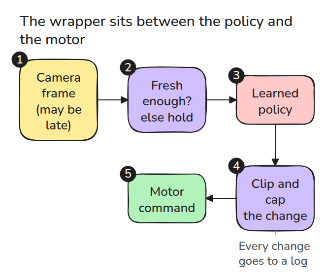
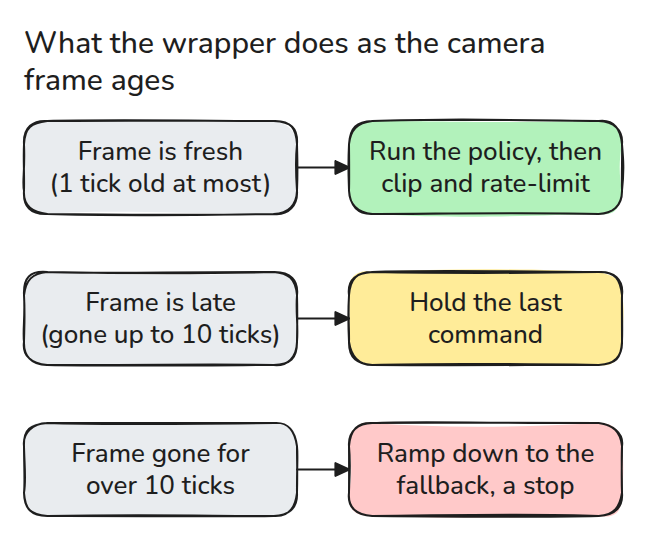
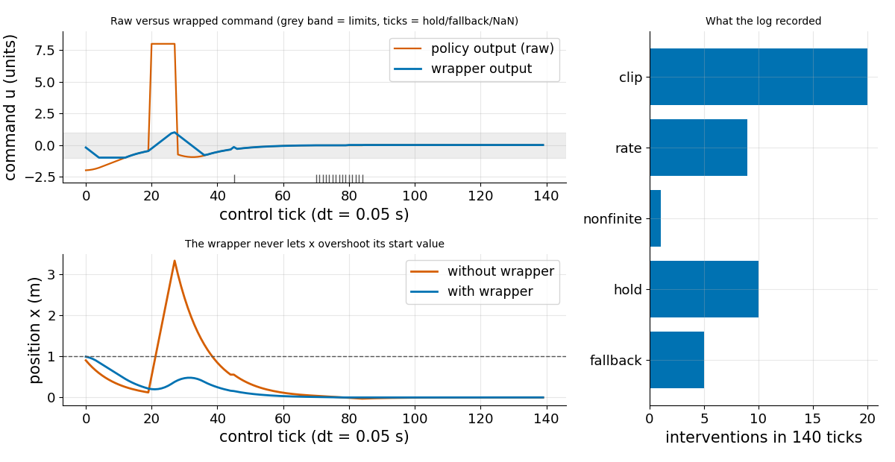

# 학습된 policy를 위한 안전 wrapper (Safety Wrapper)

> 학습된 policy는 무엇이든 출력할 수 있습니다. 그 뒤의 층은 결정론적이어야 하고 policy가 무엇을 출력하든 흔들리지 않아야 합니다.

**유형:** 만들기   **선수 지식:** 13/02 행동 복제의 함정   **시간:** 약 15분

## 쉽게 말하면

장난감 자동차의 속도 명령은 학습된 policy가 내는데 이 policy는 가끔 부호가 뒤집히거나 NaN(숫자가 아님)처럼 엉뚱한 값을 내요. safety wrapper는 policy와 모터 사이에 놓여서 policy가 무엇을 내든 명령을 작게 하고 천천히 바뀌게 해요.

카메라 영상이 오래됐으면 wrapper는 잠깐 마지막 명령을 되풀이하다가 자동차를 서서히 멈춰 세워요. 명령은 예측 가능해지지만 어떤 움직임이 안전하다고 증명되지는 않아요.

## 문제

시연으로 학습한 policy는 매 tick(제어 한 번의 주기) 명령을 내지만 그 명령이 유한하고 작고 매끄럽고 최근 관측에 근거한다는 보장은 없습니다.
spike 하나, NaN 하나, 얼어붙은 카메라 프레임 하나가 최대 속도로 모터에 닿습니다. 신경망을 테스트로 안전하게 만들 수는 없지만 짧고 결정론적인 층은 테스트할 수 있습니다.

## 개념



*번호를 따라가 보세요. wrapper는 카메라 프레임이 얼마나 오래됐는지 보고 신선한 프레임에서만 policy를 돌립니다. 그다음 출력을 clip(범위 안으로 자르기)하고 rate limit(tick 한 번에 바뀌는 크기 제한)을 겁니다.*

policy는 실행마다 달라질 수 있습니다. wrapper는 절대 그렇지 않아서 같은 입력에는 항상 같은 출력과 같은 로그가 나옵니다. 그래서 평범한 assert(규칙 검사)와 fuzzing(무작위 입력을 마구 던지는 시험)으로 테스트할 수 있습니다.



*짧은 공백에는 마지막 명령을 유지합니다. 마감 시한(10 tick)을 넘기면 fallback, 여기서는 정지로 서서히 내립니다.*



*점이 x = 1에서 0으로 가야 합니다. wrapper가 없으면 부호가 뒤집힌 burst가 x를 약 3.3까지 던집니다. wrapper가 있으면 x는 1을 넘지 않고 로그에는 개입 45건이 기록됩니다.*

tick 한 번은 0.05초이고 자동차의 위치 `x`(정지 표시선으로부터의 거리)는 명령에 0.05를 곱한 만큼 바뀝니다. 명령이 음수이면 표시선 쪽으로 가고 양수이면 멀어집니다.
tick 20에 지금까지 -0.48로 표시선 쪽을 향하던 policy가 8.0을 냅니다. 부호가 뒤집힌 burst가 8 tick 동안 이어지는 시작입니다.
wrapper는 이 값을 1.0으로 clip하고 명령이 tick마다 0.2씩만 오르게 해서 -0.28, -0.08, 0.12가 됩니다.
wrapper가 있는 자동차는 앞서 제한 때문에 느려진 채로 x = 0.22에서 0.38까지만 움직입니다. wrapper가 없으면 자동차는 tick마다 8.0을 받아서 0.12에서 3.32까지 날아갑니다.


*각 자동차 위의 주황색 화살표는 모터가 받는 명령입니다. 파랑 자동차는 원래 값 8.0을 받아 뒤로 튕겨 나갑니다. 초록 자동차의 화살표는 짧게 머뭅니다. wrapper가 명령을 1.0으로 막고 tick마다 0.2씩만 바뀌게 하기 때문입니다.*

## 만들기

`act()`는 다음 순서로 처리합니다. 오래되었거나 없는 관측을 거르고 policy를 부르고 유한하지 않은 값(NaN이나 무한대)을 바꾸고 clip하고 변화량을 제한합니다.

```python
raw = policy(obs)
target = fallback if not np.isfinite(raw) else float(np.clip(raw, lo, hi))
out = float(np.clip(target, last_out - max_step, last_out + max_step))
```

fuzz 테스트는 NaN과 무한대를 포함한 무작위 명령 2000개를 보내고 모든 출력이 두 제한을 지키는지 assert합니다.

```bash
cd robotics-engineering-from-scratch
python3 -m pytest phases/13-learning-for-robots/04-learned-policy-safety-wrapper -q
python3 phases/13-learning-for-robots/04-learned-policy-safety-wrapper/code/figure.py
```

## 실제 도구로 보기

실제 제어기에는 이미 limiter가 들어 있습니다.
ROS 2 `joint_limits` 패키지는 joint limit 인터페이스와 위치와 속도와 가속도를 위한 saturation limiter를 제공합니다.
wrapper의 나이 검사와 로그는 그 앞에 놓습니다. 그것을 대신하지 않습니다.

출처: ROS Index, `joint_limits` 패키지 페이지(index.ros.org/p/joint_limits). 2026년 11월 9일에 열어 확인했습니다.

## 결과물

`outputs/skill-policy-safety-wrapper.md`는 학습된 policy와 모터 사이의 층을 검토하는 체크리스트입니다.

## 연습 문제

1. 속도에 따라 달라지는 제한을 추가하고 그 fuzz 테스트를 쓰세요.
2. fallback이 `n` tick 동안 0으로 내려가게 하고 `n`이 정지 거리와 맞는지 확인하세요.
3. 기록된 policy 로그를 `Wrapper.act`에 다시 넣어 첫 개입을 찾으세요.
