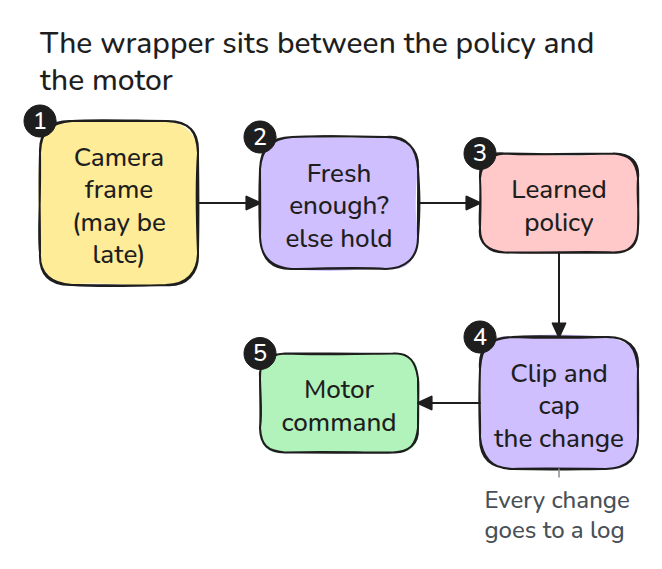
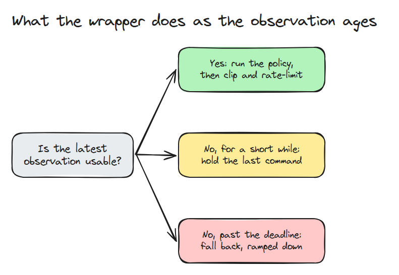
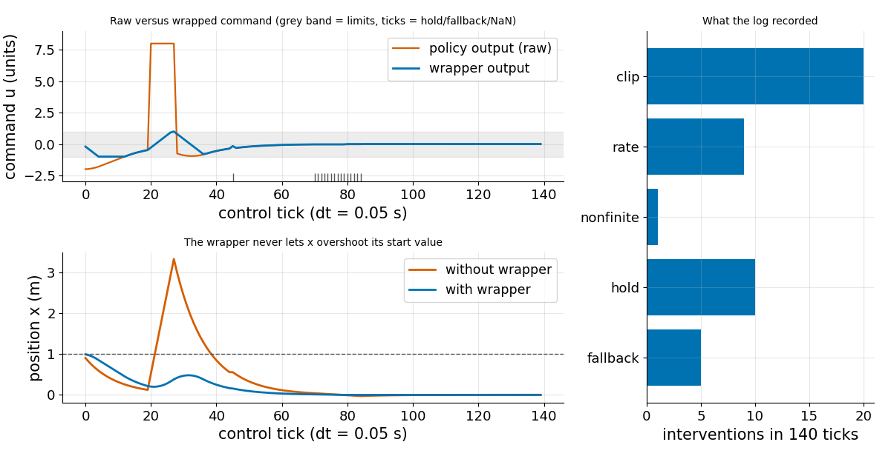

# 학습된 policy를 위한 안전 wrapper (Safety Wrapper)

> 학습된 모델과 모터 사이에 단순하고 검증할 수 있는 안전 장치를 두는 법을 배웁니다.

**유형:** 만들기   **선수 지식:** 13/02 행동 복제의 함정   **시간:** 약 15분

## 쉽게 말하면

장난감 자동차의 속도 명령은 학습된 policy가 내는데 이 policy는 가끔 부호가 뒤집히거나 NaN(숫자가 아님)처럼 엉뚱한 값을 내요. safety wrapper는 모터 앞에서 명령을 작게 하고 천천히 바뀌게 해요.

카메라 영상이 오래됐으면 wrapper는 마지막 명령을 되풀이하다가 자동차를 서서히 멈춰 세워요.

## 핵심 용어

- **Safety wrapper**: policy와 모터 사이에 놓여 모든 명령을 제한하는 고정된 층입니다.
- **Tick**: 제어 한 번의 주기입니다.
- **Clip**: 값을 범위 안으로 잘라 넣는 것입니다.
- **Rate limit**: tick 한 번에 명령이 바뀔 수 있는 크기의 상한입니다.
- **Fallback**: 관측이 오래됐을 때 쓰는 안전한 명령입니다. 여기서는 정지입니다.
- **Fuzzing**: 코드가 깨지는지 보려고 무작위 입력을 마구 던지는 시험입니다.

## 문제

학습된 모델이 장난감 자동차를 몰다가 가끔 NaN(숫자가 아님)이나 터무니없는 속도를 내거나 카메라가 얼어붙어 낡은 화면으로 계속 움직입니다. 그 명령이 최대 속도로 모터에 닿습니다. 모델을 테스트로 안전하게 만들 수는 없지만 짧고 평범한 층은 테스트할 수 있습니다.

## 개념

학습된 모델은 예상 밖의 일을 하므로 사람을 다치게 할 수 있는 로봇에는 절대 예상 밖의 일을 하지 않는 안전 장치가 필요합니다.



*프레임이 얼마나 오래됐는지 보고 신선한 프레임에서만 policy를 돌린 뒤 clip하고 rate limit을 겁니다.*

wrapper는 달라지지 않아서 같은 입력에는 항상 같은 출력과 같은 로그가 나옵니다. 그래서 assert(규칙 검사)와 fuzzing으로 테스트할 수 있습니다.



*짧은 공백에는 마지막 명령을 유지합니다. 10 tick을 넘기면 fallback으로 서서히 내립니다.*



*점이 x = 1에서 0으로 가야 합니다. wrapper가 없으면 부호가 뒤집힌 burst가 x를 약 3.3까지 던집니다. wrapper가 있으면 x는 1을 넘지 않고 개입 45건이 기록됩니다.*

tick 20에 지금까지 -0.48로 표시선 쪽을 향하던 policy가 부호가 뒤집힌 8.0을 8 tick 동안 냅니다. wrapper는 이 값을 1.0으로 clip하고 명령이 tick마다 0.2씩만 오르게 해서 -0.28, -0.08, 0.12가 됩니다.
wrapper가 있는 자동차는 x = 0.22에서 0.38까지만 움직입니다. wrapper가 없으면 0.12에서 3.32까지 날아갑니다.


*주황색 화살표는 모터가 받는 명령입니다. 파랑 자동차는 원래 값 8.0을 받아 뒤로 튕겨 나갑니다. 초록 자동차의 화살표는 제한된 채 머뭅니다.*

## 만들기

`act()`는 오래되었거나 없는 관측을 거르고 policy를 부르고 유한하지 않은 값(NaN이나 무한대)을 바꾸고 clip하고 변화량을 제한합니다.

```python
raw = policy(obs)
target = fallback if not np.isfinite(raw) else float(np.clip(raw, lo, hi))
out = float(np.clip(target, last_out - max_step, last_out + max_step))
```

fuzz 테스트는 NaN과 무한대를 포함한 무작위 명령 2000개를 보내고 모든 출력이 두 제한을 지키는지 assert합니다.

```bash
cd robotics-engineering-from-scratch
python3 -m pytest phases/13-learning-for-robots/04-learned-policy-safety-wrapper -q
python3 phases/13-learning-for-robots/04-learned-policy-safety-wrapper/code/figure.py
```

## 실제 도구로 보기

실제 제어기에는 이미 limiter가 들어 있습니다. ROS 2 `joint_limits`의 saturation limiter가 그 예입니다. wrapper의 나이 검사와 로그는 그 앞에 놓습니다.

출처: ROS Index, `joint_limits` 패키지 페이지(index.ros.org/p/joint_limits). 2026년 11월 9일에 열어 확인했습니다.

## 결과물

`outputs/skill-policy-safety-wrapper.md`는 학습된 policy와 모터 사이의 층을 검토합니다.

## 연습 문제

1. 속도에 따라 달라지는 제한을 추가하고 그 fuzz 테스트를 쓰세요.
2. fallback이 `n` tick 동안 0으로 내려가게 하고 `n`이 정지 거리와 맞는지 확인하세요.
3. 기록된 policy 로그를 `Wrapper.act`에 다시 넣으세요.
