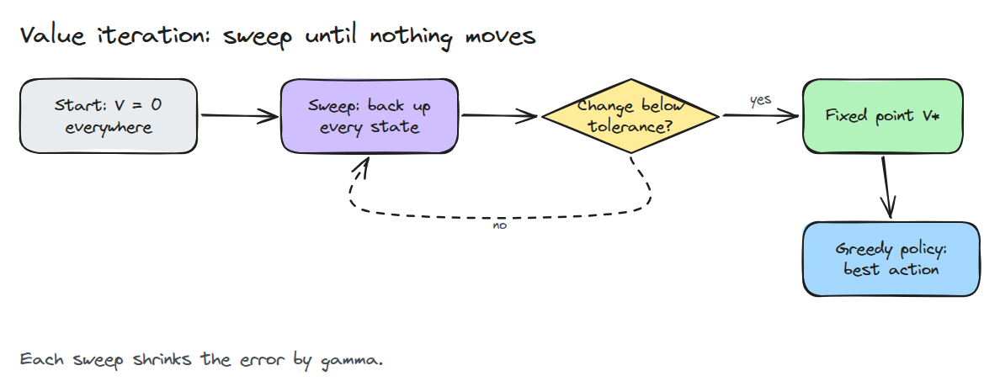
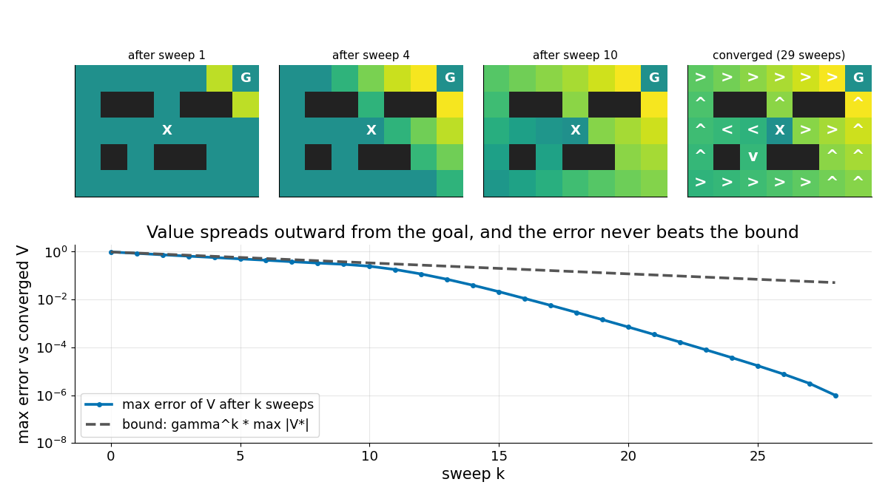

# MDPs and Value Iteration

> Learn how a robot can work out the best move in every square of a small slippery world.

**Type:** Build   **Prerequisites:** 09/05 Grid Search: Dijkstra to A*   **Time:** ~15 minutes

## In Plain Words

A rover drives on a slippery floor where one move in five slides sideways. A shortcut beside a pit can lose to a longer route.

An MDP lists each move's outcomes and chances. Value iteration scores a move by its reward now plus the value of where it may lead, and repeats until every tile has a best move.

## Key Terms

- **MDP**: Markov decision process. States, actions, transition chances and rewards.
- **Value `V(s)`**: the expected reward-to-go from state s, assuming the best actions afterwards.
- **Backup**: recomputing one state's value from its actions' rewards and next values.
- **Sweep**: one backup of every state.
- **Discount (gamma)**: a factor below one that shrinks later rewards, since sooner is better.
- **Greedy policy**: in each state, take the action with the best score.

## The Problem

A rover on a slippery floor sometimes slides into a pit. You want its best move in every square, as a yardstick for learned policies. On a small world you can compute the exact best.

## The Concept

A planning robot must weigh a sure small gain against a risky shortcut, and this does it with numbers.


*A backup scores each action by its reward now plus gamma times the value of its outcomes, and keeps the best.*

States are tiles and actions are moves. `P(s' | s, a)` is the chance of reaching tile s' from s by move a. Gamma is 0.9 here.



*Start at zero, back up every state, repeat.*



*Top: value spreads from the goal with every sweep. Bottom: the gap to the final values shrinks at least as fast as gamma to the k (k is the sweep number).*

Take the tile just right of the pit. After the first sweep, moving left scores -0.8 (chance 0.8 of the pit's -1) and moving right 0. After 29 sweeps right scores 0.64, up or down 0.43, left -0.68, so the arrow points right.


*Arrows show each move's score, blue above zero, red below.*

## Build It

Moves slip sideways with chance 0.2; the goal pays 1 and the pit -1.

```python
def backup(model, V, gamma):
    return model.r + gamma * model.P @ V      # Q[a, s]

V = backup(model, V, gamma).max(0)            # one sweep
pi = backup(model, V, gamma).argmax(0)        # greedy policy
```

Tests check contraction (each sweep shrinks the gap), the sweep bound and all 256 policies of a tiny grid. The kth change is at most `gamma**(k - 1)` times the first.

```bash
cd robotics-engineering-from-scratch
python3 -m pytest phases/13-learning-for-robots/05-mdps-and-value-iteration -q
python3 phases/13-learning-for-robots/05-mdps-and-value-iteration/code/figure.py
```

## Use It

It needs the whole model, so it fails when the dynamics are unknown.

Sources: Sutton and Barto, *Reinforcement Learning: An Introduction*, section 4.4, opened 2026-11-10.

## Ship It

`outputs/skill-value-iteration-oracle.md` makes an exact reference policy for a small task.

## Exercises

1. Raise `slip` from 0.2 to 0.5. Where does the policy first avoid the pit?
2. Set `gamma` to 0.5 and compare the sweep count with the bound.
3. Compare 13/03's policy gradient with `V`.
