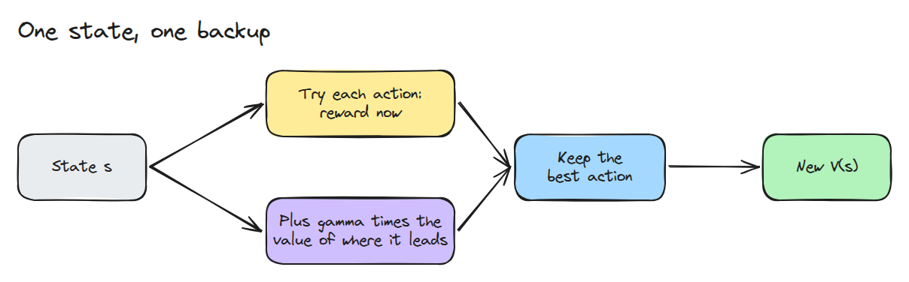
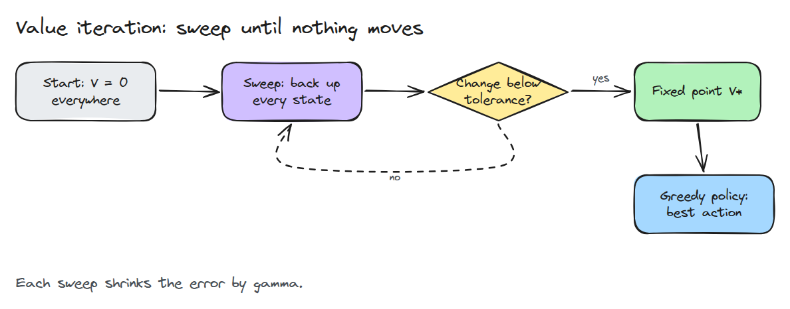
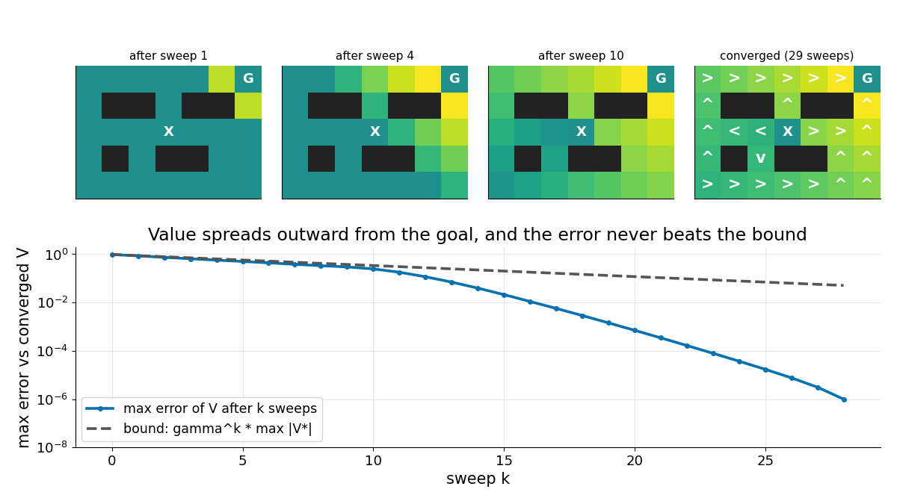

# MDPs and Value Iteration

> The value of a state is the best action's reward plus the discounted value of where it leads, and a few sweeps are enough to find it.

**Type:** Build   **Prerequisites:** 09/05 Grid Search: Dijkstra to A*   **Time:** ~15 minutes

## In Plain Words

A maze game sometimes slips your piece sideways instead of moving where you ask. A shortcut beside a pit may then be worse than a
longer route.

An MDP records those possible outcomes and their chances. Value iteration scores each move using its reward now plus the discounted
value of its possible destinations, averaged by their chances. Repeating this calculation spreads the goal's benefit and the pit's cost
through the maze, until each square has a preferred action.

## The Problem

In 13/03 a policy found its way from sampled returns, and you could only hope it was close to the best one. On a small problem you can know. When the robot's moves and rewards are written down, the best answer can be computed exactly, and then every learned policy has something to be measured against.

## The Concept



*Each action is scored by its reward now plus gamma times the value of its outcomes. The best score becomes the new value of the state.*

An MDP is states, actions, a transition chance `P(s' | s, a)` and a reward. The value `V(s)` is the reward-to-go from 13/03, averaged over chance and assuming the best actions from here on.



*Start at zero, back up every state, repeat. The converged values give the policy by taking the best action in each cell.*



*Top: value reaches farther from the goal with every sweep, and the pit repels paths. Bottom: the error shrinks at least as fast as gamma to the k.*

## Build It

The world is a grid where a move slips sideways with chance 0.2. Entering the goal pays 1 and a pit pays -1.

```python
def backup(model, V, gamma):
    return model.r + gamma * model.P @ V      # Q[a, s]

V = backup(model, V, gamma).max(0)            # one sweep
pi = backup(model, V, gamma).argmax(0)        # greedy policy
```

Tests check contraction, the sweep bound and all 256 policies of a tiny grid. For `0 < gamma < 1`, let `delta1 = max(abs(V1 - V0))`. The kth change is at most `gamma**(k - 1) * delta1`; choose the first k making this strictly below `tol`. This includes reward scale and the strict stopping rule.

```bash
cd robotics-engineering-from-scratch
python3 -m pytest phases/13-learning-for-robots/05-mdps-and-value-iteration -q
python3 phases/13-learning-for-robots/05-mdps-and-value-iteration/code/figure.py
```

## Use It

Libraries differ in layout and stopping rules, but the loop is the same. It needs the whole model, so it cannot run on a robot whose dynamics are unknown. Policy gradients exist for that case.

Sources: Sutton and Barto, *Reinforcement Learning: An Introduction*, 2nd ed. draft, section 4.4, opened 2026-11-10. It describes value iteration as policy evaluation stopped after one sweep, combined with improvement.

## Ship It

`outputs/skill-value-iteration-oracle.md` turns a small simulated task into an exact reference policy.

## Exercises

1. Raise `slip` from 0.2 to 0.5 and find where the policy first avoids the pit.
2. Set `gamma` to 0.5 and compare the sweep count with the bound.
3. Run 13/03's policy gradient on this grid and compare its return with `V` at the start cell.
