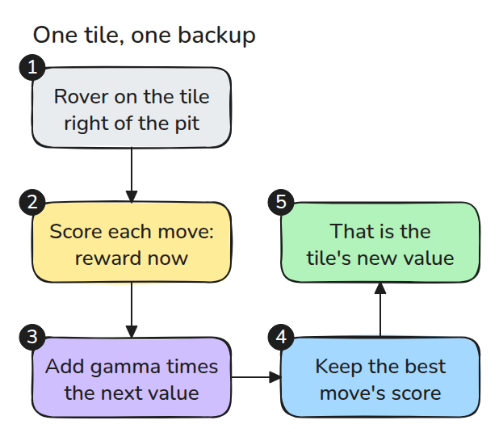

# MDPs and Value Iteration

> Learn how a robot can work out the best move in every square of a small slippery world.

**Type:** Build   **Prerequisites:** none   **Time:** ~15 minutes

## In Plain Words

A rover drives on a slippery floor where one move in five slides sideways. A shortcut beside a pit can lose to a longer route.

An MDP lists each move's outcomes and chances. Value iteration scores a move by its reward now plus how good the next square is, and repeats until every tile has a best move.

## Key Terms

- **MDP**: a list of squares, moves, the chances of each outcome, and rewards. The name is just a label.
- **Value `V(s)`**: how much reward you can expect from a square if you play the best moves afterwards.
- **Update**: recomputing one square's value from its moves and their outcomes.
- **Sweep**: one update of every square.
- **Discount (gamma)**: a number below one that makes later rewards count a little less.
- **Greedy policy**: at each square, take the move with the best score.

## The Problem

A rover on a slippery floor sometimes slides into a pit. You want its best move in every square, as a yardstick for learned policies.

## The Concept

A planning robot must weigh a sure small gain against a risky shortcut, and this does it with numbers. Give every square a value, how good it is to stand there. Update each square from its neighbours again and again. Good news spreads from the goal and bad news from the pit, until every square knows its best move.



*An update scores each move by its reward now plus the value of where it may lead, and keeps the best.*


*Start with all zeros, update every square, repeat.*


*Top: value spreads out from the goal, and the pit pushes paths away. Bottom: the gap to the final answer shrinks quickly.*

[](../assets/clip-example.mp4)

*Arrows show each move's score: blue is good, red is bad. The best turns green; the rover takes it.*

<details><summary>The math (optional)</summary>

One update sets `V(s) = max_a ( r(s, a) + gamma * sum_s' P(s' | s, a) * V(s') )`. Here `r` is the reward now and `P(s' | s, a)` the chance that move `a` from square `s` lands in square `s'`. The update is also called a backup. Gamma is 0.9 here, so one sweep shrinks the worst-case error by a factor 0.9. Moves slip sideways with chance 0.2; the goal pays 1 and the pit -1. Next to the pit, after the first sweep moving left scores -0.8 (chance 0.8 of the pit's -1) and moving right 0. After 29 sweeps right scores 0.64, up or down 0.43, left -0.68, so the arrow points right. For `0 < gamma < 1`, the kth change is at most `gamma**(k - 1)` times the first, so the sweep count is bounded. Tests check all 256 policies of a tiny grid.

</details>

## Build It

Each sweep scores every move in every square, then keeps the best.

```python
def backup(model, V, gamma):
    return model.r + gamma * model.P @ V      # Q[a, s]

V = backup(model, V, gamma).max(0)            # one sweep
pi = backup(model, V, gamma).argmax(0)        # greedy policy
```

Tests check that each sweep shrinks the gap to the final answer.

```bash
cd robotics-engineering-from-scratch
python3 -m pytest phases/13-learning-for-robots/05-mdps-and-value-iteration -q
python3 phases/13-learning-for-robots/05-mdps-and-value-iteration/code/figure.py
```

## Use It

It needs all the chances, so it fails when you do not know how the world behaves.

Sources: Sutton and Barto, *Reinforcement Learning: An Introduction*, section 4.4, opened 2026-11-10.

## Ship It

`outputs/skill-value-iteration-oracle.md` makes an exact reference policy for a small task.

## Exercises

1. Make the floor more slippery. When does the policy start to avoid the pit?
2. Lower gamma to 0.5 and count the sweeps.
3. Move the pit and see how the arrows change.
