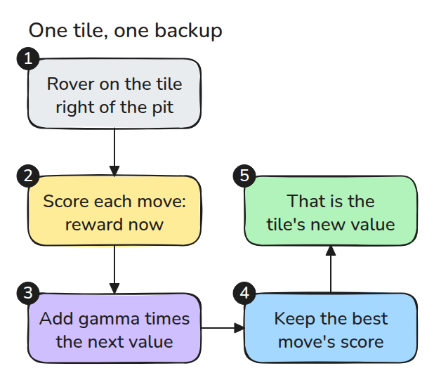
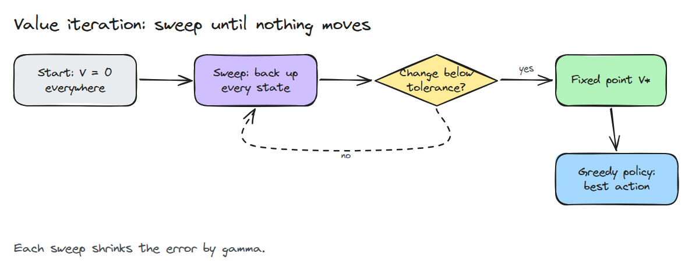
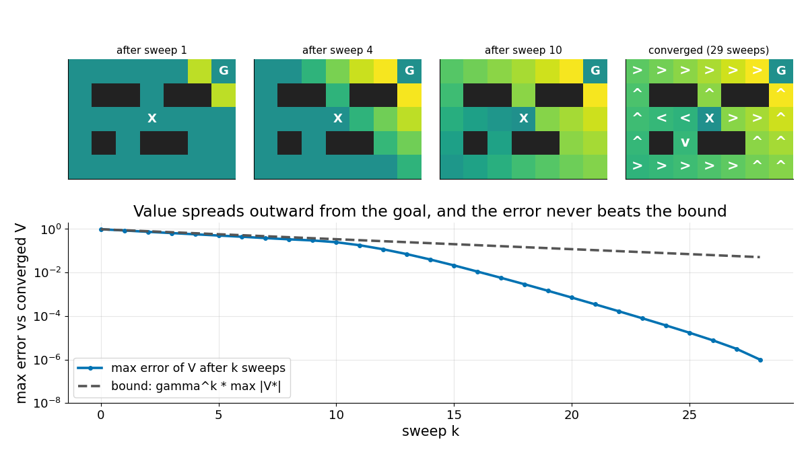

# MDP와 Value Iteration

> 미끄러운 작은 세계의 모든 칸에서 로봇이 최선의 움직임을 계산하는 법을 배웁니다.

**유형:** 만들기   **선수 지식:** 없음   **시간:** 약 15분

## 쉽게 말하면

로버가 미끄러운 바닥을 달리는데 다섯 번에 한 번쯤은 옆으로 미끄러져요. 구덩이 옆의 지름길이 돌아가는 길보다 나쁠 수 있어요.

MDP는 행동마다 가능한 결과와 그 확률을 적어 둔 거예요. value iteration은 행동의 점수를 지금 받는 reward에 다음 칸이 얼마나 좋은지를 더해서 정해요. 이걸 칸마다 가장 좋은 행동이 정해질 때까지 반복해요.

## 핵심 용어

- **MDP**: 칸, 행동, 각 결과의 확률, reward를 적어 둔 목록입니다. 이름은 그냥 이름표입니다.
- **Value `V(s)`**: 이후에 최선의 행동을 고른다고 할 때 그 칸에서 기대되는 reward입니다.
- **Update**: 한 칸의 value를 행동들과 그 결과로 다시 계산하는 일입니다.
- **Sweep**: 모든 칸을 한 번씩 update하는 것입니다.
- **Discount (gamma)**: 나중 reward를 조금 덜 쳐 주는 1보다 작은 수입니다.
- **Greedy policy**: 각 칸에서 점수가 가장 높은 행동을 고르는 policy입니다.

## 문제

미끄러운 바닥의 로버는 가끔 옆으로 미끄러져 구덩이에 빠집니다. 칸마다 최선의 움직임을 알고 싶습니다. 학습된 policy와 비교할 기준으로 쓰려는 것입니다.

## 개념

계획하는 로봇은 확실한 작은 이득과 위험한 지름길을 저울질해야 하는데 이 방법은 그 저울질을 숫자로 합니다. 모든 칸에 value, 곧 거기 서 있는 것이 얼마나 좋은지를 매깁니다. 각 칸의 value를 이웃 칸을 보고 거듭 갱신합니다.
목표의 좋은 소식과 구덩이의 나쁜 소식이 퍼지면서 모든 칸에서 최선의 행동이 정해집니다.



*update는 행동마다 지금의 reward에 그 행동이 이어질 칸의 value를 더해 점수를 매기고 가장 높은 점수를 남깁니다.*



*모두 0에서 시작해 모든 칸을 갱신하고 반복합니다.*



*위쪽은 value가 목표에서 퍼지고 구덩이가 경로를 밀어내는 모습입니다. 아래쪽은 최종 답과의 차이가 빠르게 줄어드는 모습입니다.*


*화살표는 각 이동의 점수이고 파랑은 좋고 빨강은 나쁩니다. 가장 좋은 화살표가 초록이 되면 로버가 그쪽으로 갑니다.*

<details><summary>The math (optional)</summary>

 s, a)`는 칸 s에서 행동 a로 칸 s'에 닿을 확률입니다.|`V(s)`는 칸 `s`의 value입니다. `P(s' | s, a)`는 칸 s에서 행동 a로 칸 s'에 닿을 확률입니다. 이 update를 backup이라고도 합니다.
| s, a)`는 칸 s에서 행동 a로 칸 s'에 닿을 확률입니다. gamma는 여기서 0.9이므로 sweep 한 번이 최악의 오차를 0.9배로 줄입니다. 이동은 확률 0.2로 옆으로 미끄러지고 목표는 +1, 구덩이는 -1을 줍니다.
구덩이 바로 오른쪽 칸에서 첫 sweep 뒤 왼쪽으로 가면 점수는 -0.8(확률 0.8로 구덩이의 -1)이고 오른쪽으로 가면 0입니다.
sweep 29번 뒤에는 오른쪽이 0.64, 위나 아래가 0.43, 왼쪽이 -0.68이라서 화살표는 오른쪽을 가리킵니다.
`0 < gamma < 1`에서 k번째 변화량은 첫 변화량의 `gamma**(k - 1)`배 이하이므로 sweep 횟수에는 상한이 있습니다. 테스트는 작은 격자의 policy 256개를 모두 확인합니다.

</details>

## 만들기

sweep마다 모든 칸의 모든 행동에 점수를 매기고 가장 좋은 것을 남깁니다.

```python
def backup(model, V, gamma):
    return model.r + gamma * model.P @ V      # Q[a, s]

V = backup(model, V, gamma).max(0)            # one sweep
pi = backup(model, V, gamma).argmax(0)        # greedy policy
```

테스트는 sweep마다 최종 답과의 차이가 줄어드는지 확인합니다.

```bash
cd robotics-engineering-from-scratch
python3 -m pytest phases/13-learning-for-robots/05-mdps-and-value-iteration -q
python3 phases/13-learning-for-robots/05-mdps-and-value-iteration/code/figure.py
```

## 실제 도구로 보기

이 방법은 모든 확률 목록이 필요해서 세계가 어떻게 움직이는지 모르면 쓸 수 없습니다.

출처: Sutton과 Barto, *Reinforcement Learning: An Introduction* 4.4절을 2026년 11월 10일에 열어 봤습니다.

## 결과물

`outputs/skill-value-iteration-oracle.md`는 작은 과제의 정확한 기준 policy를 만들어 줍니다.

## 연습 문제

1. 바닥을 더 미끄럽게 만드세요. policy는 언제부터 구덩이를 피하나요?
2. gamma를 0.5로 낮추고 sweep 횟수를 세세요.
3. 구덩이를 옮기고 화살표가 어떻게 바뀌는지 보세요.
