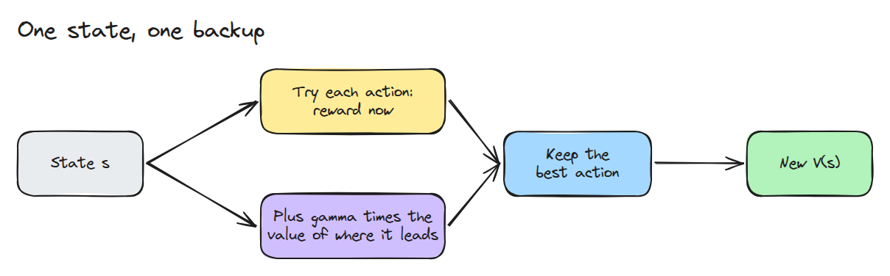
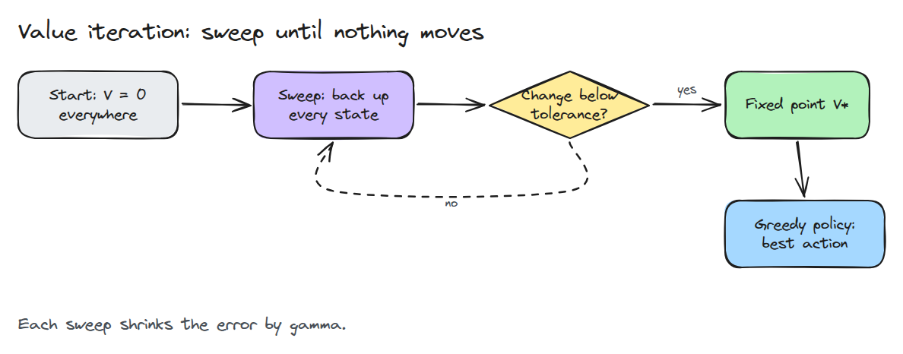
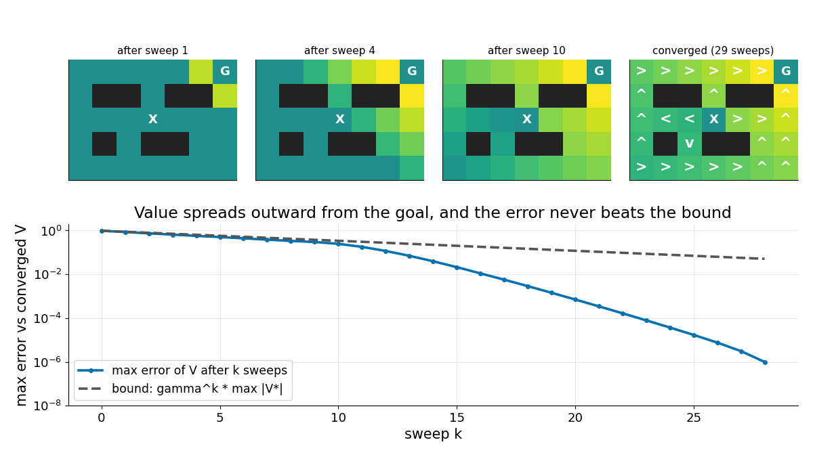

# MDP와 Value Iteration

> 상태의 value는 최선의 행동이 주는 보상에 그 행동이 이어 주는 곳의 할인된 value를 더한 값이고 몇 번의 sweep이면 찾습니다.

**유형:** 만들기   **선수 지식:** 09/05 격자 탐색   **시간:** 약 15분

## 쉽게 말하면

미로 게임에서 말을 움직였는데 가끔 옆 칸으로 미끄러진다고 해 보세요. 그러면 함정 옆의 지름길보다 돌아가는 길이 나을 수 있어요.

MDP는 행동의 가능한 결과와 그 확률을 기록해요. value iteration은 행동마다 지금의 보상과 다음 상태의 value에 discount factor를 곱한 값을 확률에 따라 평균해요. 그중 값이 가장 큰 행동을 골라요. 이
계산을 반복하면 목표의 이득과 함정의 손해가 먼 칸에도 전해져 각 칸에서 할 행동을 정할 수 있어요.

## 문제

13/03에서는 정책이 표본으로 얻은 return만 보고 길을 찾았고 그것이 최선에 가까운지는 믿는 수밖에 없었습니다. 작은 문제에서는 알 수 있습니다. 로봇의 움직임과 보상을 모두 적어 두면 최선의 답을 정확히 계산할 수 있고 그러면 학습된 정책마다 비교할 기준이 생깁니다.

## 개념



*행동마다 지금의 보상에 gamma 곱하기 결과 상태들의 value를 더해 점수를 냅니다. 가장 높은 점수가 그 상태의 새 value가 됩니다.*

MDP는 상태와 행동과 전이 확률 `P(s' | s, a)`과 보상으로 이루어집니다. value `V(s)`는 13/03의 reward-to-go를 확률로 평균한 값이고 이후에 최선의 행동을 고른다고 가정합니다.



*0에서 시작해 모든 상태를 backup하고 반복합니다. 수렴한 값에서 칸마다 최선의 행동을 고르면 정책이 나옵니다.*



*위쪽은 sweep마다 value가 목표에서 더 멀리 퍼지고 pit이 경로를 밀어내는 모습입니다. 아래쪽은 오차가 gamma의 k제곱 이상으로 빨리 줄어드는 모습입니다.*

## 만들기

세계는 격자이고 이동이 확률 0.2로 옆으로 미끄러집니다. 목표에 들어가면 +1, pit에 들어가면 -1을 받습니다.

```python
def backup(model, V, gamma):
    return model.r + gamma * model.P @ V      # Q[a, s]

V = backup(model, V, gamma).max(0)            # one sweep
pi = backup(model, V, gamma).argmax(0)        # greedy policy
```

테스트는 수축, sweep 상한, 작은 격자의 정책 256개를 확인합니다. `0 < gamma < 1`에서 `delta1 = max(abs(V1 - V0))`로 둡니다.

k번째 변화량은 `gamma**(k - 1) * delta1` 이하입니다. 이 상한이 `tol`보다 엄격히 작아지는 첫 k를 택하면 보상 크기와 종료 조건을 모두 반영합니다.

```bash
cd robotics-engineering-from-scratch
python3 -m pytest phases/13-learning-for-robots/05-mdps-and-value-iteration -q
python3 phases/13-learning-for-robots/05-mdps-and-value-iteration/code/figure.py
```

## 실제 도구로 보기

라이브러리마다 배치와 종료 조건은 다르지만 반복 구조는 같습니다. 모델 전체가 필요해서 동역학을 모르는 로봇에는 쓸 수 없습니다. 그 경우를 위해 policy gradient가 있습니다.

출처: Sutton과 Barto, *Reinforcement Learning: An Introduction* 2판 초안 4.4절을 2026년 11월 10일에 열어 봤습니다.
이 글은 value iteration을 한 번의 sweep에서 멈춘 policy evaluation과 개선을 합친 것으로 설명합니다.

## 결과물

`outputs/skill-value-iteration-oracle.md`는 작은 시뮬레이션 과제를 정확한 기준 정책으로 바꿔 줍니다.

## 연습 문제

1. `slip`을 0.2에서 0.5로 올리고 정책이 처음으로 pit을 피하는 지점을 찾으세요.
2. `gamma`를 0.5로 놓고 sweep 횟수를 상한과 비교하세요.
3. 이 격자에서 13/03의 policy gradient를 돌려 return을 시작 칸의 `V`와 비교하세요.
