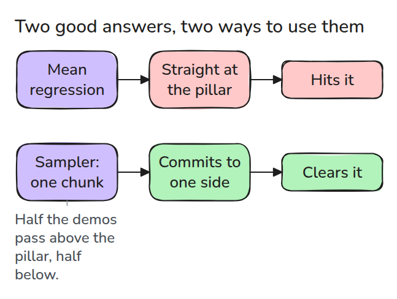
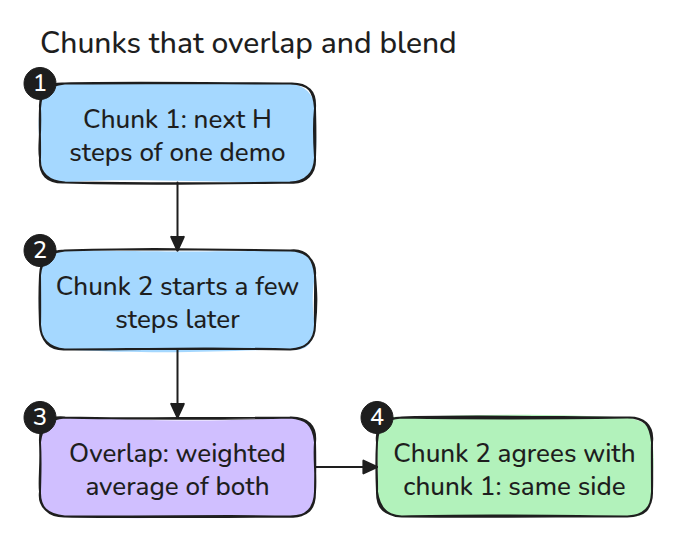
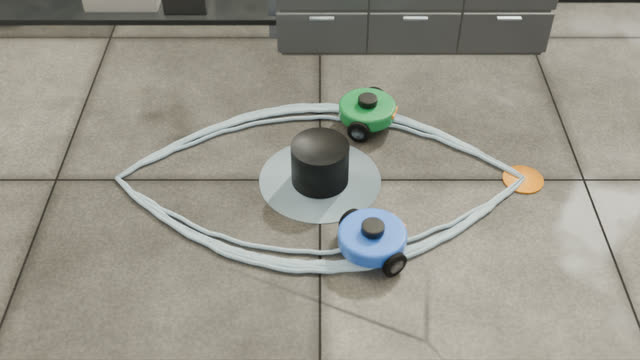

# Multimodal Demonstrations and Action Chunks

> Learn why a robot trained on two different good answers can pick a bad middle one, and how to make it pick one.

**Type:** Build   **Prerequisites:** 13/01 Imitation, 13/02 Cloning Pitfalls   **Time:** ~15 minutes

## In Plain Words

Half the example drives take a rover above a pillar and half below it. Both work, but averaging them steers straight at the pillar.

A chunk is the next few steps copied from one demonstration, so the rover commits to one side. Where chunks overlap, the old and new plans are blended. If the new one heads the other way, the blend goes straight at the pillar.

## Key Terms

- **Multimodal**: having several different correct answers, called modes.
- **Mean policy**: a rule that takes the average of the nearby demonstrated moves.
- **Action chunk**: the next few actions, chosen together.
- **Sampler**: picks one demonstration at random instead of averaging.
- **Wobble (jitter)**: how much the action changes from step to step. High wobble looks shaky.

## The Problem

Half your demonstrations steer a rover above the pillar, half below. Both are fine, but a policy that averages them drives straight into the pillar.

## The Concept

People solve one task in different ways, and a robot copying them must still pick one. Picking one demonstration avoids the bad average, but picking again every step can flip sides and wobble. So the robot follows a short chunk of the next few moves and picks new chunks matching the old plan.



*Both answers are right at the start, but their average is wrong.*



*A new chunk starts before the old one ends, and the overlap blends from old to new.*


*Left: the average goes straight through the pillar. Middle: sampling splits both ways round. Right: longer chunks wobble less.*

[](../assets/clip-example.mp4)

*Blue picks a demonstration every step and wobbles. Green follows chunks and glides.*

<details><summary>The math (optional)</summary>

At the start the two demonstrations steer +0.054 and -0.054 sideways, so the mean is 0. Over 50 runs, one-step sampling clears the pillar 98% of the time with jitter 0.034 per step. Chunks of 8 steps, a new one every 4, clear it 100% with jitter 0.011. With chunks of 2 or more, jitter falls under half and all 60 rollouts clear the pillar. Each demonstration's weight comes from a Gaussian kernel (a weight larger for demonstrations closer to where the robot is) on how close it passes. Without a `prefix` (the part of the old chunk the new one must match), the blend can head at the pillar. `SIGMA_A` sets how strongly a new chunk must agree with the old one. If the split is 5 to 1, the sampler goes over about five times in six.

</details>

## Build It

`mean_policy` averages nearby demonstrations. `sample_chunk` picks one demonstration instead and returns its next few actions.

```python
j = ((P[:, :-1] - x) ** 2).sum(2).argmin(1)            # nearest state in each demo
logw -= ((chunks[:, :len(prefix)] - prefix) ** 2).sum((1, 2)) / (2 * SIGMA_A**2)
a = w * new[k] + (1 - w) * old[k + stride]             # blend while chunks overlap
```

```bash
cd robotics-engineering-from-scratch
python3 -m pytest phases/13-learning-for-robots/06-multimodal-demos-and-action-chunks -q
python3 phases/13-learning-for-robots/06-multimodal-demos-and-action-chunks/code/figure.py
```

## Use It

Real robots use a neural network (a learning program) that outputs a whole chunk. A longer chunk reacts more slowly.

Sources (abstracts, 2026-11-10): Zhao et al., arXiv:2304.13705; Chi et al., arXiv:2303.04137.

## Ship It

`outputs/skill-multimodal-demo-check.md` finds modes a mean policy would average.

## Exercises

1. Make the demonstrations split 5 to 1. What does the average do?
2. Make `SIGMA_A` large, so chunks may disagree, and count test drives that hit the pillar.
3. Add noise to the actions. At which chunk length does the wobble stop falling?
