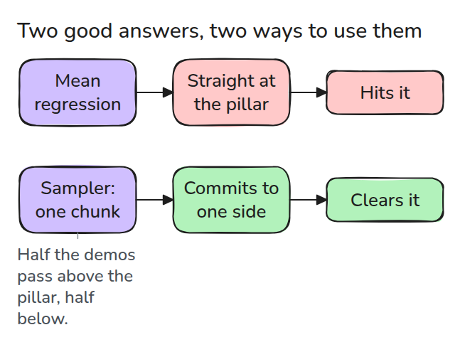
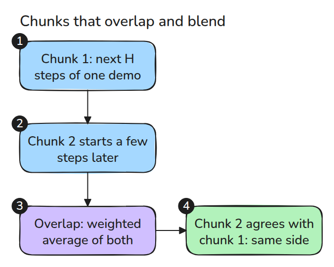
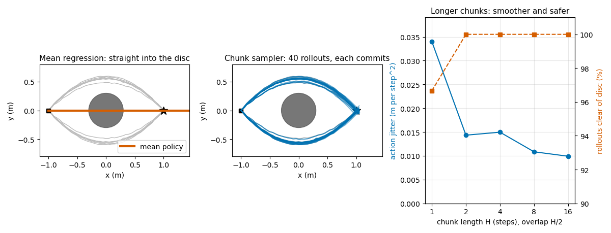

# Multimodal Demonstrations and Action Chunks

> When demonstrations disagree, a regression averages them into an action nobody demonstrated, and a short chunk of future actions commits to one.

**Type:** Build   **Prerequisites:** 13/01 Imitation, 13/02 Cloning Pitfalls   **Time:** ~15 minutes

## In Plain Words

Half of the demonstrations take a rover above a pillar in the picture and half below it. Both work, but a rule that averages the two steers straight at the pillar, and the rover hits it.

A chunk is the next few steps copied from a single demonstration, so the rover commits to one side. When a new chunk overlaps the old one, it must agree with the steps not yet done, or the blend would cancel the detour.

## The Problem

Half your demonstrations steer a rover above the pillar in the picture, half below. Each is good, yet the trained policy drives at the pillar, because its first action averages two valid answers. In 13/02 a push first had to knock the policy off the demos; here the first action is already wrong.

## The Concept



*At the start both answers are right, but their mean is wrong. A sampler picks one demonstration and follows it.*

A regression (least squares, or a weighted average of nearby demos) predicts the mean action. For "up" and "down" demos that is "straight": at the start they steer +0.054 and -0.054 sideways per step, so the mean is 0. Sampling instead copies one demonstration's action, picked at random and likelier when it passes near the current spot, so the two modes survive. Each sampled step picks afresh and can land on the other side, so the sampler returns a whole chunk of the next `H` actions.



*A new chunk starts before the old one ends. Overlapping steps blend by a weighted average that shifts from old to new, and the new chunk is chosen to agree with the old.*



*Left: the mean policy goes straight through. Middle: 40 sampled rollouts split both ways round. Right: from H = 2 on, jitter, the step-to-step change in action, falls to under half of the single-step value and all 60 rollouts clear the disc.*

In 50 runs of `python3 code/main.py`, sampling one step at a time clears the pillar in 98% of runs but jitters 0.034 per step. Chunks of 8 steps, a new one every 4 (overlap 4), clear it in 100% with jitter 0.011, a third as much.


*Blue picks a demonstration every step and wobbles. Green follows chunks of eight steps and glides.*

## Build It

`mean_policy` weights nearby demonstration actions with a Gaussian kernel. `sample_chunk` picks one demonstration with that kernel and returns its next `H` actions.

```python
j = ((P[:, :-1] - x) ** 2).sum(2).argmin(1)            # nearest state in each demo
logw -= ((chunks[:, :len(prefix)] - prefix) ** 2).sum((1, 2)) / (2 * SIGMA_A**2)
a = w * new[k] + (1 - w) * old[k + stride]             # blend while chunks overlap
```

Without `prefix`, a new chunk can pick the other side and the blend heads at the disc.

```bash
cd robotics-engineering-from-scratch
python3 -m pytest phases/13-learning-for-robots/06-multimodal-demos-and-action-chunks -q
python3 phases/13-learning-for-robots/06-multimodal-demos-and-action-chunks/code/figure.py
```

## Use It

Real policies use a network that outputs a chunk and blend overlapping predictions at run time. A longer chunk reacts more slowly in between, so measure that cost.

Sources (abstracts opened 2026-11-10): Zhao et al., "Learning Fine-Grained Bimanual Manipulation with Low-Cost Hardware", arXiv:2304.13705, learns a generative model over action sequences. Chi et al., "Diffusion Policy", arXiv:2303.04137, handles multimodal action distributions.

## Ship It

`outputs/skill-multimodal-demo-check.md` checks a demonstration set for modes a mean policy would average.

## Exercises

1. Make the split 5 to 1 and find what the mean policy does.
2. Set `SIGMA_A` large and count rollouts hitting the disc.
3. Add per-step action noise and find the chunk length where jitter stops falling.
