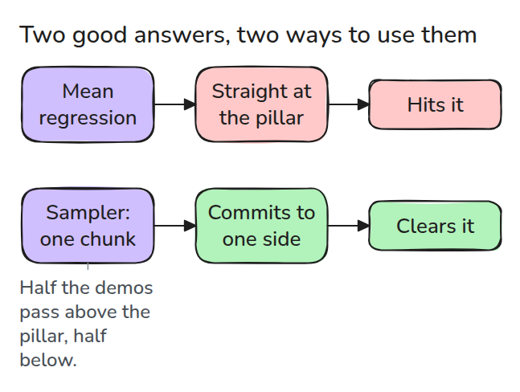
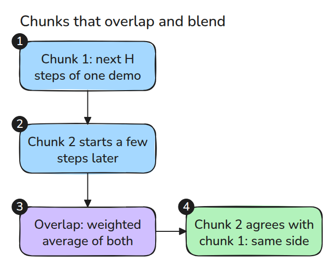
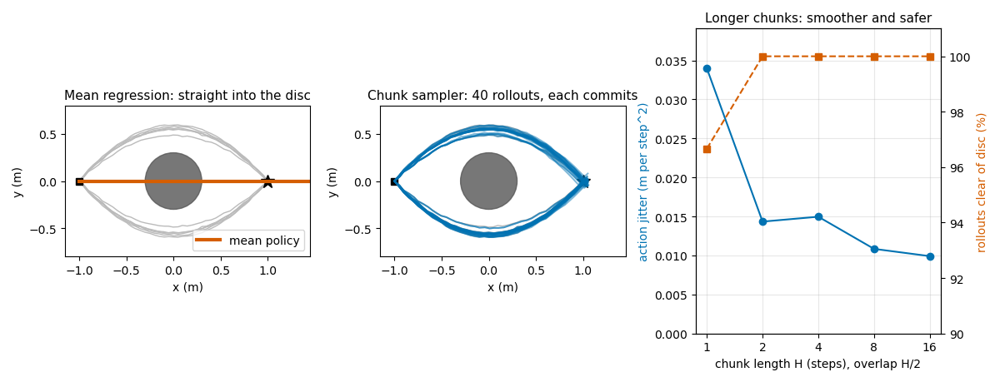

# Multimodal 시연과 Action Chunk

> 서로 다른 좋은 답 두 개로 배운 로봇이 나쁜 중간 답을 고르는 이유와 하나를 고르게 하는 법을 배웁니다.

**유형:** 만들기   **선수 지식:** 13/01 모방, 13/02 복제의 함정   **시간:** 약 15분

## 쉽게 말하면

시연의 절반은 로버를 기둥의 위쪽으로 보내고 나머지 절반은 아래쪽으로 보내요. 둘 다 잘 통하지만 두 답을 평균하는 규칙은 기둥 정면으로 몰고 가요.

chunk는 시연 하나에서 그대로 가져온 앞으로의 몇 걸음이라서 로버가 한쪽을 골라 끝까지 가요. 새 chunk가 이전 chunk와 겹칠 때는 서로 맞아야 해요. 그렇지 않으면 섞는 순간 우회가 지워져요.

## 핵심 용어

- **Multimodal**: 서로 다른 정답이 여럿 있는 것이고 각 정답을 mode라고 부릅니다.
- **Mean policy**: 가까운 시연들의 평균 행동을 예측하는 policy입니다.
- **Action chunk**: 앞으로의 `H`개 행동을 한꺼번에 고른 짧은 묶음입니다.
- **Sampler**: 평균 대신 시연 하나를 무작위로 고르는 방식입니다.
- **Jitter**: 스텝마다 행동이 바뀌는 크기입니다. 크면 흔들려 보입니다.
- **Gaussian kernel**: 현재 상태에 가까운 시연 상태일수록 큰 값을 주는 가중치입니다.

## 문제

로버를 기둥 옆으로 지나가게 하려고 시연의 절반은 위로 절반은 아래로 돌아갔습니다. 둘 다 괜찮지만 둘을 평균하는 policy는 기둥 정면으로 달려갑니다.

## 개념

사람은 같은 일을 서로 다른 방법으로 풀곤 하고 그 모두를 따라 하는 로봇도 하나는 골라야 합니다.



*시작점에서는 두 답이 모두 맞지만 둘의 평균은 틀립니다.*

"위"와 "아래" 시연이면 regression은 "정면"을 예측합니다. 시작점에서 두 시연은 옆으로 +0.054와 -0.054 움직이므로 평균은 0입니다. sampler는 대신 시연 하나를 따라 하므로 두 mode가 남습니다.
스텝마다 새로 뽑으면 반대쪽으로 넘어갈 수 있어서 다음 `H`개 행동을 한 묶음(chunk)으로 돌려줍니다.



*새 chunk는 이전 chunk가 끝나기 전에 시작합니다. 겹치는 스텝은 이전에서 새것으로 넘어가며 섞습니다.*



*왼쪽은 mean policy가 곧바로 가로지르는 모습입니다. 가운데는 표본 rollout 40개가 두 갈래로 나뉘는 모습입니다. 오른쪽은 H = 2부터 jitter가 절반 아래로 떨어지고 rollout 60개가 모두 원판을 피하는 모습입니다.*

50번 돌린 결과입니다. 한 스텝씩 표본을 뽑으면 기둥을 98% 피하지만 jitter는 스텝당 0.034입니다. 길이 8이고 4스텝마다 새로 시작하는 chunk는 100% 피하고 jitter는 0.011입니다.


*파랑 로버는 걸음마다 시연을 골라서 흔들립니다. 초록 로버는 chunk를 따라가서 매끄럽게 갑니다.*

## 만들기

`mean_policy`는 가까운 시연 행동을 Gaussian kernel로 가중합니다. `sample_chunk`는 같은 kernel로 시연 하나를 고르고 그 시연의 다음 `H`개 행동을 돌려줍니다.

```python
j = ((P[:, :-1] - x) ** 2).sum(2).argmin(1)            # nearest state in each demo
logw -= ((chunks[:, :len(prefix)] - prefix) ** 2).sum((1, 2)) / (2 * SIGMA_A**2)
a = w * new[k] + (1 - w) * old[k + stride]             # blend while chunks overlap
```

`prefix`가 없으면 섞인 값이 원판 정면으로 향할 수 있습니다.

```bash
cd robotics-engineering-from-scratch
python3 -m pytest phases/13-learning-for-robots/06-multimodal-demos-and-action-chunks -q
python3 phases/13-learning-for-robots/06-multimodal-demos-and-action-chunks/code/figure.py
```

## 실제 도구로 보기

실제 policy는 chunk를 출력하는 network를 쓰고 겹치는 예측은 실행할 때 섞습니다. chunk가 길수록 반응이 늦습니다.

출처(초록을 2026년 11월 10일에 열어 봤습니다): Zhao 외, arXiv:2304.13705(행동 시퀀스), Chi 외, "Diffusion Policy", arXiv:2303.04137(multimodal 행동).

## 결과물

`outputs/skill-multimodal-demo-check.md`는 mean policy가 뭉개 버릴 mode를 찾습니다.

## 연습 문제

1. 시연을 5 대 1로 가르세요. mean policy는 어떻게 되나요?
2. `SIGMA_A`를 크게 키우고 원판에 부딪히는 rollout 수를 세세요.
3. 행동 노이즈를 넣으세요. 어느 chunk 길이에서 jitter가 더는 줄지 않나요?
