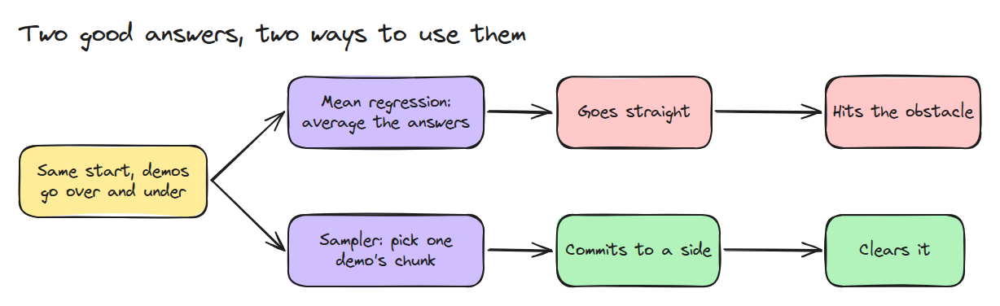
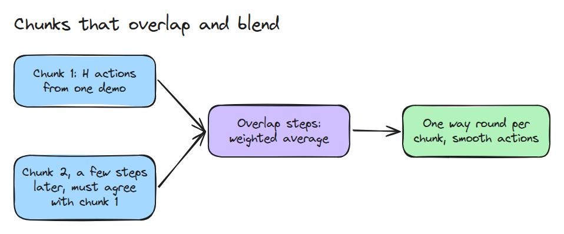
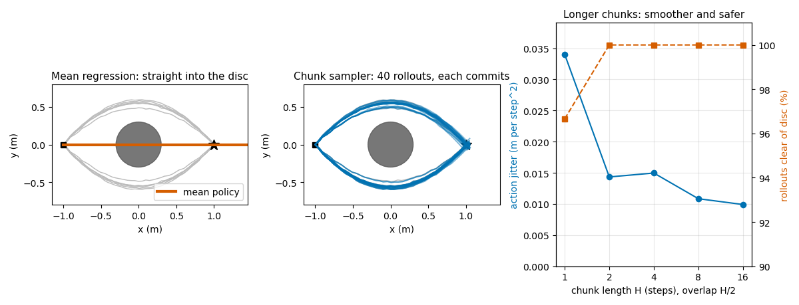

# 다봉 시연과 Action Chunk

> 시연들이 서로 다른 답을 주면 회귀는 그것을 평균해서 아무도 시연하지 않은 행동을 만들고 짧은 미래 행동 묶음은 하나를 골라 끝까지 갑니다.

**유형:** 만들기   **선수 지식:** 13/01 모방, 13/02 복제의 함정   **시간:** 약 15분

## 쉽게 말하면

배식 쟁반을 들고 식탁을 지나갈 때 왼쪽으로 돌아도 오른쪽으로 돌아도 돼요. 두 방향을 평균하면 식탁 정면으로 갈 수 있어요. 걸음마다 쪽을 바꿔도 머뭇거리며 지그재그로 움직이게 돼요.

multimodal 시연에는 이런 서로 다른 답이 함께 있어요. action chunk를 뽑으면 반대 방향을 평균하는 대신 한 경로의 짧은 행동 묶음을 따라가요. chunk가 겹칠 때는 아직 남은 행동과 맞는 새 묶음을 골라야 우회 방향을
지우지 않고 부드럽게 이을 수 있어요.

## 문제

시연의 절반은 점 로봇을 장애물 위로 돌리고 절반은 아래로 돌립니다. 시연은 모두 좋은데 그것으로 학습한 정책은 장애물 정면으로 달려갑니다. 첫 오답부터 같은 관측의 유효한 행동 둘을 평균해서 생깁니다.

13/02의 rollout distribution shift는 정책의 실수로 낯선 상태에 들어가는 문제입니다. 그 오차는 노이즈 없이도 누적될 수 있습니다.

## 개념



*시작점에서는 두 답이 모두 맞습니다. 둘의 평균은 틀린 세 번째 답입니다. 표본기는 시연 하나를 골라 그대로 따라갑니다.*

최소제곱과 kernel regression은 둘 다 평균 행동을 예측합니다. 대칭으로 갈린 데이터에서 "위"와 "아래"의 평균은 "정면"입니다. 표본을 뽑으면 데이터의 두 mode가 그대로 남습니다. 한 스텝만 뽑으면 그래도 쪽이 뒤집힐 수 있습니다.
그래서 표본기는 다음 `H`개 행동을 한 묶음(chunk)으로 돌려주고 그것을 실행합니다.



*새 청크는 이전 청크가 끝나기 전에 시작합니다. 겹치는 스텝은 가중 평균이고 새 청크는 이전 청크와 맞는 것으로 고릅니다.*



*왼쪽은 평균 정책이 원판을 곧바로 가로지르는 모습입니다. 가운데는 표본 롤아웃 40개가 두 갈래로 나뉘는 모습입니다. 오른쪽은 H = 2부터 jitter가 한 스텝 표본의 절반 아래로 떨어지고 롤아웃 60개가 모두 원판을 피하는 모습입니다.*

## 만들기

`mean_policy`는 가까운 시연 행동을 Gaussian kernel로 가중합니다. `sample_chunk`는 같은 kernel로 시연 하나를 고르고 그 시연의 다음 `H`개 행동을 돌려줍니다.

```python
j = ((P[:, :-1] - x) ** 2).sum(2).argmin(1)            # nearest state in each demo
logw -= ((chunks[:, :len(prefix)] - prefix) ** 2).sum((1, 2)) / (2 * SIGMA_A**2)
a = w * new[k] + (1 - w) * old[k + stride]             # blend while chunks overlap
```

`prefix` 항이 없으면 새 청크가 반대쪽을 고를 수 있고 그러면 두 청크가 섞여 원판 정면으로 향합니다.

```bash
cd robotics-engineering-from-scratch
python3 -m pytest phases/13-learning-for-robots/06-multimodal-demos-and-action-chunks -q
python3 phases/13-learning-for-robots/06-multimodal-demos-and-action-chunks/code/figure.py
```

## 실제 도구로 보기

실제 정책은 조회 대신 청크를 출력하는 network를 쓰고 겹치는 예측은 실행할 때 섞습니다. 청크가 길수록 그 사이에 생기는 일에 늦게 반응하므로 그 비용은 과제에서 직접 재야 합니다.

출처: Zhao 외, "Learning Fine-Grained Bimanual Manipulation with Low-Cost Hardware", arXiv:2304.13705의 초록을 2026년 11월 10일에 열어 봤습니다. 행동 시퀀스에 대한 생성 모델을 학습한다고 적혀 있습니다.
Chi 외, "Diffusion Policy", arXiv:2303.04137의 초록도 같은 날 열어 봤습니다. 다봉 행동 분포를 다룬다고 적혀 있습니다.

## 결과물

`outputs/skill-multimodal-demo-check.md`는 평균 정책이 뭉개 버릴 mode가 시연 세트에 있는지 점검합니다.

## 연습 문제

1. 시연을 5 대 1로 갈라서 평균 정책이 어떻게 되는지 찾으세요.
2. `SIGMA_A`를 크게 키우고 원판에 부딪히는 롤아웃 수를 세세요.
3. 스텝마다 행동 노이즈를 넣고 jitter가 더는 줄지 않는 청크 길이를 찾으세요.
