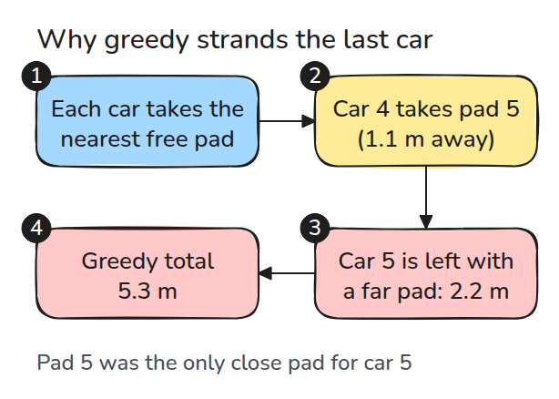
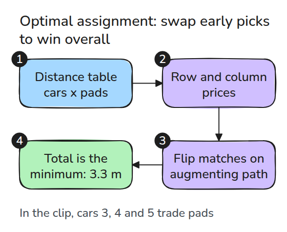
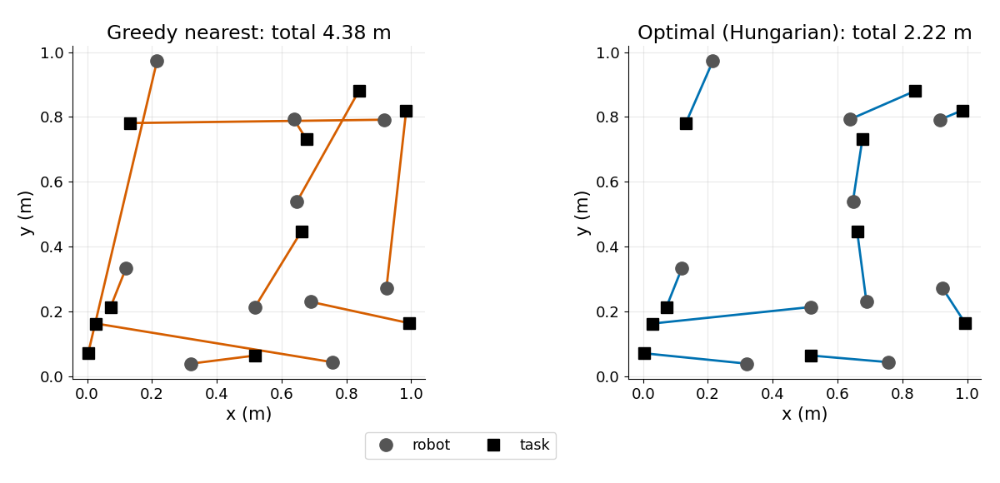
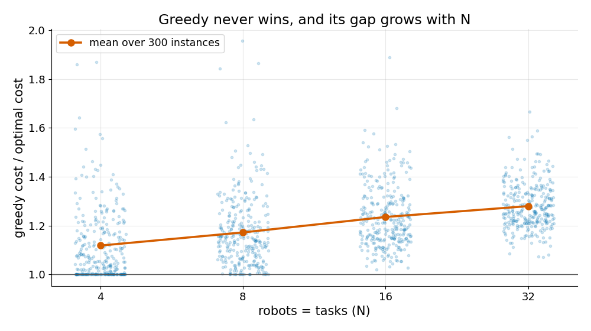

# Task Allocation

> Assigning each robot its nearest task one at a time is fast and often wrong. The optimal assignment looks at all pairs at once.

**Type:** Build   **Prerequisites:** 08/01 Differential Drive and Odometry   **Time:** ~15 minutes

## In Plain Words

Five toy cars each need a different pad. If every car takes the nearest free pad in turn, the last car may be left with a pad across the floor. One car driving a little farther earlier would have saved it that trip.

Task allocation compares every car-to-pad distance and gives each pad to one car. The Hungarian method can change an earlier match while it searches for the smallest total distance.

## The Problem

Ten robots, ten pick-up points. Each robot grabs the closest free point, so one crosses the whole floor after its nearby points were taken. Total travel grows, though no decision looked wrong.

## The Concept



*Greedy decides car by car, so an early cheap pick forces a later costly one: car 4 takes the only pad near car 5.*



*The Hungarian method prices the rows and columns of the distance table (cars by pads), then flips matches along augmenting paths (chains of swaps) until the total is minimal.*



*Ten robots, ten tasks. Greedy crosses the map several times; the optimal assignment is almost all short, local pairs.*



*Over 300 random layouts per size, greedy costs about 1.12 times the optimum at N = 4 and 1.28 times at N = 32, never less.*

`C[i, j]` is the distance from robot `i` to task `j`. We want a permutation (one task per robot, none twice) with the smallest sum of `C[i, perm[i]]`.

In the clip, cars 1 and 2 take the same pads either way (1.29 m together). Cars 3 to 5 decide the rest (distances in metres):

| | pad 1 | pad 3 | pad 5 |
|---|---|---|---|
| car 3 | 0.65 | 0.69 | 1.53 |
| car 4 | 0.52 | 1.43 | 1.14 |
| car 5 | 2.36 | 2.22 | 0.77 |

Greedy: car 3 takes pad 1, car 4 takes pad 5, car 5 gets pad 3, so 0.65 + 1.14 + 2.22 = 4.01 m. Best: car 3 pad 3, car 4 pad 1, car 5 pad 5, so 0.69 + 0.52 + 0.77 = 1.98 m. With cars 1 and 2 the totals are 5.3 m and 3.3 m.


*One car at a time at 1.2 m/s on a 2.7 m floor. Blue (`greedy()`): car 5 crosses. Green (`hungarian()`): cars 3, 4, 5 trade pads.*

## Build It

`greedy()` loops over robots and takes the cheapest free task. `hungarian()` keeps potentials `u`, `v` and grows an alternating tree until each robot is matched.

```python
cur = C[i0 - 1, j - 1] - u[i0] - v[j]   # reduced cost of edge (robot i0, task j)
```

Tests compare it with brute force over every permutation for N up to 6, then with SciPy for N = 30.

```bash
cd robotics-engineering-from-scratch
python3 -m pytest phases/14-multi-robot-and-swarms/01-task-allocation -q
python3 phases/14-multi-robot-and-swarms/01-task-allocation/code/figure.py
```

## Use It

`scipy.optimize.linear_sum_assignment` solves the same problem and the test checks our total equals its total. Compare runtime at N = 200.

Sources: SciPy docs, `linear_sum_assignment` (opened 2026-11-09): "find a complete assignment of workers to jobs of minimal cost"; it uses a modified Jonker-Volgenant algorithm.

## Ship It

`outputs/skill-task-allocation.md` is a checklist for choosing an assignment method for a fleet.

## Exercises

1. Allow more tasks than robots by padding the matrix with zero-cost dummy robots.
2. Replace straight-line distance with grid path length and rerun the gap plot.
3. Make greedy pick the globally cheapest pair first and measure the gap again.
