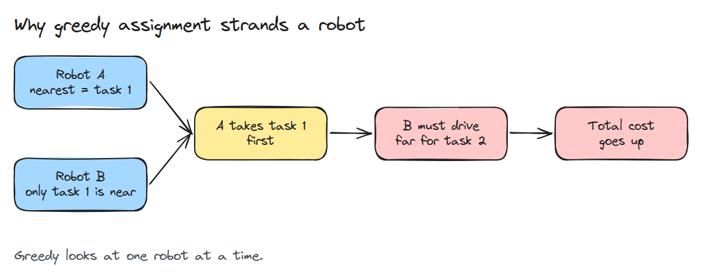
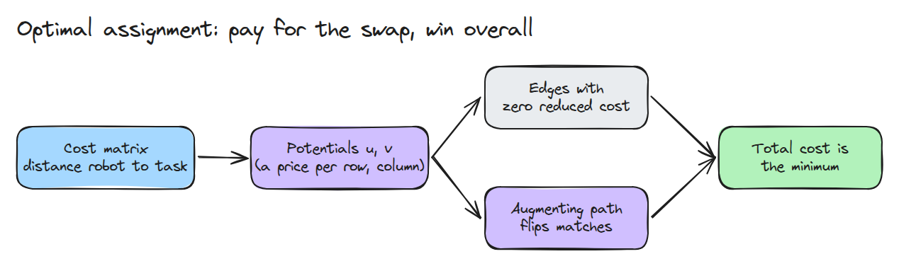
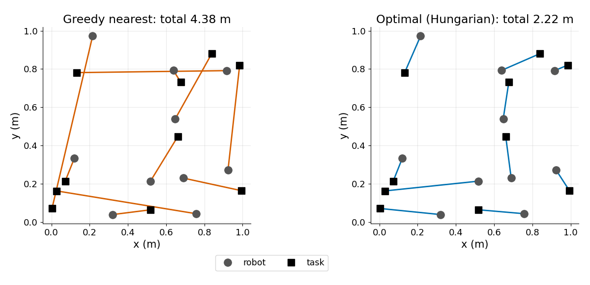
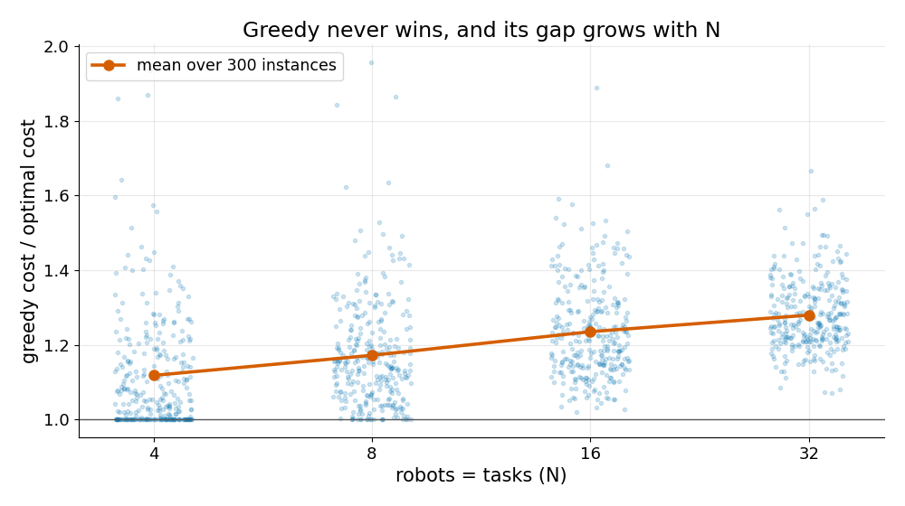

# 작업 배정 (Task Allocation)

> 로봇 팀에 일을 나눠 줘서 전체 이동 거리를 가장 작게 만드는 법을 배웁니다.

**유형:** 만들기   **선수 지식:** 08/01 차동 구동과 odometry   **시간:** 약 15분

## 쉽게 말하면

장난감 자동차 다섯 대가 바닥에 놓인 서로 다른 패드로 한 대씩 가야 해요. 자동차마다 차례로 가장 가까운 빈 패드를 고르면 마지막 자동차에는 바닥 반대편의 패드만 남을 수 있어요.

task allocation은 모든 자동차와 패드 사이의 거리를 한꺼번에 비교해서 패드마다 자동차 한 대를 정해요. Hungarian 방법은 전체 거리가 가장 작은 조합을 찾으려고 먼저 정한 짝도 바꿀 수 있어요.

## 핵심 용어

- **Task allocation**: 어느 로봇이 어느 작업을 할지 정하는 일입니다.
- **Greedy**: 앞을 내다보지 않고 매 단계에서 가장 좋아 보이는 것을 고르는 방식입니다.
- **Assignment**: 로봇과 작업을 하나씩 짝짓는 것입니다.
- **Cost matrix `C`**: 로봇마다 작업까지의 거리를 적은 표입니다.
- **Hungarian method**: 전체 비용이 가장 낮은 배정을 찾는 알고리즘입니다.
- **Augmenting path**: 짝을 연쇄로 바꿔서 한 쌍을 더 맞추는 길입니다.

## 문제

창고에 로봇 열 대와 물건을 집는 지점 열 곳이 있습니다. 로봇마다 차례로 가장 가까운 빈 지점을 잡으면 마지막 로봇은 바닥 전체를 가로질러야 할 수 있습니다. 나쁜 선택은 하나도 없는데 전체 이동 거리는 커집니다.

## 개념

일을 하나씩 나눠 주면 로봇 무리는 배터리와 시간을 낭비하므로 무리로 함께 계획해야 합니다.



*앞에서 싸게 고른 선택이 뒤의 비싼 선택을 강요합니다. 4번 자동차가 5번 자동차에게 하나뿐인 가까운 패드를 가져갑니다.*



*Hungarian 방법은 행과 열에 가격을 매긴 뒤 합이 최소가 될 때까지 augmenting path를 따라 짝을 뒤집습니다.*



*greedy 배정은 지도를 가로지르고 최적 배정은 가까운 짝을 유지합니다.*



*greedy 배정은 N = 4에서 최적의 약 1.12배, N = 32에서 약 1.28배입니다(각각 배치 300개).*

`C[i, j]`는 로봇 `i`에서 작업 `j`까지의 거리입니다. 합이 가장 작은 조합을 찾습니다.

클립에서 1번과 2번 자동차는 어느 쪽이든 같은 패드로 가고 합쳐서 1.29 m를 달립니다. 나머지는 3번부터 5번 자동차가 정합니다(단위는 m).

| 자동차 \ 패드 | 1 | 3 | 5 |
|---|---|---|---|
| 3 | 0.65 | 0.69 | 1.53 |
| 4 | 0.52 | 1.43 | 1.14 |
| 5 | 2.36 | 2.22 | 0.77 |

greedy 배정은 0.65 + 1.14 + 2.22 = 4.01 m입니다. 가장 좋은 배정은 0.69 + 0.52 + 0.77 = 1.98 m입니다. 1번과 2번을 더하면 합계가 5.3 m와 3.3 m입니다.


*파란 쪽(`greedy()`)은 5번 자동차가 바닥을 가로지르고 초록 쪽(`hungarian()`)은 3, 4, 5번이 패드를 바꿉니다.*

## 만들기

`greedy()`는 로봇마다 남은 작업 중 가장 싼 것을 고릅니다. `hungarian()`은 행과 열의 가격 `u`, `v`를 유지하면서 모든 로봇이 짝을 찾을 때까지 계산합니다.

```python
cur = C[i0 - 1, j - 1] - u[i0] - v[j]   # reduced cost of edge (robot i0, task j)
```

테스트는 N이 6 이하일 때 brute force와 비교하고 N = 30에서는 SciPy와 비교합니다.

```bash
cd robotics-engineering-from-scratch
python3 -m pytest phases/14-multi-robot-and-swarms/01-task-allocation -q
python3 phases/14-multi-robot-and-swarms/01-task-allocation/code/figure.py
```

## 실제 도구로 보기

`scipy.optimize.linear_sum_assignment`가 같은 문제를 풀고 테스트가 총비용이 같은지 확인합니다.

출처: SciPy 문서의 `linear_sum_assignment`(2026년 11월 9일 확인).

## 결과물

`outputs/skill-task-allocation.md`는 배정 방법을 고릅니다.

## 연습 문제

1. 비용이 0인 가짜 로봇으로 작업이 로봇보다 많은 경우를 다루세요.
2. 직선 거리 대신 격자 경로 길이를 쓰세요.
3. greedy 배정이 전체에서 가장 싼 짝부터 고르게 바꾸세요.
