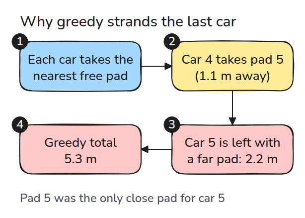
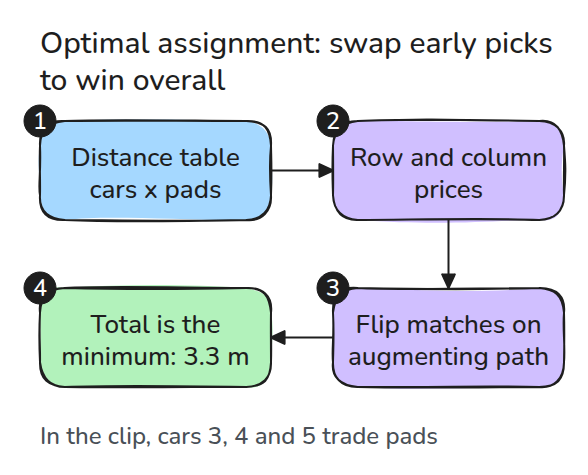
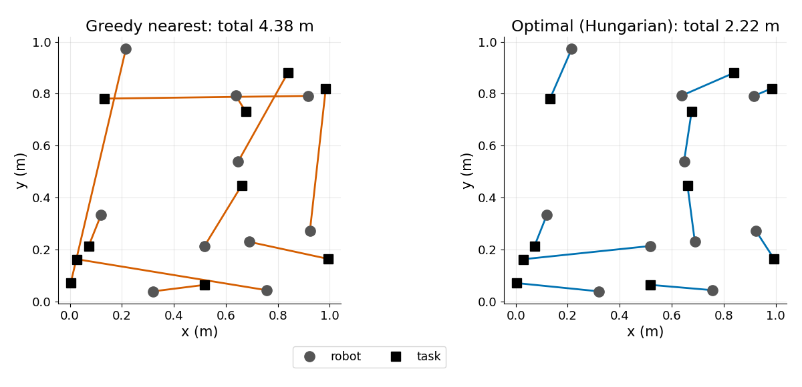
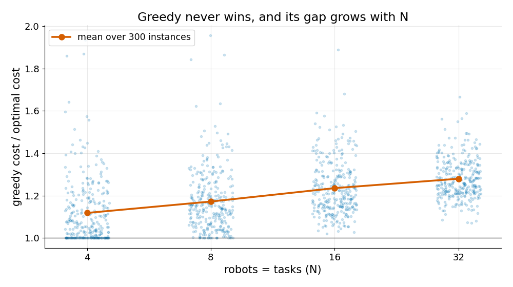

# 작업 배정 (Task Allocation)

> 로봇마다 가장 가까운 작업을 차례로 고르면 빠르지만 자주 틀립니다. 최적 배정은 모든 짝을 한꺼번에 봅니다.

**유형:** 만들기   **선수 지식:** 08/01 차동 구동과 odometry   **시간:** 약 15분

## 쉽게 말하면

장난감 자동차 다섯 대가 바닥에 놓인 서로 다른 패드로 한 대씩 가야 해요. 자동차마다 차례로 가장 가까운 빈 패드를 고르면 마지막 자동차에는 바닥 반대편의 패드만 남을 수 있어요. 앞의 자동차가 조금 더 멀리 갔다면 그 긴 길을 줄일 수 있었어요.

task allocation은 모든 자동차와 패드 사이의 거리를 한꺼번에 비교해서 패드마다 자동차 한 대를 정해요. Hungarian 방법은 전체 거리가 가장 작은 조합을 찾는 동안 먼저 정한 짝도 바꿀 수 있어요.

## 문제

로봇 열 대와 물건을 집는 지점 열 곳이 있습니다. 로봇마다 가장 가까운 빈 지점을 잡게 했더니 한 대는 근처 지점을 모두 다른 로봇이 먼저 가져가서 바닥을 가로질러 가야 합니다. 전체 이동 거리는 필요 이상으로 커졌는데 개별 선택은 하나도 틀려 보이지 않습니다.

## 개념



*greedy 배정은 자동차를 하나씩 결정합니다. 그래서 앞에서 싸게 고른 선택이 뒤의 비싼 선택을 강요할 수 있습니다. 4번 자동차가 5번 자동차에게 하나뿐인 가까운 패드를 가져갑니다.*



*Hungarian 방법은 거리 표(자동차마다 행 하나, 패드마다 열 하나)의 행과 열에 가격을 매겨 짝을 공평하게 비교합니다. 그다음 합이 최소가 될 때까지 augmenting path(짝을 연쇄로 바꾸는 길)를 따라 짝을 뒤집습니다.*



*같은 로봇 열 대와 작업 열 개입니다. greedy 배정은 지도를 여러 번 가로지르고 최적 배정은 대부분 짧은 이웃 짝입니다.*



*크기마다 임의 배치 300개를 보면 greedy 배정은 N = 4에서 최적의 약 1.12배, N = 32에서 약 1.28배입니다. 더 싼 경우는 없습니다.*

비용 `C[i, j]`는 로봇 `i`에서 작업 `j`까지의 거리입니다. `C[i, perm[i]]`의 합이 최소인 순열을 찾습니다. 순열은 로봇마다 작업을 하나씩 겹치지 않게 배정하는 방법입니다.

클립(1 x 1 배치를 2.7 m 바닥으로 그렸습니다)에서 1번과 2번 자동차는 어느 쪽이든 같은 패드로 가고 합쳐서 1.29 m를 달립니다. 나머지는 3번부터 5번 자동차가 정합니다. 세 패드까지의 거리는 m 단위로 다음과 같습니다.

| | 패드 1 | 패드 3 | 패드 5 |
|---|---|---|---|
| 자동차 3 | 0.65 | 0.69 | 1.53 |
| 자동차 4 | 0.52 | 1.43 | 1.14 |
| 자동차 5 | 2.36 | 2.22 | 0.77 |

greedy 배정은 자동차를 차례로 봅니다. 3번이 패드 1을, 4번이 패드 5를 가져가서 5번에게는 패드 3이 남고 합은 0.65 + 1.14 + 2.22 = 4.01 m입니다.
가장 좋은 배정은 3번이 패드 3, 4번이 패드 1, 5번이 패드 5로 가는 것이고 합은 0.69 + 0.52 + 0.77 = 1.98 m입니다. 1번과 2번을 더하면 합계가 5.3 m와 3.3 m입니다.


*같은 다섯 대가 1.2 m/s로 한 대씩 달립니다. 파란 쪽(`greedy()`)은 5번 자동차가 바닥을 가로지르고 초록 쪽(`hungarian()`)은 3, 4, 5번이 패드를 바꿉니다.*

## 만들기

`greedy()`는 로봇을 순서대로 돌며 남은 작업 중 가장 싼 것을 고릅니다. `hungarian()`은 potential `u`, `v`를 유지하면서 모든 로봇이 짝을 찾을 때까지 alternating tree를 키웁니다.

```python
cur = C[i0 - 1, j - 1] - u[i0] - v[j]   # reduced cost of edge (robot i0, task j)
```

테스트는 N이 6 이하일 때 모든 순열을 다 돌린 brute force와 비교하고 N = 30에서는 SciPy와 비교합니다.

```bash
cd robotics-engineering-from-scratch
python3 -m pytest phases/14-multi-robot-and-swarms/01-task-allocation -q
python3 phases/14-multi-robot-and-swarms/01-task-allocation/code/figure.py
```

## 실제 도구로 보기

`scipy.optimize.linear_sum_assignment`가 같은 문제를 풀고 테스트가 우리 총비용과 그 결과가 같은지 확인합니다. N = 200에서 실행 시간을 비교해 보세요.

출처: SciPy 문서의 `linear_sum_assignment`(2026년 11월 9일 확인). "find a complete assignment of workers to jobs of minimal cost"라고 적혀 있고 수정된 Jonker-Volgenant 알고리즘을 씁니다.

## 결과물

`outputs/skill-task-allocation.md`는 로봇 무리에 쓸 배정 방법을 고르고 검증하는 체크리스트입니다.

## 연습 문제

1. 비용이 0인 가짜 로봇으로 행렬을 채워 작업이 로봇보다 많은 경우를 다루세요.
2. 직선 거리 대신 격자 경로 길이를 쓰고 비용 차이 그림을 다시 그리세요.
3. greedy 배정이 전체에서 가장 싼 짝부터 고르게 바꾸고 차이를 다시 재세요.
