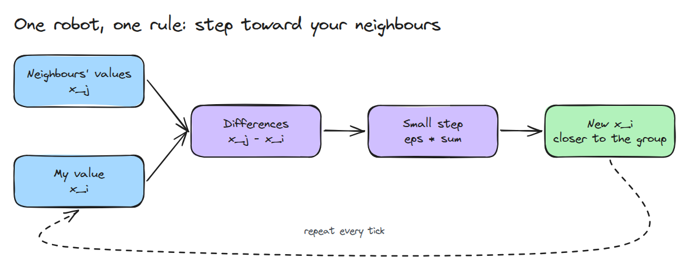
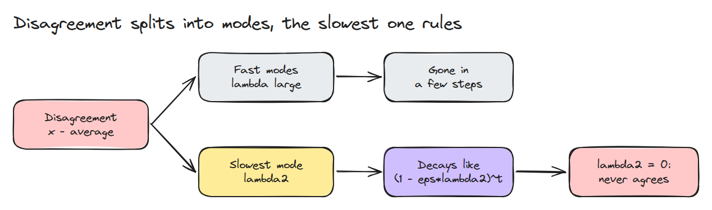
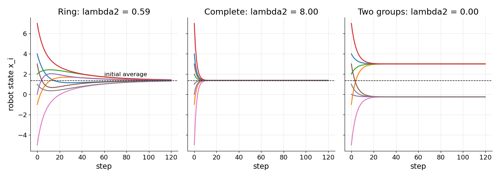
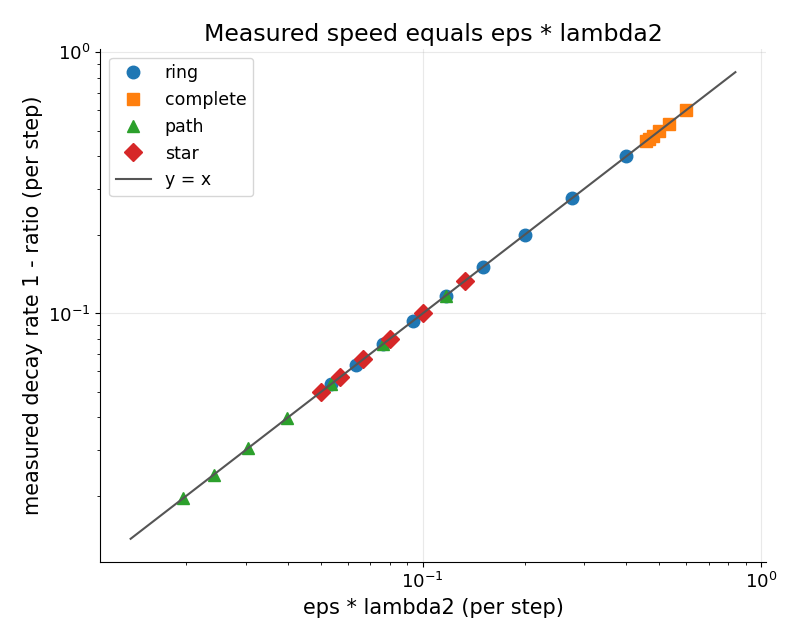

# Consensus

> Robots that only talk to neighbours can still agree on one number, and how fast they agree is set by the second-smallest eigenvalue of the graph Laplacian.

**Type:** Build   **Prerequisites:** eigenvalues of a symmetric matrix   **Time:** ~15 minutes

## The Problem

Eight robots each measure the same quantity with a different error, and no robot can hear all the others. You want every robot to end up holding the group average, using only messages to its radio neighbours. Some layouts agree in a dozen ticks and some take hundreds. A split fleet never agrees at all.

## The Concept



*Each robot moves a small step toward the average of its neighbours, every tick.*



*Disagreement splits into modes. Fast ones vanish, the slowest one sets the pace, and a zero eigenvalue means that mode never decays.*



*The ring crawls to the average, the complete graph is there in about ten steps, and two disconnected groups settle on two different values.*



*Ring, complete, path and star graphs of several sizes all fall on the line y = x, so the measured decay rate is eps times lambda2.*

With `L = D - A`, the update is `x <- (I - eps L) x`. `L` is symmetric and its rows sum to zero, so the all-ones vector has eigenvalue 0 and the average never changes. Every other eigenvector `v_k` is multiplied by `1 - eps * lambda_k` each step. The error is stable when `eps * lambda_max < 2`. When `eps` is small enough that no factor goes negative, the slowest decay is `1 - eps * lambda2`. The second eigenvalue is above zero exactly when the graph is connected.

## Build It

`laplacian()` builds `D - A`, `lambda2()` takes the second sorted eigenvalue, `run()` iterates the update.

```python
M = np.eye(len(A)) - eps * laplacian(A)
out.append(M @ out[-1])
```

Tests check the average is preserved, the per-step contraction equals `1 - eps * lambda2`, and a step above `2 / lambda_max` diverges.

```bash
cd robotics-engineering-from-scratch
python3 -m pytest phases/14-multi-robot-and-swarms/02-consensus -q
python3 phases/14-multi-robot-and-swarms/02-consensus/code/figure.py
```

## Use It

Cross-check `lambda2` with `numpy.linalg.eigvalsh` on a graph from your own radio logs. Sources: Wikipedia, Algebraic connectivity (opened 2026-11-09): "This eigenvalue is greater than 0 if and only if G is a connected graph."

## Ship It

`outputs/skill-consensus.md` checks a communication graph and a step size before a fleet runs consensus.

## Exercises

1. Add one long-range link to the ring and measure how much `lambda2` and the step count change.
2. Drop each edge with probability 0.2 every tick and plot the mean steps to agree.
3. Give robot 0 a fixed value and show everyone converges to it.
