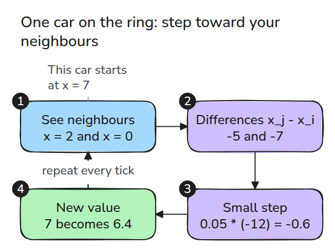
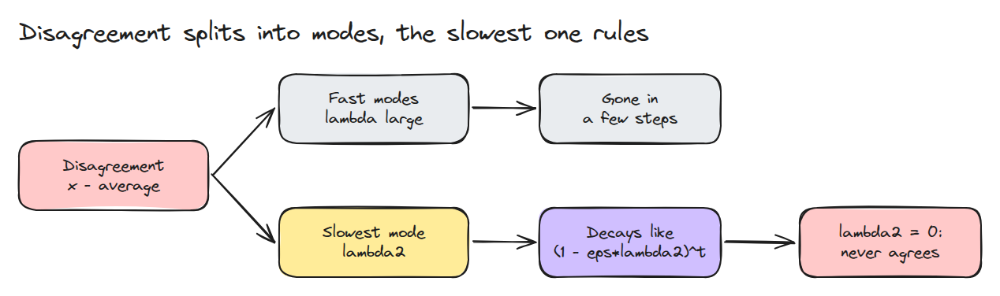
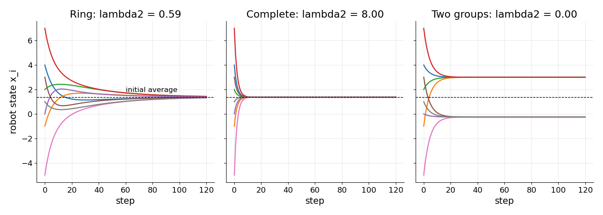
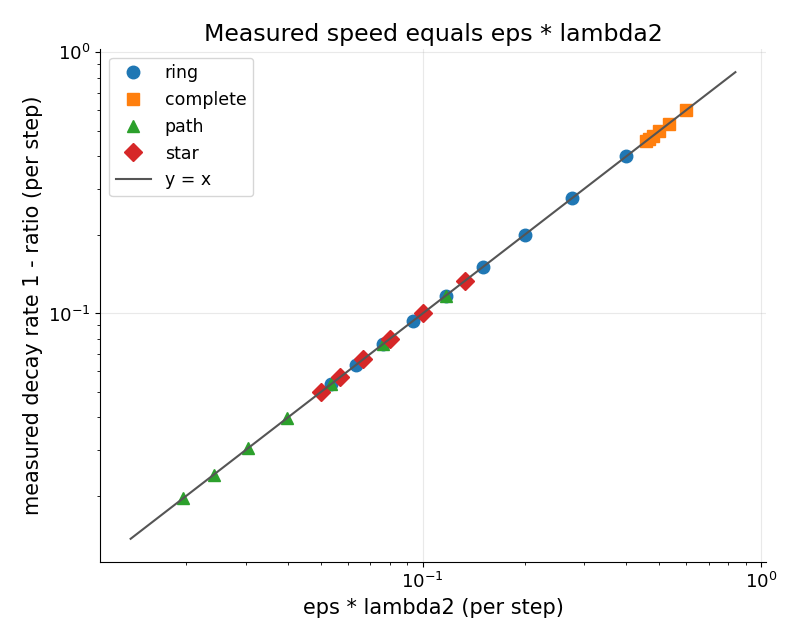

# Consensus

> Learn how robots that only talk to their neighbours can still agree on one number, and what makes it slow.

**Type:** Build   **Prerequisites:** none   **Time:** ~15 minutes

## In Plain Words

Eight toy cars each point a different way and see only their neighbours. Every tick a car turns a little toward the headings it sees. The average heading never changes.

Cars linked by chains of neighbours settle on that average. Groups with no link between them settle on different headings. A turn that is too big overshoots.

## Key Terms

- **Consensus**: all robots agreeing on one value by talking only to neighbours.
- **Neighbour table (`L`)**: a table of which robots can talk to each other. Its proper name is the graph Laplacian.
- **Agreement speed (`lambda2`)**: one number, read off the neighbour table, that sets how fast the robots agree.
- **Step size (`eps`)**: how far each robot moves toward its neighbours per tick.

## The Problem

Eight robots each measure the same thing with a different error, and each hears only a few nearby robots. They should all reach the group average.

## The Concept

A real fleet has no boss and no radio that reaches everyone, so robots must agree using only local talk. Each tick, every robot moves a little toward the average of its neighbours. If the robots are connected, everyone ends at the group average. How fast depends on how well connected they are: a ring is slow, a group where everyone talks to everyone is quick, and two separate groups never agree.



*Each robot steps a little toward its neighbours' average every tick.*



*Disagreement fades in separate patterns. The slowest one sets the pace.*



*The ring crawls, the fully connected group is fast, and two split groups never agree.*



*Four different networks of cars land on one line: the speed is set by one number, lambda2.*


*Watch the green car turn a little toward its two neighbours each tick.*

<details><summary>The math (optional)</summary>

Let `x_i` be car `i`'s heading. One tick moves every car at once: `x <- (I - eps L) x`, where `L = D - A`, `A` marks neighbours and `D` counts them. Rows of `L` sum to zero, so the average never changes. `lambda2` is the second-smallest eigenvalue of `L` (a number telling how fast one pattern of disagreement, a mode, shrinks). Every other mode shrinks by `1 - eps * lambda_k` per tick, so the slowest decay is `1 - eps * lambda2`. The update is stable when `eps * lambda_max < 2`. With `eps = 0.05` on a ring, the car at x = 7 sees neighbours 2 and 0, so one tick gives 7 + 0.05 * ((2 - 7) + (0 - 7)) = 6.4, a turn of about 9 degrees (1 unit drawn as 0.25 rad). If `lambda2 = 0` the network is split. One long-range link added to a ring raises `lambda2`.

</details>

## Build It

`laplacian()` builds the table, `lambda2()` finds the agreement speed, `run()` repeats the update.

```python
M = np.eye(len(A)) - eps * laplacian(A)
out.append(M @ out[-1])
```

Tests check the average never changes and that too big a step diverges.

```bash
cd robotics-engineering-from-scratch
python3 -m pytest phases/14-multi-robot-and-swarms/02-consensus -q
python3 phases/14-multi-robot-and-swarms/02-consensus/code/figure.py
```

## Use It

NumPy, a Python maths library, can cross-check `lambda2` with `numpy.linalg.eigvalsh`.

Sources: Wikipedia, Algebraic connectivity (opened 2026-11-09). `lambda2` is above 0 exactly when the network is connected.

## Ship It

`outputs/skill-consensus.md` checks a graph and step size.

## Exercises

1. Add one long-range link to the ring. What changes?
2. Drop each link at random every tick. Do the cars still agree?
3. Fix robot 0's value. Does everyone follow it?
