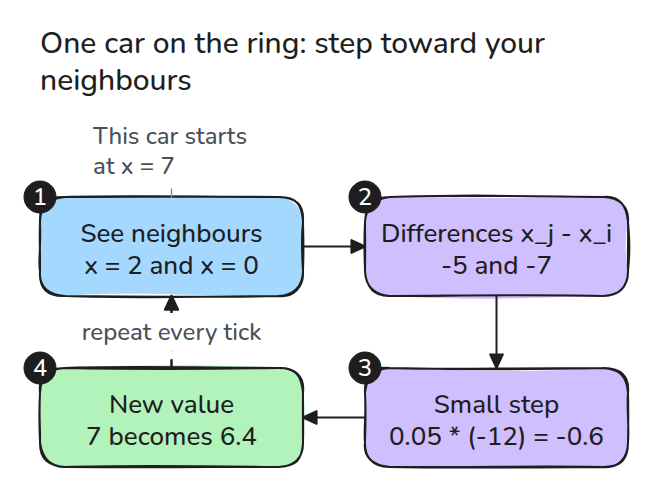
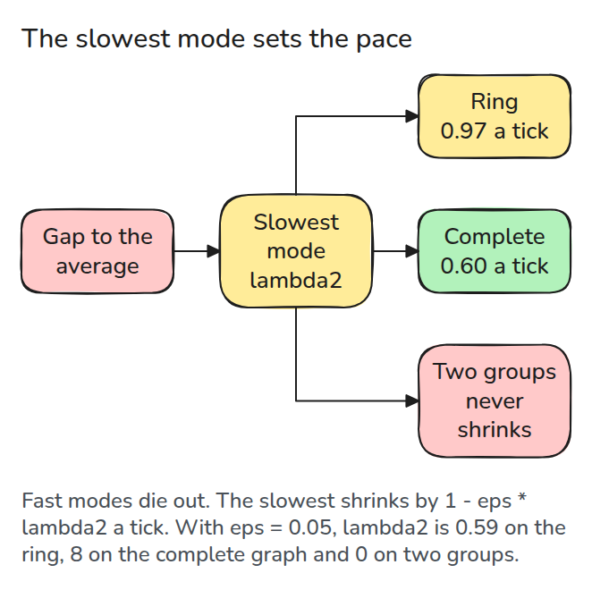
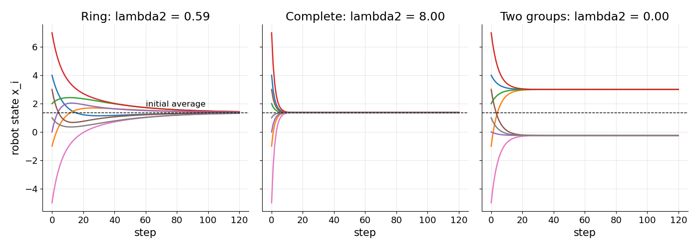
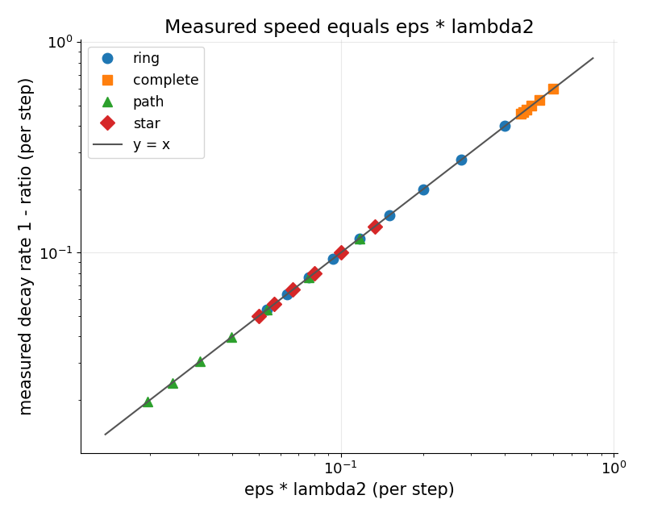

# 합의 (Consensus)

> 이웃과만 통신하는 로봇들도 숫자 하나에 합의할 수 있고 합의 속도는 그래프 Laplacian의 두 번째로 작은 고유값이 정합니다.

**유형:** 만들기   **선수 지식:** 대칭 행렬의 고유값   **시간:** 약 15분

## 쉽게 말하면

장난감 자동차 여덟 대가 바닥에서 저마다 다른 방향을 보고 있고 각 자동차는 이웃만 볼 수 있어요. 매 tick마다 자동차는 보이는 이웃의 방향 쪽으로 조금씩 돌아요. 두 자동차가 서로 끌어당기는 정도가 같아서 한 대가 얻은 만큼 다른 대가 잃고
그래서 무리의 평균 방향은 변하지 않아요.

모두 연결돼 있으면 처음의 평균 방향에 모여요. 떨어진 무리는 서로 다른 방향에 모여요. 한 번에 너무 크게 돌면 이웃의 방향을 원래 차이보다 더 멀리 지나쳐 가서 차이가 줄지 않고 커져요.

## 문제

로봇 여덟 대가 같은 양을 각자 다른 오차로 재는데 나머지 전부의 소리를 듣는 로봇은 없습니다. 무전이 닿는 이웃과 메시지만 주고받아 모두가 그룹 평균을 갖게 하려고 합니다. 배치에 따라 빨리 합의하기도 하고 한참 걸리기도 합니다. 갈라진 무리는 끝내 합의하지 못합니다.

## 개념



*로봇은 tick마다 이웃의 평균 쪽으로 조금씩 움직입니다.*



*불일치는 모드, 곧 서로 독립이고 저마다 다른 속도로 줄어드는 패턴으로 나뉩니다. 빠른 모드는 금방 사라지고 가장 느린 모드가 속도를 정합니다. 고유값이 0이면 그 모드는 줄지 않습니다.*



*링은 평균까지 느리게 기어갑니다. 완전 그래프는 열 tick쯤에 도착하고 끊어진 두 무리는 서로 다른 값에 멈춥니다.*



*크기가 다른 링, 완전, path, star 그래프가 모두 y = x 선 위에 놓입니다. 측정한 감쇠 속도가 eps 곱하기 lambda2입니다.*

각 자동차의 방향을 숫자 `x_i`로 씁니다. tick 한 번에 모든 자동차는 이웃 `j`에 대해 `eps * sum_j (x_j - x_i)`만큼 움직입니다.
`eps`는 작은 step 크기입니다.

모든 자동차를 한꺼번에 쓰면 `x <- (I - eps L) x`입니다. `I`는 단위 행렬이고 `L = D - A`는 graph Laplacian입니다.
`A`는 이웃인 쌍을 표시하고 `D`는 각 자동차의 이웃 수를 셉니다.
`L`은 대칭이고 행의 합이 0이라서 모든 성분이 1인 벡터의 고유값이 0이고 평균은 변하지 않습니다.
나머지 고유벡터 `v_k`는 서로 독립인 불일치 패턴 하나이며 mode라고 부릅니다. mode는 매 tick `1 - eps * lambda_k`배가 됩니다.

링에서는 각 자동차가 왼쪽과 오른쪽 이웃을 봅니다. `eps = 0.05`일 때 x = 7인 자동차는 2와 0을 보므로 한 tick에 7 + 0.05 * ((2 - 7) + (0 - 7)) = 6.4가 됩니다.


*초록 자동차(x = 7)를 보세요. x 1 단위는 0.25 rad로 그렸고 회색 화살표는 처음 방향입니다. 첫 tick은 0.8초로 느리게 보여 주며 이웃 쪽으로 약 9도 돕니다. 이어서 19 tick이 빠르게 지나갑니다.*

`eps * lambda_max < 2`이면 안정합니다. `eps`가 충분히 작아서 어느 모드도 부호가 뒤집히지 않으면 가장 느린 감쇠는 `1 - eps * lambda2`입니다.

## 만들기

`laplacian()`은 `D - A`를 만듭니다. `lambda2()`는 정렬한 두 번째 고유값을 꺼내고 `run()`은 갱신을 반복합니다.

```python
M = np.eye(len(A)) - eps * laplacian(A)
out.append(M @ out[-1])
```

테스트는 평균이 보존되는지, tick당 수축 비율이 `1 - eps * lambda2`와 같은지, `2 / lambda_max`를 넘는 step 크기가 발산하는지 확인합니다.

```bash
cd robotics-engineering-from-scratch
python3 -m pytest phases/14-multi-robot-and-swarms/02-consensus -q
python3 phases/14-multi-robot-and-swarms/02-consensus/code/figure.py
```

## 실제 도구로 보기

실제 무전 기록에서 만든 그래프로 `numpy.linalg.eigvalsh`와 `lambda2`를 대조해 보세요.

출처는 Wikipedia의 Algebraic connectivity 문서입니다(2026년 11월 9일 확인). "This eigenvalue is greater than 0 if and only if G is a connected graph."라고 적혀 있습니다.

## 결과물

`outputs/skill-consensus.md`는 로봇 무리가 합의를 돌리기 전에 통신 그래프와 step 크기를 점검합니다.

## 연습 문제

1. 링에 장거리 연결을 하나 더하고 `lambda2`와 tick 수가 얼마나 변하는지 재세요.
2. tick마다 각 연결을 확률 0.2로 끊고 합의까지 걸리는 평균 tick 수를 그리세요.
3. 로봇 0의 값을 고정하면 모두가 그 값으로 수렴함을 보이세요.
