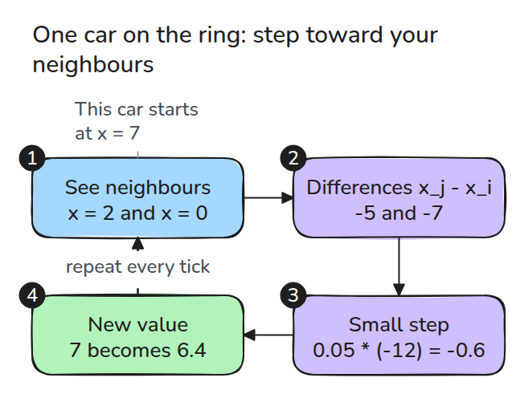
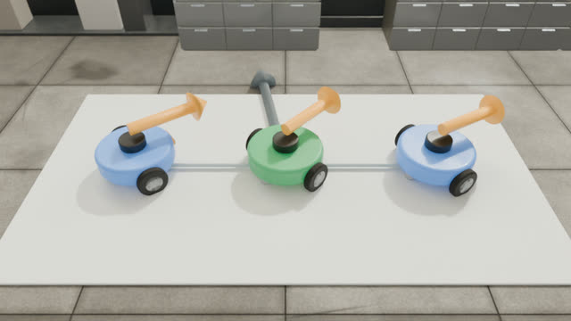

# 합의 (Consensus)

> 이웃과만 이야기하는 로봇들이 숫자 하나에 합의하는 법과 합의가 느려지는 이유를 배웁니다.

**유형:** 만들기   **선수 지식:** 없음   **시간:** 약 15분

## 쉽게 말하면

장난감 자동차 여덟 대가 저마다 다른 방향을 보고 있고 각 자동차는 이웃만 볼 수 있어요. 매 tick마다 자동차는 보이는 이웃의 방향 쪽으로 조금씩 돌아요. 무리의 평균 방향은 변하지 않아요.

이웃의 사슬로 이어진 자동차들은 그 평균 방향에 모여요. 서로 이어지지 않은 무리는 각자 자기 평균에 모여요. 한 번에 너무 크게 돌면 지나쳐요.

## 핵심 용어

- **Consensus**: 로봇들이 이웃과만 통신해서 값 하나에 합의하는 것입니다.
- **Neighbour table (`L`)**: 어느 로봇끼리 통신할 수 있는지 적어 둔 표입니다. 정식 이름은 graph Laplacian입니다.
- **Agreement speed (`lambda2`)**: 이웃 표에서 읽어 낸 수 하나로, 로봇들이 얼마나 빨리 합의하는지를 정합니다.
- **Step size (`eps`)**: tick마다 이웃 쪽으로 움직이는 크기입니다.

## 문제

로봇 여덟 대가 같은 것을 각자 다른 오차로 재는데 각자 가까운 몇 대의 소리만 들을 수 있습니다. 모두가 그룹 평균에 이르러야 합니다.

## 개념

실제 로봇 무리에는 우두머리도 없고 모두에게 닿는 무전도 없어서 로봇들은 가까운 대화만으로 합의해야 합니다. 매 tick마다 모든 로봇이 이웃의 평균 쪽으로 조금씩 움직입니다. 로봇들이 서로 이어져 있으면 모두 그룹 평균에 이릅니다.
속도는 얼마나 잘 연결되었는지에 달려 있습니다. 링은 느리고 모두가 모두와 이야기하는 무리는 빠르며 떨어진 두 무리는 각자 자기 평균에 모입니다.



*로봇은 tick마다 이웃의 평균 쪽으로 조금씩 움직입니다.*


*불일치는 서로 다른 패턴으로 사라집니다. 가장 느린 패턴이 속도를 정합니다.*


*링은 느리게 기어가고 모두 연결된 무리는 빠르며 갈라진 두 무리는 끝까지 따로 남습니다.*


*서로 다른 네 연결망이 한 선 위에 놓입니다. 속도는 lambda2라는 수 하나가 정합니다.*

[](../assets/clip-example.mp4)

*초록 자동차가 매 tick 두 이웃 쪽으로 조금씩 도는 모습을 보세요.*

<details><summary>The math (optional)</summary>

각 자동차의 방향을 `x_i`로 씁니다. tick 한 번에 모든 자동차가 한꺼번에 움직입니다. `x <- (I - eps L) x`이고 `L = D - A`이며 `A`는 이웃인 쌍을 표시하고 `D`는 이웃 수를 셉니다.
연결은 양쪽으로 통하므로 `L`은 대칭이고 행의 합이 0이라서 평균은 변하지 않습니다. `lambda2`는 `L`의 두 번째로 작은 고유값입니다(불일치 패턴 하나, 곧 mode가 얼마나 빨리 줄어드는지 알려 주는 수입니다).
나머지 mode는 매 tick `1 - eps * lambda_k`배가 되므로 step이 작으면 가장 느린 감쇠는 `1 - eps * lambda2`입니다. `eps * lambda_max < 2`이면 갱신이 안정합니다.
링에서 `eps = 0.05`일 때 x = 7인 자동차는 이웃 2와 0을 보므로 한 tick에 7 + 0.05 * ((2 - 7) + (0 - 7)) = 6.4가 되어 약 9도 돕니다(x 1 단위는 0.25 rad로 그렸습니다).
링에 연결을 하나 더해도 `lambda2`가 반드시 올라가지는 않습니다. 자동차 8대 링에서는 0.586 그대로이고 모든 쌍을 이으면 8이 됩니다.

</details>

## 만들기

`laplacian()`은 표를 만들고 `lambda2()`는 합의 속도를 구하고 `run()`은 갱신을 반복합니다.

```python
M = np.eye(len(A)) - eps * laplacian(A)
out.append(M @ out[-1])
```

테스트는 평균이 변하지 않는지, 너무 큰 step이 발산하는지 확인합니다.

```bash
cd robotics-engineering-from-scratch
python3 -m pytest phases/14-multi-robot-and-swarms/02-consensus -q
python3 phases/14-multi-robot-and-swarms/02-consensus/code/figure.py
```

## 실제 도구로 보기

파이썬 수학 라이브러리인 NumPy의 `numpy.linalg.eigvalsh`로 `lambda2`를 대조해 보세요.

출처는 Wikipedia의 Algebraic connectivity 문서입니다(2026년 11월 9일 확인). 연결망이 이어져 있을 때만 `lambda2`가 0보다 큽니다.

## 결과물

`outputs/skill-consensus.md`는 그래프와 step 크기를 점검합니다.

## 연습 문제

1. 링에 장거리 연결을 하나 더하세요. `lambda2`가 변하나요?
2. tick마다 연결을 무작위로 끊어 보세요. 그래도 합의하나요?
3. 로봇 0의 값을 고정하세요. 모두가 따라가나요?
