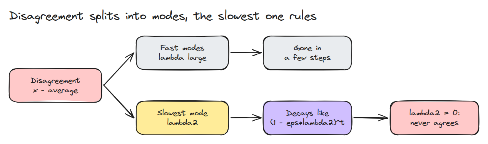
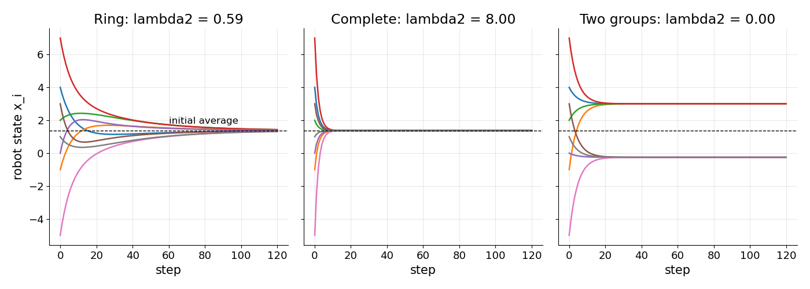
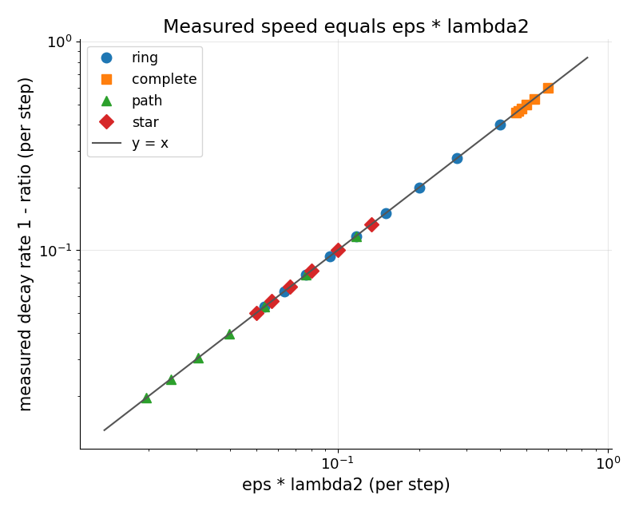

# 합의 (Consensus)

> 이웃과만 이야기하는 로봇들이 숫자 하나에 합의하는 법과 그것이 느려지는 이유를 배웁니다.

**유형:** 만들기   **선수 지식:** 대칭 행렬의 고유값   **시간:** 약 15분

## 쉽게 말하면

장난감 자동차 여덟 대가 저마다 다른 방향을 보고 있고 각 자동차는 이웃만 볼 수 있어요. 매 tick마다 자동차는 보이는 이웃의 방향 쪽으로 조금씩 돌아요. 두 자동차가 서로 끌어당기는 정도가 같아서 무리의 평균 방향은 변하지 않아요.

모두 연결돼 있으면 그 평균 방향에 모여요. 떨어진 무리는 서로 다른 방향에 모여요. 한 번에 너무 크게 돌면 지나쳐서 차이가 오히려 커져요.

## 핵심 용어

- **Consensus**: 로봇들이 이웃과만 통신해서 값 하나에 합의하는 것입니다.
- **Graph Laplacian `L`**: 누가 누구와 통신하는지 담은 행렬 `D - A`입니다.
- **Eigenvalue**: 행렬의 패턴 하나가 얼마나 빨리 커지거나 줄어드는지 알려 주는 수입니다.
- **`lambda2`**: `L`의 두 번째로 작은 고유값이고 합의 속도를 정합니다.
- **Mode**: 서로 독립인 불일치 패턴 하나입니다.
- **Step size `eps`**: tick마다 이웃 쪽으로 움직이는 크기입니다.

## 문제

로봇 여덟 대가 같은 것을 각자 다른 오차로 재는데 각자 가까운 몇 대의 소리만 들을 수 있습니다. 모두가 그룹 평균에 이르러야 하지만 서로 연결되지 않은 두 무리로 갈라지면 불가능합니다.

## 개념

실제 로봇 무리에는 우두머리도 모두에게 닿는 무전도 없어서 로봇들은 가까운 대화만으로 합의해야 합니다.


*로봇은 tick마다 이웃의 평균 쪽으로 조금씩 움직입니다.*



*가장 느린 mode가 속도를 정합니다. 고유값이 0이면 줄지 않습니다.*



*링은 느리게 기어가고 완전 그래프는 열 tick쯤에 도착하고 끊어진 두 무리는 서로 다른 값에 멈춥니다.*



*네 그래프가 모두 y = x 선 위에 놓이므로 감쇠 속도는 eps 곱하기 lambda2입니다.*

각 자동차의 방향을 숫자 `x_i`로 씁니다. tick 한 번에 각 자동차는 이웃 `j`에 대해 `eps * sum_j (x_j - x_i)`만큼 움직이고 전체로 쓰면 `x <- (I - eps L) x`입니다.
`A`는 이웃인 쌍을 표시하고 `D`는 이웃 수를 셉니다. `L`의 행의 합이 0이라서 평균은 변하지 않습니다. 나머지 mode는 매 tick `1 - eps * lambda_k`배가 됩니다.

링에서 `eps = 0.05`일 때 x = 7인 자동차는 이웃 2와 0을 보므로 한 tick에 7 + 0.05 * ((2 - 7) + (0 - 7)) = 6.4가 됩니다.


*초록 자동차(x = 7)를 보세요. x 1 단위는 0.25 rad로 그렸습니다. 첫 tick에 약 9도 돕니다.*

`eps * lambda_max < 2`이면 갱신이 안정합니다.

## 만들기

`laplacian()`은 `D - A`를 만듭니다. `lambda2()`는 두 번째 고유값을 꺼내고 `run()`은 갱신을 반복합니다.

```python
M = np.eye(len(A)) - eps * laplacian(A)
out.append(M @ out[-1])
```

테스트는 평균이 보존되는지, tick당 수축 비율이 `1 - eps * lambda2`와 같은지, `2 / lambda_max`를 넘는 step 크기가 발산하는지 확인합니다.

```bash
cd robotics-engineering-from-scratch
python3 -m pytest phases/14-multi-robot-and-swarms/02-consensus -q
python3 phases/14-multi-robot-and-swarms/02-consensus/code/figure.py
```

## 실제 도구로 보기

`numpy.linalg.eigvalsh`와 `lambda2`를 대조해 보세요.

출처는 Wikipedia의 Algebraic connectivity 문서입니다(2026년 11월 9일 확인). 그래프가 연결되어 있을 때만 `lambda2`가 0보다 큽니다.

## 결과물

`outputs/skill-consensus.md`는 그래프와 step 크기를 점검합니다.

## 연습 문제

1. 링에 장거리 연결을 하나 더하세요. 무엇이 변하나요?
2. tick마다 각 연결을 확률 0.2로 끊으세요.
3. 로봇 0의 값을 고정하면 모두가 그 값으로 수렴함을 보이세요.
