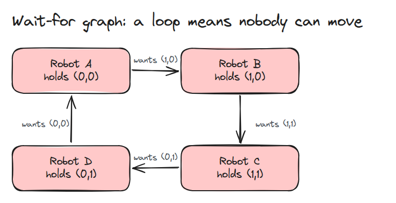
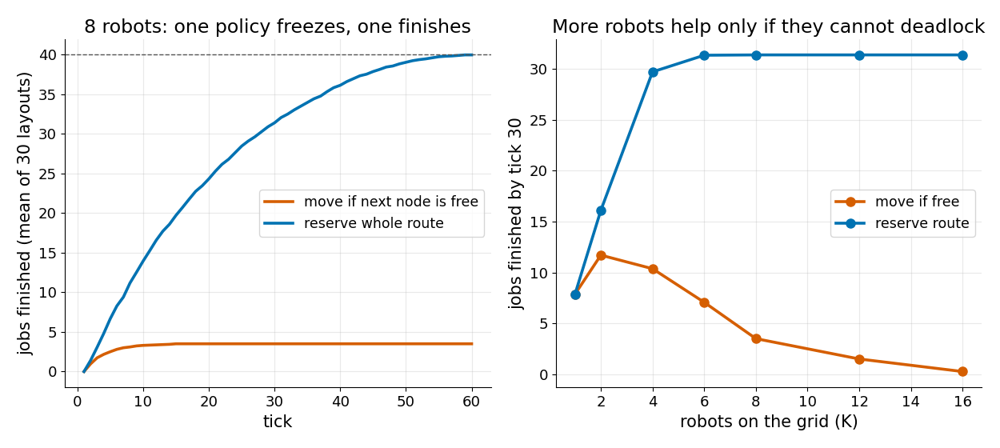

# Traffic and Deadlock

> Learn why robots can block each other forever at a crossing, and a simple rule that prevents it.

**Type:** Build   **Prerequisites:** a graph as nodes and arrows   **Time:** ~15 minutes

## In Plain Words

Four toy cars meet at a crossing. Each stops on a square the next car needs and waits for the square ahead. The waits form a loop, so every car is stuck forever. That is deadlock.

A car that enters only when its whole route is clear, then reserves it, holds nothing while it waits outside. No loop forms, but reserved routes block other cars.

## Key Terms

- **Deadlock**: robots waiting on each other in a loop, so none can move.
- **Wait-for graph**: arrows from each robot to the robot it waits for.
- **Hold-and-wait**: holding a cell while waiting for the next one.
- **Reservation**: claiming a whole route before entering it.
- **Throughput**: the number of jobs finished per tick.

## The Problem

Four robots enter a small crossing. Each stops on a square because the next one is taken, and each holds the square the next robot needs. Nobody can move and throughput drops to zero.

## The Concept

Warehouses and factories run many robots on one floor, so a single jam can stop the whole fleet.



*An arrow means "waits for the car standing there". A loop is a deadlock.*


*A robot enters only if its whole route is free, then holds it. A robot waiting outside holds nothing.*



*Left: 8 robots, 40 jobs, mean of 30 layouts: "move if free" freezes near 3.5 jobs while reservation finishes all 40. Right: with more robots, reservation levels off near 31.*

Deadlock needs four conditions at once: one robot per cell, hold-and-wait, no pushing and circular wait. Reservation removes hold-and-wait.

In the clip, four cars start on a 2 x 2 grid of cells, each needing the next car's cell. With `naive` all four enter at tick 1 and `find_cycle()` returns `[0, 1, 2, 3]`. With `reserve` car 0 takes its three cells first, the others wait outside, and all four finish by tick 7.


*A red bar stops a car whose whole route is not free. Amber marks reserved cells.*

## Build It

`Sim.wait_for()` returns the robot on each robot's next cell, and `find_cycle()` follows those pointers. `reserve` admits a robot only if its whole route is free.

```python
need = p if self.policy == "reserve" else p[:1]
if len(self.at) < self.K and all(n not in self.occ and n not in self.res for n in need):
```

Tests check the loop is found and that under reservation the wait-for graph is empty at every tick on 40 random jobs.

```bash
cd robotics-engineering-from-scratch
python3 -m pytest phases/14-multi-robot-and-swarms/03-traffic-and-deadlock -q
python3 phases/14-multi-robot-and-swarms/03-traffic-and-deadlock/code/figure.py
```

## Use It

Cross-check `find_cycle` against a graph library's cycle finder.

## Ship It

`outputs/skill-traffic-deadlock.md` reviews a fleet traffic rule.

## Exercises

1. Replace reservation with "back up one cell when a loop is detected".
2. Take cells one at a time in a fixed global order. Can a loop form?
3. Use a 6 x 6 grid. When does reservation stop improving?
