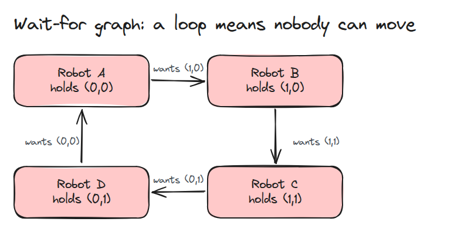
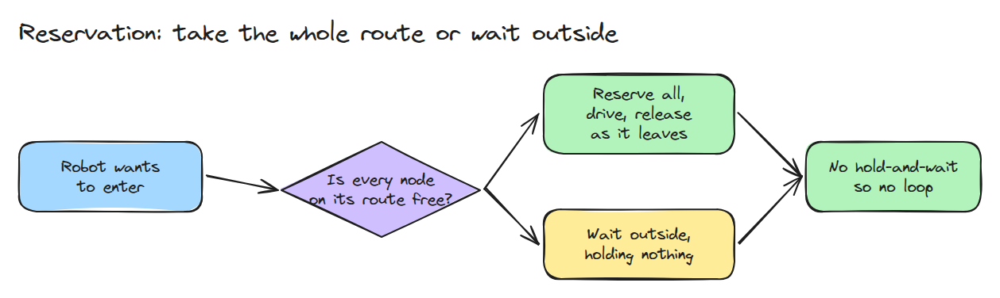
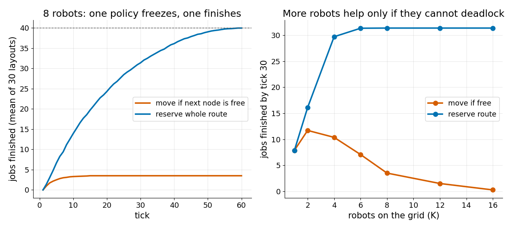

# Traffic and Deadlock

> At a single-lane crossing robots can block each other in a loop. Draw who waits for whom, find the loop, and remove it by taking a whole route at once.

**Type:** Build   **Prerequisites:** a graph as nodes and arrows   **Time:** ~15 minutes

## The Problem

Four robots enter a small junction, each stopping on one intersection because the next one is taken. Each holds what the next robot needs, so none can move and the fleet's output drops to zero. Nothing is broken. Every robot did the polite thing and waited for a free cell.

## The Concept



*An arrow means "waits for the robot standing there". A loop in this graph is a deadlock, and no robot in it can ever move.*



*A robot enters only if its whole route is free, then holds it. A robot that waits outside holds nothing, so no one waits on it.*



*Left: with 8 robots and 40 jobs, "move if free" freezes at about 3.5 finished while reservation reaches 40. Right: the more robots share the grid, the more the naive rule deadlocks. Reservation levels off near 31 by tick 30 because whole routes block each other, which is its price.*

The deadlock needs four conditions at once: one robot per cell, robots hold a cell while waiting for the next, nobody can be pushed out, and the waits form a loop. Reservation removes hold-and-wait.

## Build It

`Sim.wait_for()` returns for each robot the robot standing on its next cell. `find_cycle()` follows those pointers. The `reserve` policy admits a robot only if every node on its route is free.

```python
need = p if self.policy == "reserve" else p[:1]
if len(self.at) < self.K and all(n not in self.occ and n not in self.res for n in need):
```

Tests build the four-robot loop, check it is found, and check that under reservation the wait-for graph is empty at every tick on 40 random jobs.

```bash
cd robotics-engineering-from-scratch
python3 -m pytest phases/14-multi-robot-and-swarms/03-traffic-and-deadlock -q
python3 phases/14-multi-robot-and-swarms/03-traffic-and-deadlock/code/figure.py
```

## Use It

No external source was consulted for this lesson. Cross-check `find_cycle` against a graph library's cycle finder on random wait-for graphs, and try time-window reservations to recover the throughput lost to whole-route holding.

## Ship It

`outputs/skill-traffic-deadlock.md` is a review checklist for a fleet traffic rule.

## Exercises

1. Replace the reservation with "back up one cell when a loop is detected" and compare throughput.
2. Let robots take cells one at a time but only in a fixed global cell order, and check the loop cannot form.
3. Add a 6 x 6 grid and find the robot count where reservation stops improving.
