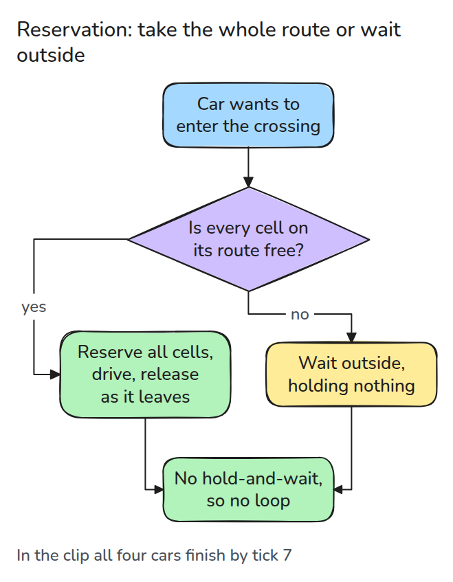
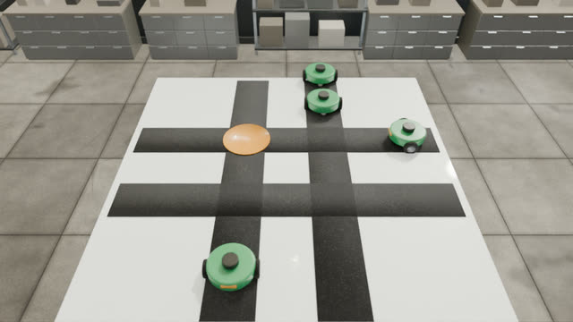

# Traffic and Deadlock

> Learn why robots can block each other forever at a crossing, and a simple rule that prevents it.

**Type:** Build   **Prerequisites:** none   **Time:** ~15 minutes

## In Plain Words

Four toy cars meet at a crossing. Each car sits on a square that the next car needs, and waits for the square in front of it. The waits form a loop, so every car is stuck forever. That is deadlock.

## Key Terms

- **Deadlock**: robots waiting on each other in a loop, so none can move.
- **Wait-for graph**: a drawing with an arrow from each robot to the robot it is waiting for.
- **Hold-and-wait**: keeping your square while waiting for the next one.
- **Reservation**: claiming a whole route before entering it.
- **Throughput**: the number of jobs finished per time step.

## The Problem

Four robots enter a small crossing. Each stops on a square because the next one is taken, and each holds the square the next robot needs. Nobody can move and throughput drops to zero.

## The Concept

Many robots share one floor, so a single jam can stop the whole fleet. Draw an arrow from each robot to the robot it waits for. A loop of arrows is a deadlock.

The fix is to enter only when the whole route is free and then claim all of it.

A waiting robot holds nothing, so nobody waits on it and no loop can form. The price: claimed routes block other robots.


*An arrow means "waits for the car standing there". A loop is a deadlock.*



*A robot enters only if its whole route is free. A robot waiting outside holds nothing.*


*Left: with "move if free" the fleet freezes, with reservation all jobs finish. Right: reservation stops improving as robots are added.*

[](../assets/clip-example.mp4)

*A red bar stops a car whose whole route is not free. Amber marks claimed squares.*

<details><summary>The math (optional)</summary>

Deadlock needs four things at once: one robot per cell, hold-and-wait, no pushing and circular wait. Reservation removes hold-and-wait. In the clip, four cars start on a 2 x 2 grid, each needing the next car's cell: car 0 drives (0,0), (1,0), (1,1), car 1 (1,0), (1,1), car 2 (1,1), (0,1), car 3 (0,1), (0,0). With `naive` all four enter at tick 1 and `find_cycle()` returns `[0, 1, 2, 3]`. With `reserve` car 0 takes its three cells first and all four finish by tick 7. Left plot: 8 robots, 40 jobs, mean of 30 layouts: "move if free" freezes near 3.5 jobs while reservation finishes all 40. Right: reservation levels off near 31 jobs by tick 30.

</details>

## Build It

`Sim.wait_for()` finds who each robot waits for, and `find_cycle()` follows the arrows. `reserve` lets a robot in only if its whole route is free.

```python
need = p if self.policy == "reserve" else p[:1]
if len(self.at) < self.K and all(n not in self.occ and n not in self.res for n in need):
```

Tests check the loop is found, and that reservation never leaves a loop on 40 random jobs.

```bash
cd robotics-engineering-from-scratch
python3 -m pytest phases/14-multi-robot-and-swarms/03-traffic-and-deadlock -q
python3 phases/14-multi-robot-and-swarms/03-traffic-and-deadlock/code/figure.py
```

## Use It

Cross-check `find_cycle` (a cycle is the loop of arrows) against a ready-made cycle finder.

## Ship It

`outputs/skill-traffic-deadlock.md` reviews a fleet traffic rule.

## Exercises

1. Replace reservation with "back up one cell when a loop is found".
2. Number every square. Cars may only take squares in rising number order. Can a loop form?
3. Use a 6 x 6 grid. When does reservation stop helping?
