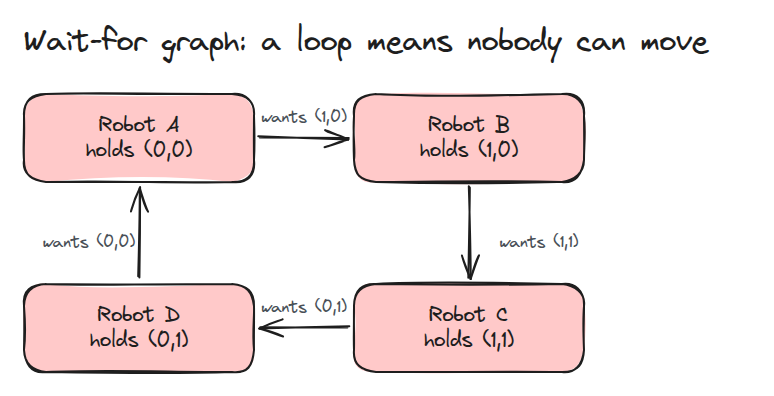
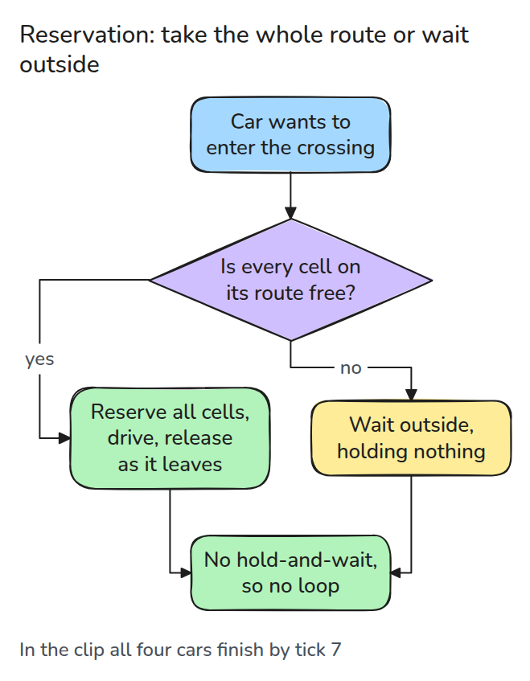
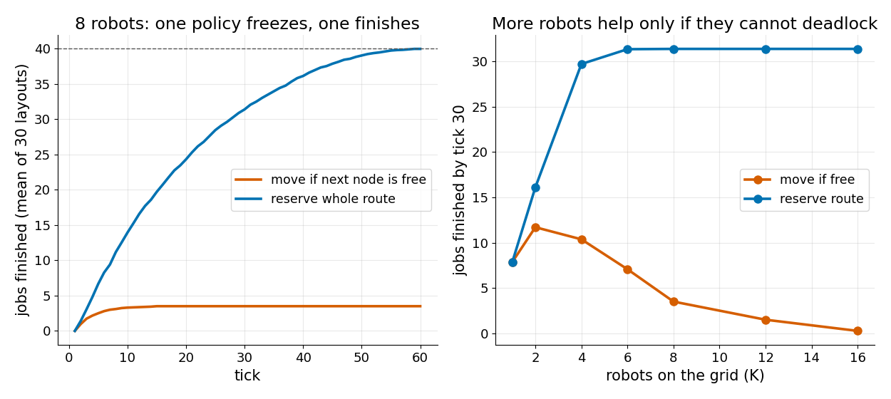

# 교통과 교착 (Traffic and Deadlock)

> 교차로에서 로봇들이 영원히 서로를 막는 이유와 그것을 막는 단순한 규칙을 배웁니다.

**유형:** 만들기   **선수 지식:** 노드와 화살표로 그린 그래프   **시간:** 약 15분

## 쉽게 말하면

장난감 자동차 네 대가 교차로에서 만나요. 자동차마다 다음 자동차가 필요한 칸에 서서 앞칸이 비기를 기다려요. 기다림이 고리로 이어져서 모든 자동차가 영원히 멈춰요. 이것이 deadlock이에요.

## 핵심 용어

- **Deadlock**: 로봇들이 고리로 서로를 기다려서 아무도 움직이지 못하는 상태입니다.
- **Wait-for graph**: 각 로봇에서 그 로봇이 기다리는 로봇으로 그은 화살표입니다.
- **Hold-and-wait**: 다음 칸을 기다리는 동안 자기 칸을 쥐고 있는 것입니다.
- **Reservation**: 들어가기 전에 경로 전체를 먼저 잡는 것입니다.
- **Throughput**: tick당 끝낸 작업 수입니다.

## 문제

로봇 네 대가 작은 교차로에 들어옵니다. 각자 다음 칸이 차 있어서 한 칸을 차지한 채 멈추고 그 칸은 다음 로봇이 필요한 칸입니다. 아무도 움직이지 못해 처리량이 0이 됩니다.

## 개념

창고와 공장은 같은 바닥에서 로봇 여러 대를 돌리므로 정체 하나가 무리 전체를 멈출 수 있습니다. 각 로봇에서 그 로봇이 기다리는 로봇으로 화살표를 그립니다. 화살표의 고리가 deadlock입니다.
해결책은 경로 전체가 비어 있을 때만 들어가서 그 전체를 잡는 것입니다. 밖에서 기다리는 로봇은 아무것도 쥐지 않으므로 고리가 생길 수 없습니다. 대가는 잡아 둔 경로가 다른 로봇을 막는 것입니다.



*화살표는 "그 칸에 서 있는 자동차를 기다린다"는 뜻입니다. 고리가 교착입니다.*



*로봇은 경로 전체가 비어 있을 때에만 들어와서 그 경로를 쥡니다. 바깥에서 기다리는 로봇은 아무것도 쥐지 않습니다.*



*왼쪽은 "비면 이동" 규칙에서는 무리가 멈추고 예약에서는 모든 작업이 끝나는 모습입니다. 오른쪽은 로봇이 늘면 예약이 더는 나아지지 않는 모습입니다.*


*경로 전체가 비지 않으면 빨간 막대가 기다리는 자동차를 막습니다. 주황색은 잡아 둔 칸입니다.*

<details><summary>The math (optional)</summary>

교착에는 네 조건이 동시에 필요합니다. 한 칸에 로봇 하나, hold-and-wait, no pushing(누구도 밀려날 수 없음), circular wait(기다림이 고리를 이룸)입니다. 예약은 hold-and-wait를 없앱니다.
클립에서 자동차 네 대는 2 x 2 격자에서 출발하고 각자 다음 자동차가 선 칸이 필요합니다.
0번은 (0,0), (1,0), (1,1)로, 1번은 (1,0), (1,1)로, 2번은 (1,1), (0,1)로, 3번은 (0,1), (0,0)으로 달립니다.
`naive`에서는 tick 1에 네 대가 모두 들어가고 `find_cycle()`은 `[0, 1, 2, 3]`을 돌려줍니다. `reserve`에서는 0번이 세 칸을 먼저 잡고 네 대가 tick 7까지 모두 끝냅니다.
왼쪽 그림은 로봇 8대와 작업 40개를 30가지 배치로 평균한 값이고 "비면 이동"은 약 3.5개에서 멈추고 예약은 40개를 모두 끝냅니다. 오른쪽은 예약이 tick 30까지 31개 근처에서 평평해지는 모습입니다.

</details>

## 만들기

`Sim.wait_for()`는 로봇마다 누구를 기다리는지 찾고 `find_cycle()`은 화살표를 따라갑니다. `reserve` 정책은 경로 전체가 비어 있을 때에만 로봇을 들여보냅니다.

```python
need = p if self.policy == "reserve" else p[:1]
if len(self.at) < self.K and all(n not in self.occ and n not in self.res for n in need):
```

테스트는 고리를 찾아내는지, 그리고 임의 작업 40개에서 예약 정책의 로봇이 어느 tick에도 고리로 기다리지 않는지 확인합니다.

```bash
cd robotics-engineering-from-scratch
python3 -m pytest phases/14-multi-robot-and-swarms/03-traffic-and-deadlock -q
python3 phases/14-multi-robot-and-swarms/03-traffic-and-deadlock/code/figure.py
```

## 실제 도구로 보기

`find_cycle`을 그래프 라이브러리의 고리 탐지와 대조해 보세요.

## 결과물

`outputs/skill-traffic-deadlock.md`는 로봇 무리의 교통 규칙을 검토합니다.

## 연습 문제

1. 예약 대신 "고리를 찾으면 한 칸 물러난다"로 바꾸세요.
2. 칸을 고정된 전역 순서로 하나씩 잡으세요. 고리가 생길 수 있나요?
3. 격자를 6 x 6으로 키우세요. 예약은 언제 더는 도움이 안 되나요?
